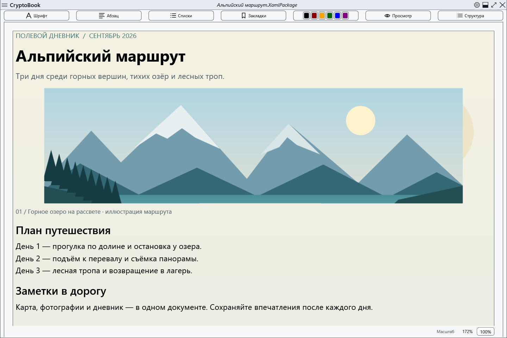
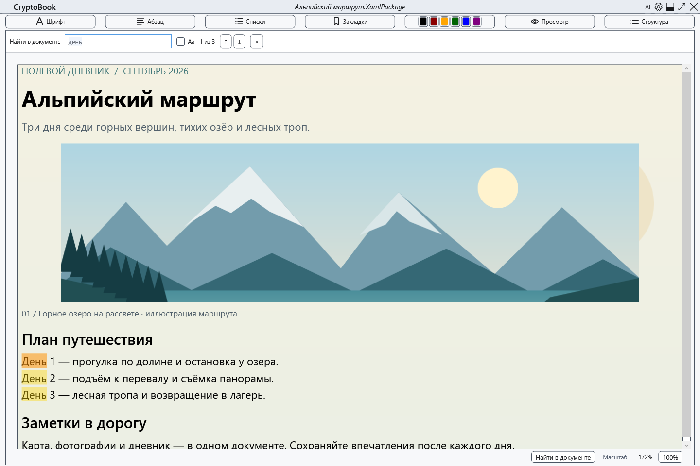
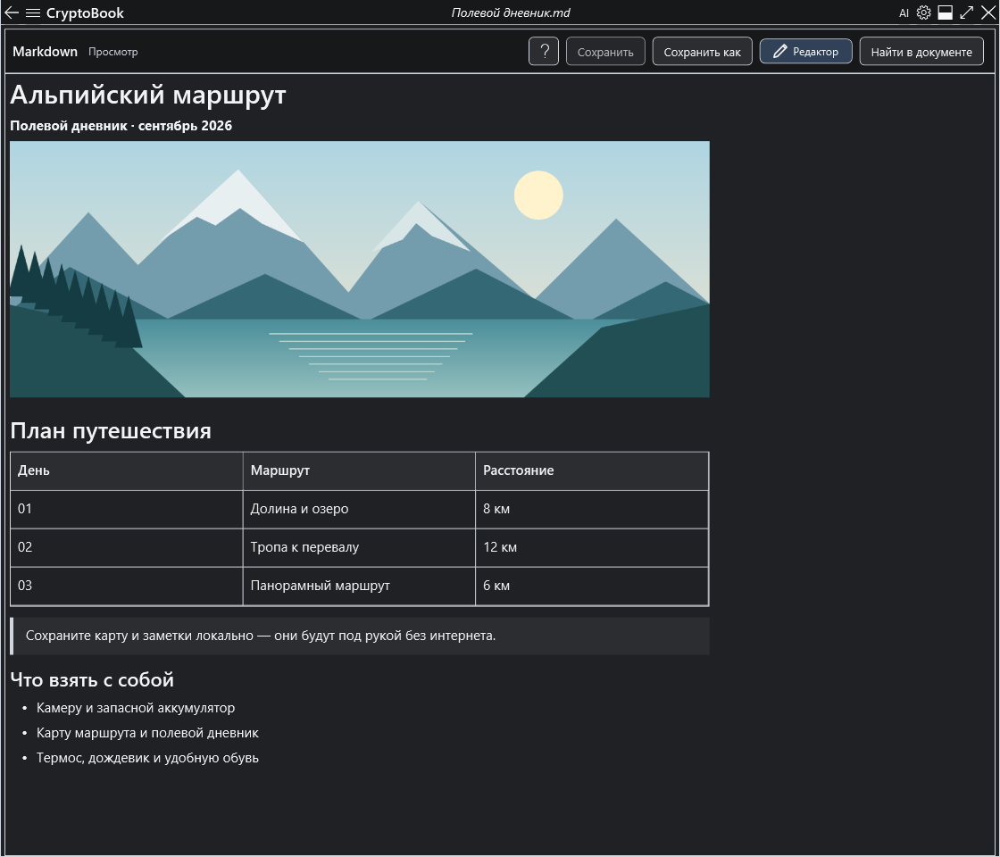
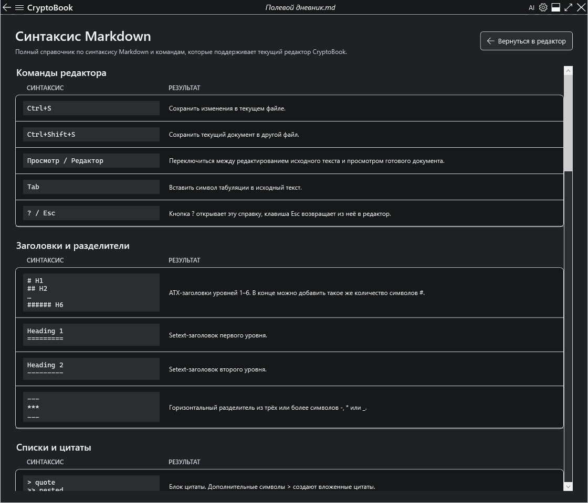
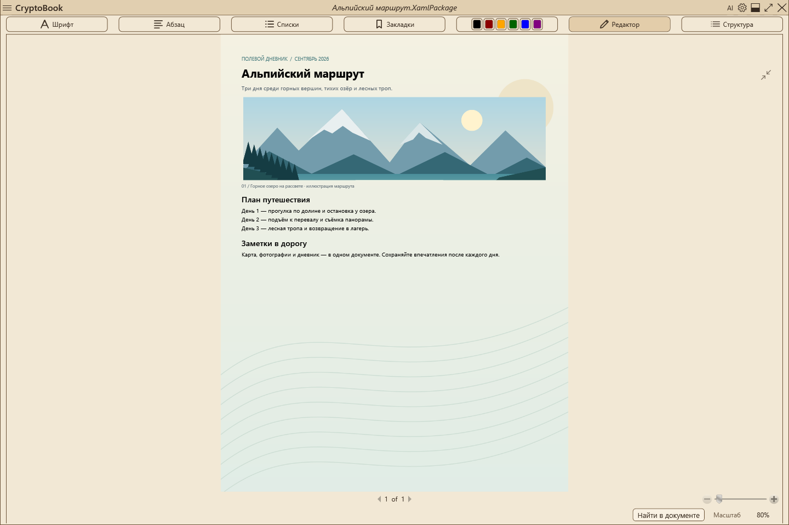
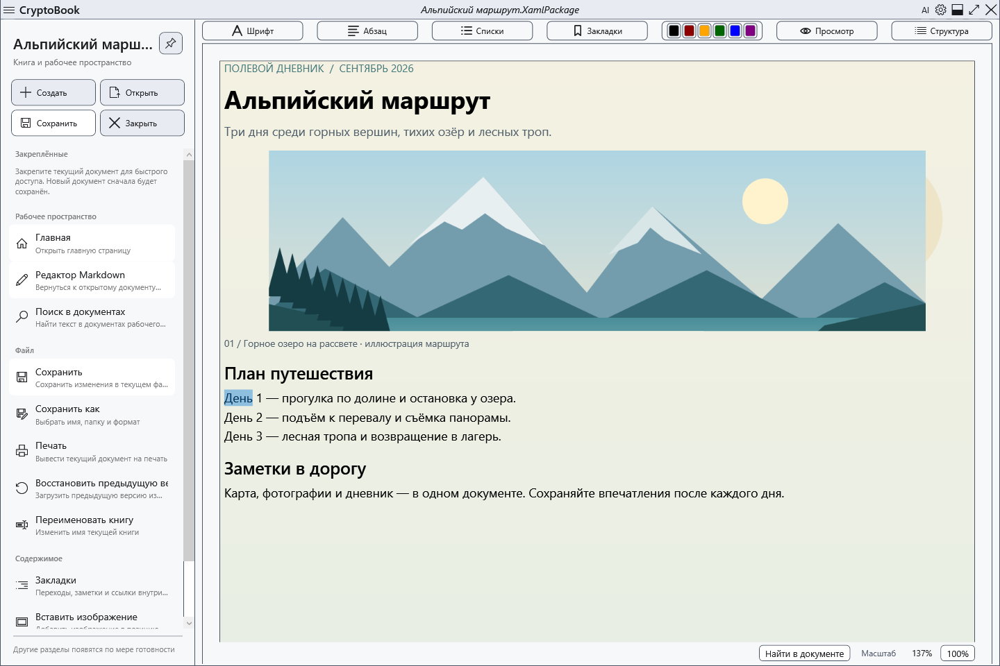
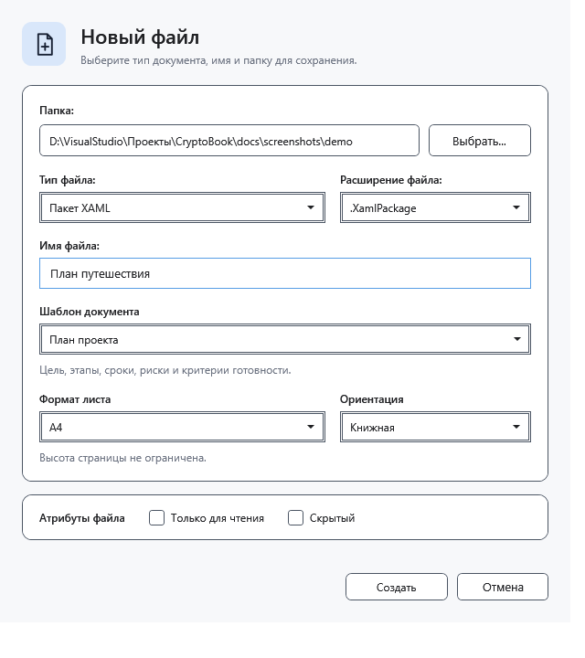
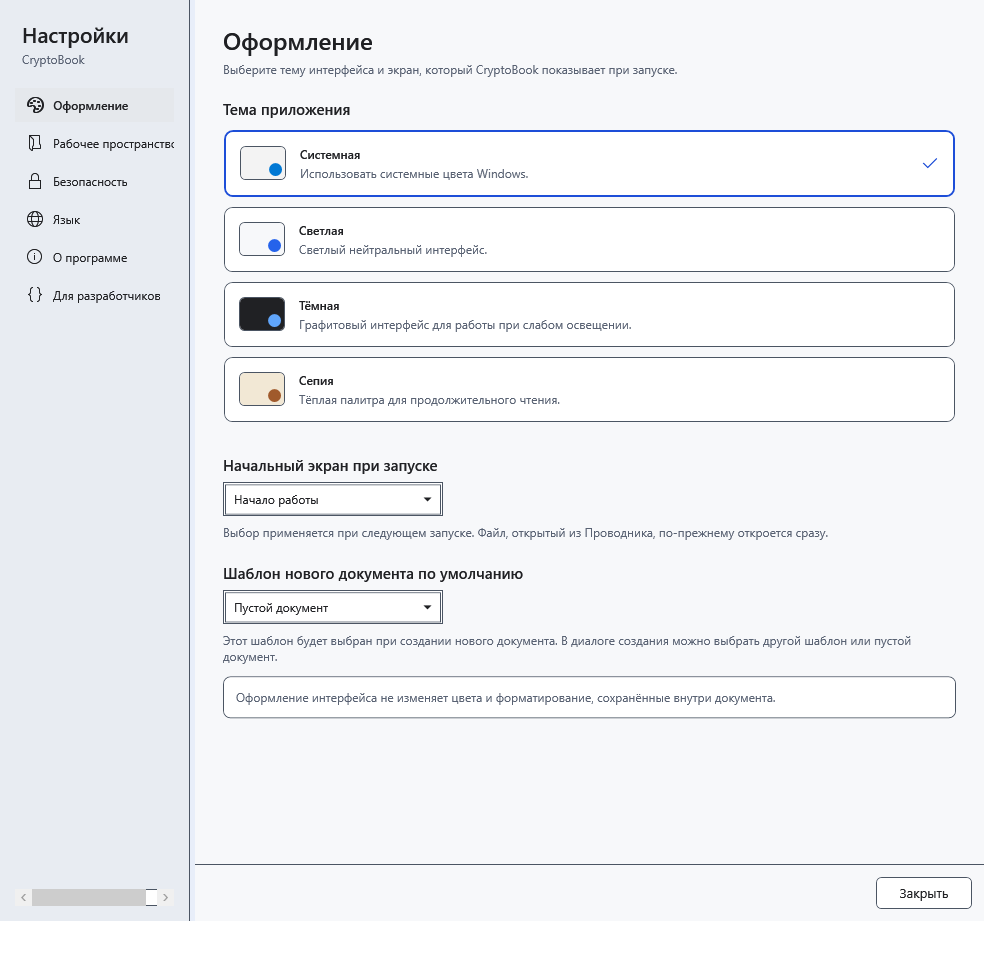

# CryptoBook

[English](README.md)

[](https://github.com/RomanovCopy/CryptoBook/actions/workflows/ci.yml)
[](https://github.com/RomanovCopy/CryptoBook/releases/tag/v1.1.5.1)
[](https://dotnet.microsoft.com/download/dotnet/10.0)
[](https://www.microsoft.com/windows)
[](LICENSE)

**Локальное рабочее пространство для документов с шифрованием под Windows.**

CryptoBook объединяет форматированный текстовый редактор, файловый менеджер, полнотекстовый
поиск, предпросмотр медиафайлов и защищённые паролем документы в одном WPF-приложении.
Данные остаются на компьютере пользователя, пока он сам не переместит или не передаст их.

[](https://github.com/RomanovCopy/CryptoBook/releases/latest)

> Проект находится в активной разработке. Перед работой с важными данными сохраняйте отдельные
> резервные копии. Текущие Windows-сборки могут выпускаться без Authenticode-подписи; в релизы
> входят SHA-256-контрольные суммы и явный статус подписи.



## Зачем CryptoBook?

- **Local-first** — документы и состояние приложения хранятся локально.
- **Зашифрованные документы** — собственный формат `.cbook` с аутентифицированным шифрованием.
- **Rich-text редактор** — форматирование, списки, ссылки, изображения, закладки и печать.
- **Файловое рабочее пространство** — навигация, избранное, Quick Access, сортировка и буфер обмена.
- **Поиск** — по имени и содержимому, включая поддерживаемые зашифрованные документы.
- **Поиск в документе** — Ctrl+F открывает поиск с подсветкой всех совпадений; Enter/F3 и Shift+Enter/Shift+F3 переходят между ними, Esc закрывает панель. Поддерживаются обычные документы и Markdown; поиск из постраничного просмотра открывает редактор.
- **Резервные копии** — аварийные снимки, `.bak` и атомарная замена файлов.
- **Медиа** — предпросмотр текста и изображений, видео через Flyleaf/FFmpeg.
- **Локальный AI-помощник** — GGUF-чат, вложения документов и изображений, применение ответов к документу.

## Скриншоты



| Предпросмотр Markdown | Справка Markdown |
| --- | --- |
|  |  |
| **Режим чтения Sepia** | **Навигация по документам** |
|  |  |
| **Создание документа и шаблоны** | **Шаблон по умолчанию** |
|  |  |

Скриншоты показывают дневник путешествия с иллюстрацией и фоном страницы.
[Описание съёмки и примеры документов](docs/screenshots/README.md).

## Новое в 1.1.5.1

- В AI-панели появились шаблоны общения: обычный помощник, краткие ответы, подробные объяснения, редактор текста, аналитик и разработчик. В настройках AI можно создавать, переименовывать, редактировать и удалять шаблоны; прежние инструкции моделей переносятся автоматически.
- Выбранный шаблон применяется к следующему запросу с сохранением переписки и загруженной модели. Названия встроенных шаблонов следуют языку интерфейса; пользовательские названия сохраняются. После сохранения изменений название выбранного шаблона остаётся видимым.
- Можно прикреплять текстовые файлы с любым расширением и без расширения. Для неизвестных двоичных форматов передаются имя, размер и HEX-превью первых 256 байт с предупреждением, что полное содержимое не извлечено.
- Остановка генерации сохраняет уже полученный текст и позволяет повторно использовать отвечающий worker с загруженной моделью. Идентификаторы запросов защищают следующий ответ от запоздалой отмены и фрагментов; не отвечающий worker завершается по тайм-ауту.

Подробнее — в [описании релиза](docs/releases/v1.1.5.1.md), [руководстве по локальному AI](docs/LOCAL_AI.md) и [истории изменений](CHANGELOG.md).

## Основные возможности

- создание и редактирование TXT, RTF, XAML и XamlPackage-документов;
- отдельный редактор Markdown с переключением между исходным текстом и просмотром;
- встроенная справка по синтаксису Markdown, доступная без закрытия документа;
- переходы между обычным документом и Markdown с сохранением несохранённых изменений;
- форматирование текста, абзацев и списков, вставка ссылок и изображений;
- фоновый цвет или изображение документа с сохранением в XamlPackage и
  защищённых документах;
- изменение размера и размещения изображений внутри документа;
- выбор ширины страницы A2/A3/A4 и ориентации для новых текстовых документов,
  автоматическое масштабирование и сохранение геометрии в XamlPackage и защищённых текстовых документах;
- создание пустого документа или документа по стандартному шаблону: заметки, план проекта,
  протокол встречи, дневник и отчёт; выбор шаблона по умолчанию в настройках внешнего вида;
- масштабирование через Ctrl + колесо мыши и сброс отображения редактора до 100%;
- файловый менеджер с избранными каталогами, сортировкой, буфером обмена и мониторингом;
- [подробные свойства файлов](docs/FILE_DETAILS.md): тип по содержимому, признаки маскировки,
  метаданные Windows, права, потоки, цифровые подписи и контрольные суммы SHA-256/SHA-512;
- Quick Access для закрепления часто используемых документов;
- поиск файлов по имени внутри выбранной рабочей директории;
- полнотекстовый поиск по поддерживаемым документам, включая `.cbook` после разблокировки;
- поиск в текущем документе с учётом регистра, подсветкой и переходами с клавиатуры;
- предпросмотр текста и изображений, воспроизведение видео через Flyleaf/FFmpeg;
- закладки и навигация по документу;
- печать через системный диалог Windows;
- системная, светлая, тёмная и Sepia-темы;
- выбор запуска со стартовой страницы или сразу с редактора;
- шифрование отдельных файлов и каталогов;
- создание проверенных защищённых `.cbook`-копий без изменения исходных файлов;
- автоматический сброс ключа после заданного периода бездействия;
- сохранение аварийных снимков без запроса восстановления при запуске;
- атомарное сохранение с резервной копией предыдущей версии в `.bak`;
- проверка стабильных релизов на GitHub и запуск загруженного установщика.

## Локальный AI-помощник

Откройте **Настройки → AI-помощник → Настройки модели**, включите помощника и выберите
локальный файл `.gguf`. Откройте панель кнопкой **AI** внизу окна, введите запрос и нажмите
**Ctrl+Enter**. Отдельный сервер не нужен. Модели в поставку не входят.

- Прикрепляйте документы, изображения или снимок текущего документа, включая несохранённые изменения.
  Для анализа изображений нужна совместимая vision-модель и соответствующий `mmproj*.gguf` рядом с ней.
- Копируйте ответ, вставляйте его в текущую позицию курсора или заменяйте текущее выделение.
  Документ и выделение можно изменить после генерации; вставка поддерживает отмену.
- Настраивайте шрифт, цвета, рамки и отображение Markdown. Счётчик контекста, доступный лимит
  ответа и защита от повторов для каждой модели помогают работать с длинными диалогами.
- Загрузка модели и генерация выполняются в отдельном рабочем процессе. Автоподбор памяти
  регулирует распределение на GPU и может перейти на CPU; доступны ручные настройки и отмена.
- Переписка хранится в памяти. Очистка чата сбрасывает сообщения, черновик, вложения и счётчики;
  блокировка защищённого пространства также очищает чат и выгружает модель.

Поддерживаемые вложения, рассуждения, настройки памяти и профили запуска описаны в
[инструкции по локальному AI](docs/LOCAL_AI.md).

## Поддерживаемые форматы

Подробности о разметке, кодировках, навигации и ограничениях изображений и ссылок —
в [описании поддержки Markdown](docs/MARKDOWN.md).

| Назначение | Форматы |
| --- | --- |
| Редактирование документов | `.txt`, `.log`, `.md`, `.cs`, `.json`, `.xml`, `.rtf`, `.xaml`, `.XamlPackage` |
| Изображения | `.png`, `.jpg`, `.jpeg`, `.bmp`, `.gif`, `.webp` |
| Видео | `.mp4`, `.mkv`, `.avi`, `.mov`, `.webm`, `.wmv` и другие контейнеры Flyleaf/FFmpeg |
| Защищённые файлы | `.cbook`, устаревший `.cbox` |
| Внешнее открытие | `.pdf` |

PDF открывается системным приложением и не редактируется внутри CryptoBook. Поддержка конкретного
видеокодека зависит от медиадвижка.

## Защита данных

Актуальный формат `.cbook` использует:

- Argon2id для получения 256-битного ключа из пароля;
- AES-256-GCM для аутентифицированного шифрования;
- случайные salt и nonce;
- атомарную замену файла после успешного завершения операции.

Ключ хранится только в памяти процесса во время активной сессии и может автоматически очищаться
после бездействия или вручную через Ctrl+L. Снимки защищённых документов используют пароль,
Argon2id и AES-256-GCM; снимки обычных документов — Windows DPAPI для текущего пользователя. Старый формат `.cbox` поддерживается для обратной совместимости.

Шифрование снижает риск чтения защищённого файла без пароля, но не заменяет резервное копирование.
Утраченный пароль восстановить нельзя.

Порядок сообщения об уязвимостях и границы security scope описаны в [SECURITY.md](SECURITY.md).

## Системные требования

Для готовой сборки:

- Windows 10 версии 1809 или новее;
- 64-разрядная система.

Официальный установщик self-contained и не требует отдельной установки .NET Desktop Runtime.

## Скачать и запустить

Опубликован [CryptoBook 1.1.5.1](https://github.com/RomanovCopy/CryptoBook/releases/tag/v1.1.5.1)
от 26 октября 2026 года.

| Файл | Назначение |
| --- | --- |
| [Установщик Windows x64](https://github.com/RomanovCopy/CryptoBook/releases/download/v1.1.5.1/CryptoBook-Setup-1.1.5.1.exe) | Установка или обновление CryptoBook |
| [Portable ZIP](https://github.com/RomanovCopy/CryptoBook/releases/download/v1.1.5.1/CryptoBook-win-x64.zip) | Распакуйте в отдельную папку и запустите `CryptoBook.exe` |
| [SHA256SUMS.txt](https://github.com/RomanovCopy/CryptoBook/releases/download/v1.1.5.1/SHA256SUMS.txt) | Проверка загруженных файлов |
| [SIGNING-STATUS.txt](https://github.com/RomanovCopy/CryptoBook/releases/download/v1.1.5.1/SIGNING-STATUS.txt) | Заявленный статус цифровой подписи |

Установщик и приложение версии 1.1.5.1 **не подписаны цифровой подписью**. Перед запуском
сравните SHA-256 загруженного файла с соответствующей записью в `SHA256SUMS.txt`, например:

```powershell
Get-FileHash .\CryptoBook-Setup-1.1.5.1.exe -Algorithm SHA256
```

В релиз также входят архив лицензий, архив происхождения FFmpeg/Flyleaf, файл зафиксированных
зависимостей и SPDX SBOM. Изменения описаны в [релизе](docs/releases/v1.1.5.1.md) и
[CHANGELOG.md](CHANGELOG.md). Встроенное обновление проверяет SHA-256 установщика перед запуском.

## Сборка из исходников

Для разработки требуется .NET 10 SDK (10.0.400 или новее в линейке 10.0).
В Visual Studio установите workload
**.NET desktop development**.

```powershell
git clone https://github.com/RomanovCopy/CryptoBook.git
cd CryptoBook
dotnet restore CryptoBook/CryptoBook.sln --locked-mode
dotnet build CryptoBook/CryptoBook.sln -c Release --no-restore
./tools/Run-ReleaseTests.ps1

# Проверка WPF-шаблона видеоплеера
dotnet run --project tools/FlyleafPlaybackSmoke/FlyleafPlaybackSmoke.csproj -c Release --no-restore -- --template-only
```

Для self-contained x64-сборки и установщика требуется Inno Setup 6:

```powershell
./installer/Build-Installer.ps1 -Version 1.1.5.1
```

`Run-ReleaseTests.ps1` выполняет все тесты в четырёх отдельных процессах: интеграция AI, жизненный цикл AI,
поиск в документе и остальные тесты. Это исключает взаимное влияние глобального состояния
WPF-приложения. Для кандидата 1.1.5.1 пройдено **1094 теста**, без ошибок и пропусков. Подробнее — в [описании релиза](docs/releases/v1.1.5.1.md).
TRX-отчёты сохраняются в `artifacts/TestResults`, установщик — в
`artifacts/CryptoBook-Setup-1.1.5.1.exe`.

В проекте используются xUnit и STA-тесты для WPF. Предупреждения компилятора и обнаруженные
NuGet-уязвимости считаются ошибками.

## Структура проекта

```text
CryptoBook/
├── CryptoBook/          # WPF-приложение
│   ├── Views/
│   ├── ViewModels/
│   ├── Models/
│   ├── Services/
│   ├── Security/
│   ├── FileTemplates/
│   └── Themes/
├── CryptoBook.Tests/
├── CryptoBook.Performance/
├── docs/
├── installer/
├── compliance/
└── .github/workflows/
```

CryptoBook построен на WPF и .NET 10, использует MVVM и Autofac для внедрения зависимостей.

## CI и релизы

GitHub Actions восстанавливает зафиксированные зависимости, проверяет происхождение FFmpeg,
выполняет изолированные Release-тесты, проверяет WPF-шаблон Flyleaf и собирает установщик Windows x64.
Тег версии запускает релизный workflow, который сохраняет проверенную поставку как артефакт.
Публичная публикация выполняется отдельно после одобрения кандидата и успешного CI;
одобренный локальный установщик сохраняется.

Релиз 1.1.5.1 содержит восемь файлов: установщик, portable ZIP, архив лицензий, архив
происхождения FFmpeg, файл зафиксированных зависимостей, SPDX SBOM, статус подписи и список SHA-256.

Подробности выпуска описаны в [docs/PRODUCTION.md](docs/PRODUCTION.md).

## Участие в разработке

Правила сборки, тестирования и pull request workflow вынесены в
[CONTRIBUTING.md](CONTRIBUTING.md). Изменения криптографии, восстановления и release automation
требуют особенно внимательного ревью.

## Контакты

Электронная почта: [EncryptoBook@gmail.com](mailto:EncryptoBook@gmail.com).

## Лицензия

CryptoBook распространяется на условиях [GNU GPL версии 3](LICENSE), только версия 3
(`GPL-3.0-only`). Сведения об авторских правах приведены в [COPYRIGHT.md](COPYRIGHT.md),
уведомления о сторонних компонентах — в [THIRD_PARTY_NOTICES.md](THIRD_PARTY_NOTICES.md),
а порядок получения соответствующего исходного кода — в [SOURCE_CODE.md](SOURCE_CODE.md).

Происхождение графических материалов описано в [ASSET_PROVENANCE.md](ASSET_PROVENANCE.md).
Происхождение FFmpeg, параметры сборки и закреплённые источники находятся в
[`compliance/ffmpeg/PROVENANCE.md`](compliance/ffmpeg/PROVENANCE.md).
