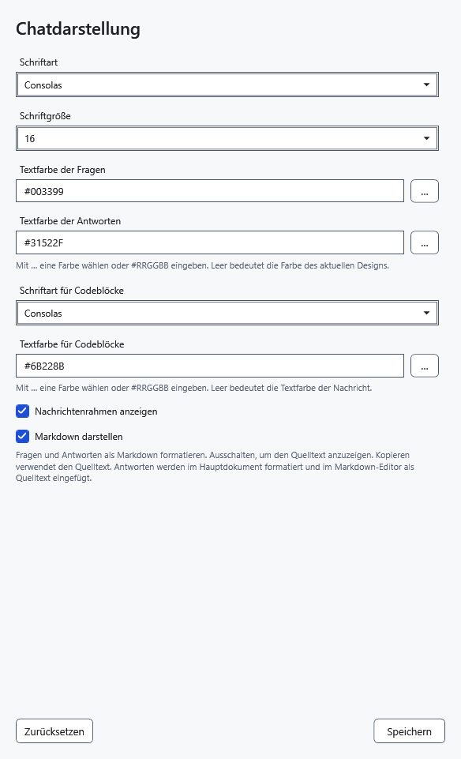
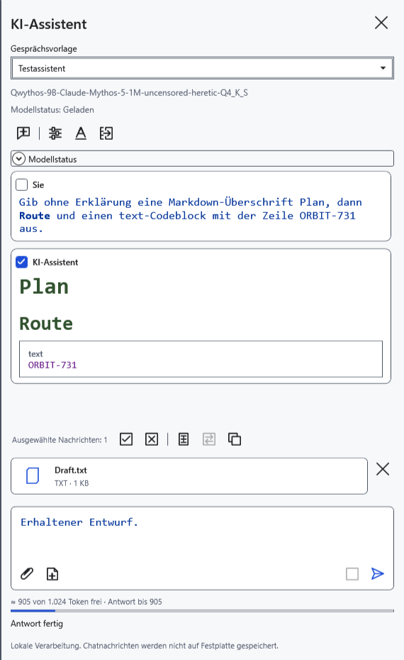
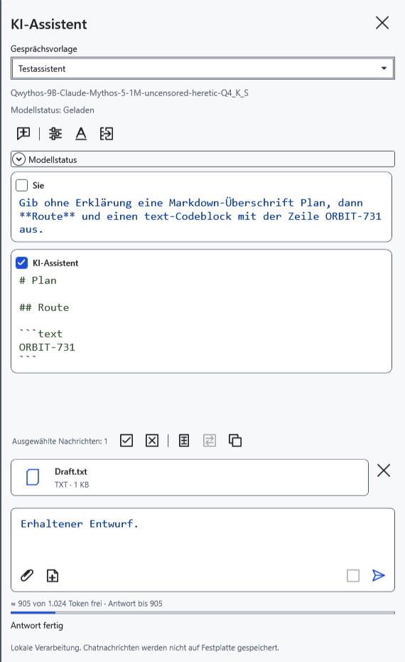
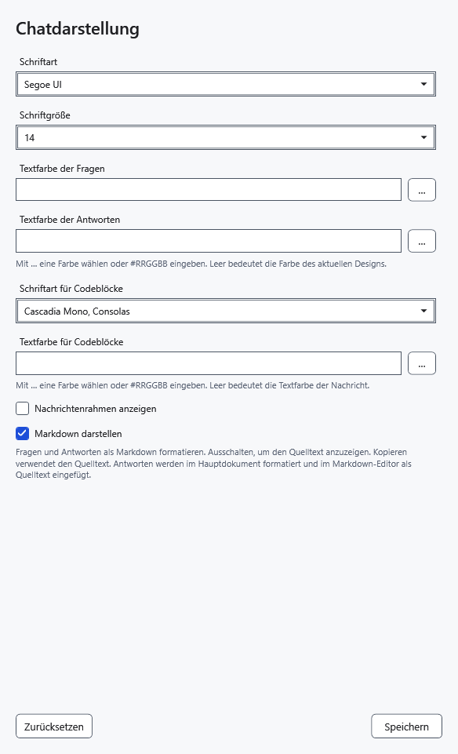

# Darstellung des KI-Chats

Schriften, Farben und Markdown ändern die Chatdarstellung und erhalten Originalantwort, Gespräch, Entwurf und Anhänge. Die Darstellungseinstellungen gelten gemeinsam für alle Modelle. Speichern entlädt das Modell nicht und stoppt keine aktive Antwort.

## Darstellung ändern

1. Klicken Sie oben im Assistentenbereich auf **Chatdarstellung**, das A-Symbol.
2. Wählen Sie **Schriftart** und **Schriftgröße** von 8 bis 40. Sie gelten für Nachrichten, Fragefeld und Nachdenken. Codeblöcke haben eine eigene Schriftart.
3. Geben Sie Frage-, Antwort- und Codefarben als **#RRGGBB** an, etwa `#31522F`. Die Farbschaltfläche öffnet einen Systemdialog. Ein leeres Farbfeld nutzt die Designfarbe; eine leere Codefarbe übernimmt die Farbe der jeweiligen Nachricht.
4. Aktivieren Sie bei Bedarf **Nachrichtenrahmen anzeigen**. Rahmen sind standardmäßig aus.

5. Klicken Sie auf **Speichern**. Vorhandene Antworten werden mit der gewählten Darstellung neu gezeichnet.

## Markdown und Quelltext

**Markdown darstellen** ist standardmäßig aktiv: Überschriften, Listen, Tabellen und Code werden formatiert angezeigt. Deaktivieren Sie die Option und speichern Sie, um ursprüngliches Markdown mit seinen Auszeichnungszeichen zu sehen.

**Kopieren** nutzt in beiden Modi den ursprünglichen Antworttext. Die Option steuert nicht die formatierte Übertragung in den normalen Editor; dafür gelten eigene Regeln. HTML wird nicht ausgeführt, externe Markdown-Bilder werden nicht geladen. Die Darstellung macht generierten Code nicht sicher ausführbar.

## Zurücksetzen und verwerfen

6. Öffnen Sie das Fenster und klicken Sie auf **Zurücksetzen**: Standardwerte erscheinen — Größe 14, ohne Rahmen, Markdown aktiv und Designfarben. Klicken Sie auf **Speichern**, um sie anzuwenden.

Schließen ohne Speichern verwirft Änderungen einschließlich Zurücksetzen. Korrigieren Sie eine ungültige Farbe oder leeren Sie das Feld und speichern Sie erneut. Fehlt eine Schriftart in der Liste, wählen Sie eine installierte. Vergrößern Sie zu kleinen Text über die Schriftgröße; diese Einstellungen ändern nicht den Dokumenttext.

- [Chat und Kopieren](help:ai.chat)
- [Antwort ins Dokument übertragen](help:ai.apply)
- [Anwendungsdarstellung](help:settings.appearance)
