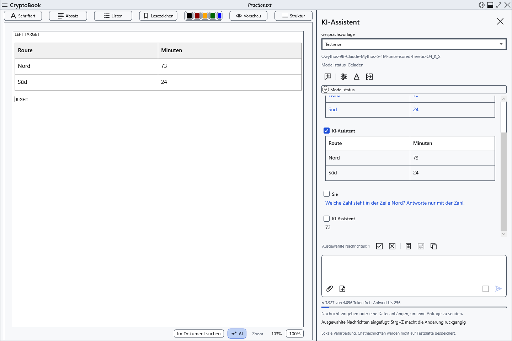
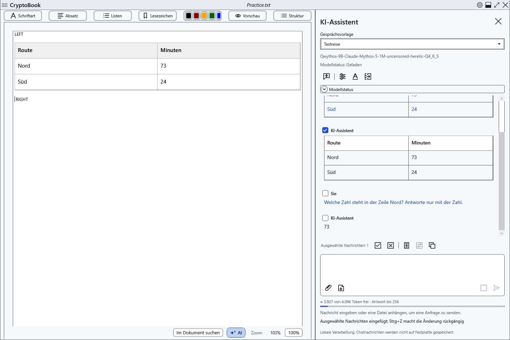
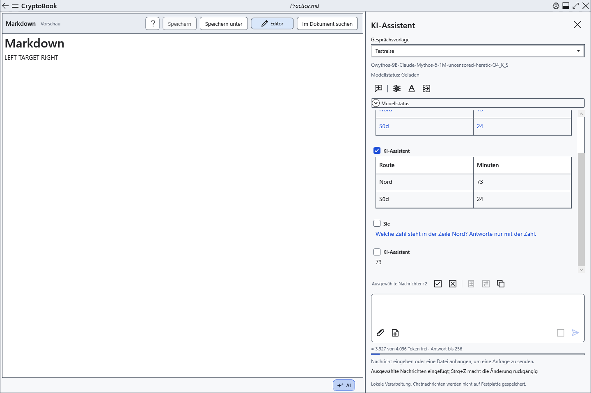
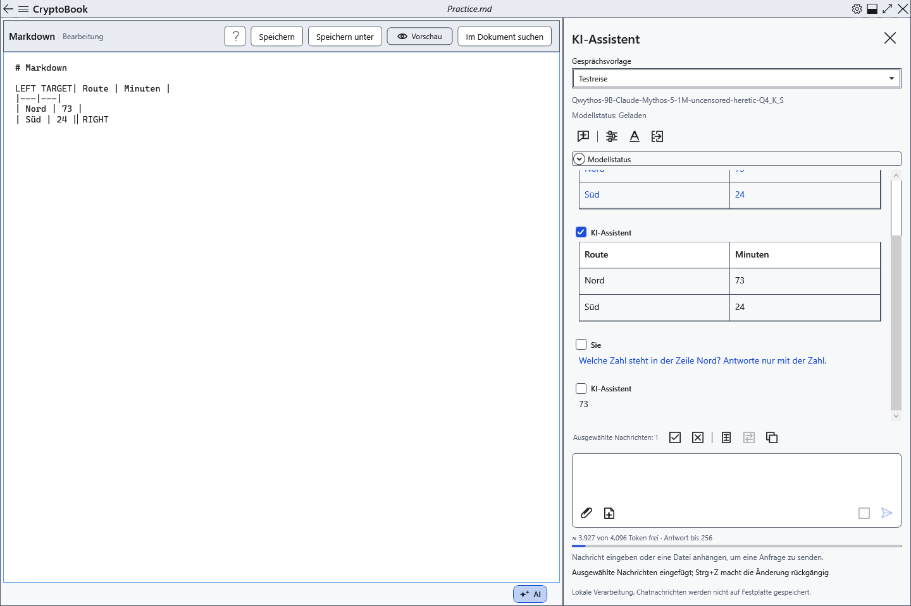

# Antworten in ein Dokument übertragen

**Auswahl einfügen** und **Auswahl ersetzen** übertragen markierte Chatnachrichten in den aktuellen Editor. Dokument, Cursor und Textauswahl können Sie nach dem Empfang der Antwort wählen. Prüfen Sie die Modellausgabe vor dem Übertragen.

## Normaler Editor

1. Markieren Sie die benötigten Nachrichten im KI-Bereich. Eine einzelne erhält keine zusätzliche Beschriftung; mehrere folgen der Dialogreihenfolge mit Teilnehmernamen und Trennlinien. Überlegungen und Anhanginhalte werden nicht übertragen.
2. Öffnen Sie ein normales Dokument zur Bearbeitung. Setzen Sie den Cursor oder markieren Sie Text.
3. Klicken Sie auf **Auswahl einfügen**. Die Antwort erscheint am Cursor oder bei markiertem Text hinter der Auswahl. Der markierte Text bleibt erhalten.

4. Prüfen Sie vor dem Ersetzen die Textauswahl: Der Befehl entfernt genau diesen Text. Klicken Sie auf **Auswahl ersetzen**. Ohne Textauswahl ist der Befehl nicht verfügbar.

Der normale Editor wandelt Markdown in bearbeitbare Überschriften, Hervorhebungen, Listen, Code und Tabellen um. Zellen lassen sich unabhängig bearbeiten, ohne die ursprüngliche Chatantwort zu ändern. Erneutes Einfügen bleibt möglich und fügt den Inhalt nochmals hinzu. HTML ist inaktiv; Bilder in KI-Auszeichnung werden nicht geladen. Verwenden Sie für Bilddateien die Werkzeuge des Editors.

## Markdown

5. Wechseln Sie zum gewünschten Markdown-Dokument. Ist **Vorschau** geöffnet, klicken Sie auf **Editor**. Beide Übertragungsbefehle sind in der Vorschau nicht verfügbar.

6. Setzen Sie im Quelltext Cursor oder Auswahl und verwenden Sie denselben Befehl. Eingefügt wird ursprüngliches Markdown der markierten Nachrichten, kein formatierter WPF-Abschnitt. Wechseln Sie zur **Vorschau**, um das Ergebnis zu prüfen.

Zeilenumbrüche werden nicht automatisch ergänzt. Bereiten Sie für eine eigene Tabelle oder Überschrift die Blockgrenzen im Quelltext vor: Beim Einfügen mitten in einer Zeile kann die Auszeichnung als normaler Text erscheinen.

## Prüfen, rückgängig machen und speichern

Die Übertragung ändert das Dokument im Speicher und schreibt die Datei nicht automatisch. Prüfen Sie Einfügeort und umgebenden Text. Einmal Strg+Z im jeweiligen Editor macht das gesamte Einfügen oder Ersetzen rückgängig; Strg+Y wiederholt es. Speichern Sie anschließend regulär. Wählen Sie zum Erhalt der Formatierung ein passendes Format für normale Dokumente; TXT behält nur Text.

Ist nichts markiert, wählen Sie Nachrichten aus. Ist Einfügen nicht verfügbar, öffnen Sie ein bearbeitbares Dokument, verlassen Sie Vorschau oder Lesemodus und warten Sie auf das Antwortende. Eine Arbeitsbereichssperre verhindert die Übertragung. Wurde das Dokument während des Anwendens geändert, lesen Sie die Meldung und prüfen Sie das Ziel erneut; verlassen Sie sich nicht auf einen früheren Cursor in einem anderen Dokument.

- [Nachrichten auswählen](help:ai.chat)
- [Dokumenttabellen](help:content.tables)
- [Markdown bearbeiten](help:md.edit)
- [Dokumentformate](help:doc.formats)
- [Speichern](help:doc.save)
