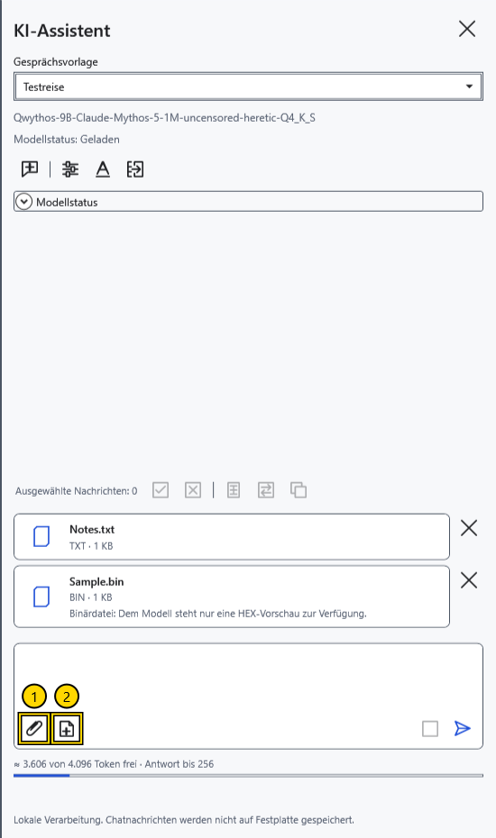
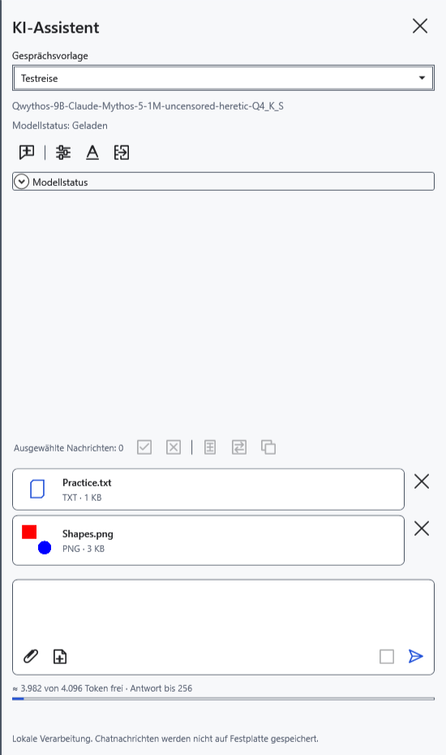
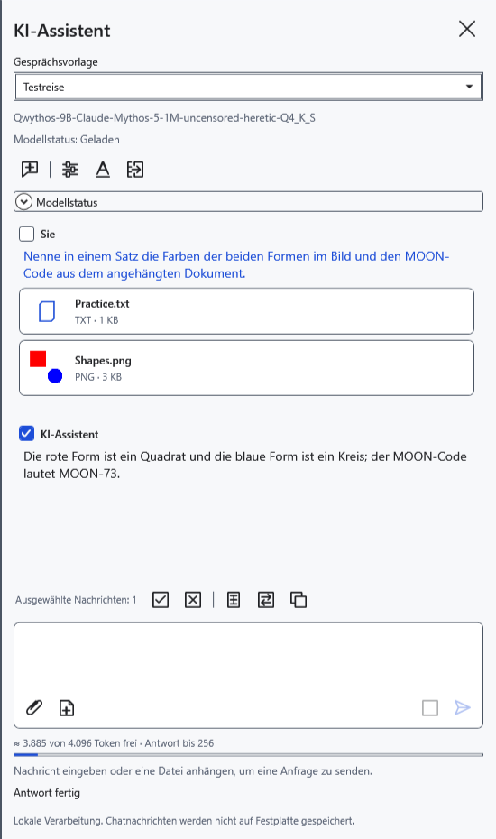
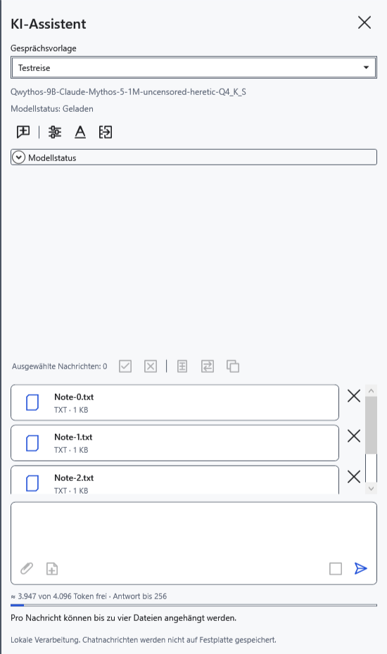

# Dateien und das aktuelle Dokument anhängen

Anhänge ergänzen Informationen zu einer Frage. Wählen Sie Dateien, die Sie dem lokalen Modell übergeben möchten. Eine Dateikarte bestätigt nicht, dass das Programm den gesamten Inhalt auslesen konnte.

## Hinzufügen und entfernen

1. Klicken Sie neben dem Eingabefeld auf **Dateien anhängen…** (1). Die Systemauswahl bietet Dokumente/Bilder und **Alle Dateien** (`*.*`). Wählen Sie mehrere Dateien oder ziehen Sie sie auf den Bereich.
2. Prüfen Sie die Karten. Vor dem Senden entfernt das Kreuz **Anhang entfernen** die entsprechende Karte.

Text, Markdown, RTF, DOCX und XamlPackage werden als ausgelesener Text übergeben. Formatierung und eingebettete Dokumentbilder werden nicht zu Vision-Eingaben. Bei unbekannter Endung versucht das Programm, Text zu lesen; eine Binärdatei erhält eine begrenzte HEX-Vorschau der ersten 256 Bytes sowie Name und Größe. Dies ist keine vollständige Auswertung von PDF, Archiven oder anderen Binärformaten. Öffnen Sie geschützte Dokumente zuerst regulär und verwenden Sie den Schnappschuss des aktuellen Dokuments.

## Dokument und Bild anhängen

3. Öffnen Sie das gewünschte Dokument und klicken Sie auf **Aktuelles Dokument** (2). Der gesamte aktuelle Text wird angehängt, einschließlich ungespeicherter Änderungen, nicht nur die Auswahl. Bei Markdown ist es der Quelltext. Spätere Änderungen aktualisieren die Karte nicht: Entfernen Sie sie und hängen Sie das Dokument erneut an.
4. Hängen Sie für ein Bild eine eigene PNG/JPEG/BMP/GIF/TIFF-Datei an. Erforderlich sind ein bildfähiges Modell und genau eine kompatible mmproj-Datei neben dem GGUF.

5. Geben Sie eine Frage ein und klicken Sie auf **Senden**. Ohne Fragetext wird eine Standardfrage zu den Dateien verwendet. Gesendete Karten wechseln in den Verlauf; Rückfragen im selben Chat verwenden die bisherigen Anhänge.

## Grenzen und Fehler

Bis zu vier Dateien pro Nachricht; höchstens 32 MiB pro Datei; bis zu 500000 ausgelesene Textzeichen; bis zu 100 Megapixel vor der Bildverkleinerung. Große Bilder werden verkleinert; feine Details können verloren gehen. Anhänge und Verlauf beanspruchen Modellkontext: Auch eine zulässige Datei kann das Budget einer konkreten Anfrage überschreiten.

Nach einem Grenzfehler bleiben frühere Karten erhalten: Entfernen Sie überzählige und versuchen Sie es erneut. Leere oder zu große Dateien, Lesefehler und beschädigte Bilder werden nicht hinzugefügt. Warten Sie während des Einlesens oder einer Antwort. Gesendete Anhänge lassen sich nicht einzeln aus dem Verlauf entfernen; **Neuer Chat** löscht Verlauf, Entwurf und Anhänge ohne Archivierung. Bewahren Sie benötigte Antworten vorher auf. Programmende und Schlüsselrücksetzung verwerfen Anhänge ebenfalls.

- [Chat](help:ai.chat)
- [Modell und Vision-Projektor](help:ai.models)
- [Antwort übertragen](help:ai.apply)
- [Fehler des Assistenten](help:ai.troubleshoot)
- [Kontext](help:ai.context)
