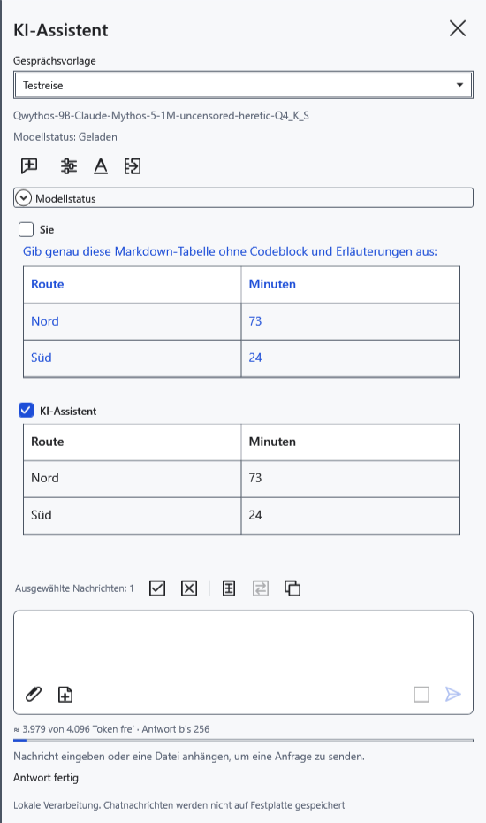
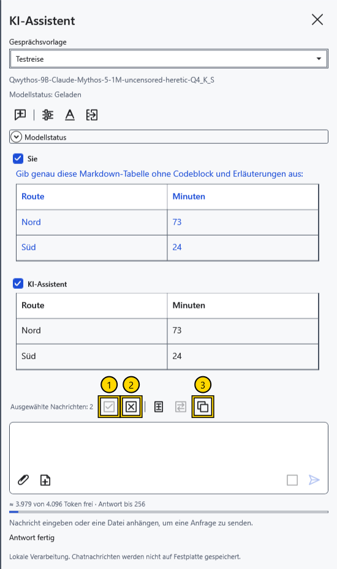
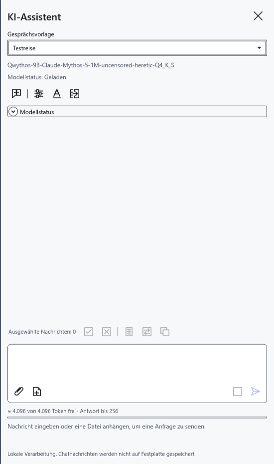

# Mit dem Assistenten chatten und Nachrichten auswählen

Der Chat befindet sich im rechten KI-Bereich. Fragen, Antworten und gesendete Anhänge bilden den Verlauf für spätere Anfragen. Die Kontrollkästchen bestimmen das Kopieren und Übertragen in den Editor; nicht ausgewählte Nachrichten bleiben Teil des Modellkontexts.

## Eine Frage senden

1. Aktivieren Sie den Assistenten und wählen Sie ein Modell. Geben Sie unten im Bereich eine Frage ein.
2. Klicken Sie auf **Senden** oder drücken Sie im Eingabefeld Strg+Enter. Enter allein fügt eine neue Zeile ein. Warten Sie auf den Abschluss oder klicken Sie während der Antwort auf **Stoppen**.
3. Lesen Sie die Antwort und prüfen Sie die Fakten. Stellen Sie im selben Chat eine Rückfrage, um den bisherigen Verlauf zu verwenden.

Die Antwort erscheint fortlaufend. Liefert das Modell gesonderte Überlegungen, können Sie **Überlegungen des Modells** aufklappen; sie bleiben vom Antworttext getrennt. Lesen Sie bei einer leeren Antwort die Statusmeldung. Die Einstellungen für Überlegungen hängen vom Modell ab.

## Auswählen und kopieren

Markieren Sie die Kästchen neben **Sie** und **KI-Assistent**. Sie können Fragen, Antworten oder mehrere Nachrichten auswählen. Bis zur manuellen Änderung wird automatisch die letzte nicht leere Antwort ausgewählt; manuelle Markierungen bleiben bei der nächsten Anfrage erhalten.

1. **Alle auswählen** markiert alle Nachrichten mit nicht leerem Text.
2. **Auswahl aufheben** entfernt die Markierungen und deaktiviert Kopieren und Übertragen.
3. **Kopieren** legt den ursprünglichen Text der ausgewählten Nachrichten in die Zwischenablage.

Eine einzelne Nachricht erhält keine zusätzliche Beschriftung. Mehrere folgen der Dialogreihenfolge mit Teilnehmernamen und Trennlinien. Ursprüngliches Markdown bleibt erhalten, auch wenn der Chat eine formatierte Tabelle anzeigt. Überlegungen und Anhanginhalte werden nicht kopiert. **Auswahl einfügen** und **Auswahl ersetzen** verwenden dieselben markierten Nachrichten.

## Neu beginnen

Übertragen Sie benötigte Antworten vor **Neuer Chat** in ein Dokument: Der Befehl löscht Verlauf, Entwurf, Anhänge, Auswahl und Berechnungscache ohne Archivierung. Modellgewichte bleiben geladen; auch das Ausblenden des Bereichs archiviert den Chat nicht. Nachrichten bleiben zwischen Programmstarts nicht erhalten und werden beim Zurücksetzen des Schlüssels gelöscht.

Schlägt Kopieren fehl, lesen Sie den Status und wiederholen Sie den Befehl. Ist Senden nicht verfügbar, lesen Sie die Erklärung unter dem Eingabefeld.

- [Assistent aktivieren](help:ai.start)
- [Gesprächsvorlagen](help:ai.templates)
- [Anhänge](help:ai.attachments)
- [Antworten in ein Dokument übertragen](help:ai.apply)
- [Stoppen und Entladen](help:ai.lifecycle)
