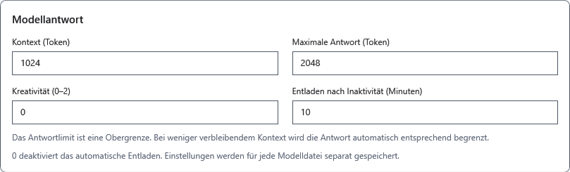
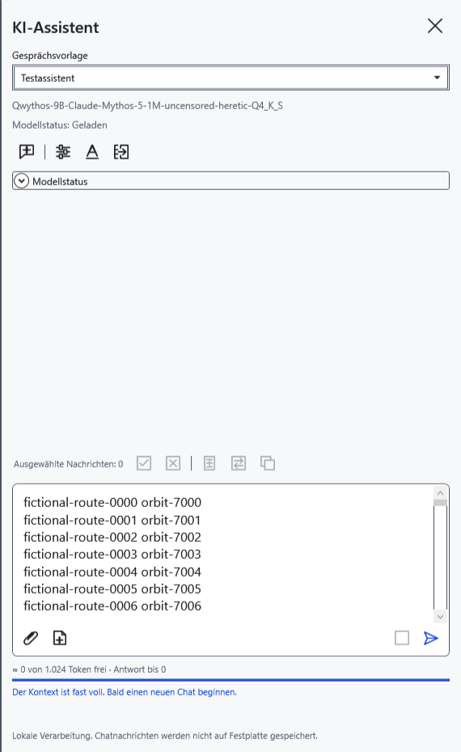
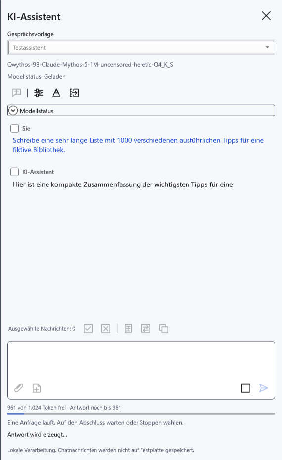
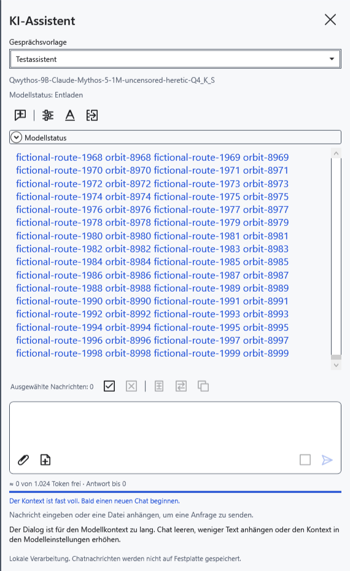
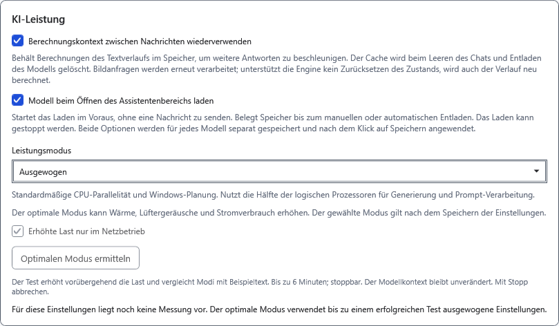
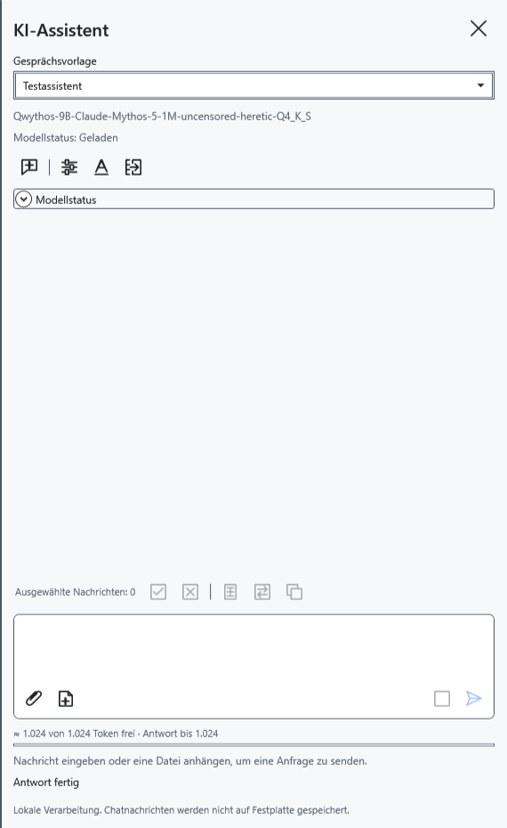

# Kontext, Antwortgrenze und Vorladen

Der Kontext ist ein gemeinsames Tokenfenster für Vorlagenanweisungen, Verlauf, Frage, Anhänge und die neue Antwort einschließlich des Nachdenkens. Ein Token entspricht weder einem Zeichen noch einem Wort. Für eine lange Antwort steht nur der freie Rest dieses Fensters bereit.

## Grenzen festlegen

1. Öffnen Sie **Modelleinstellungen**, wählen Sie die gewünschte GGUF-Datei und scrollen Sie zu den Antwortparametern.
2. Stellen Sie **Kontext (Token)** auf 512–131072 ein, innerhalb der Fähigkeiten des Modells und des verfügbaren Speichers. Ein höherer Wert braucht mehr Speicher und verbessert das Modell nicht automatisch.
3. Stellen Sie **Maximale Antwort (Token)** auf 1–131072 ein. Dies ist eine Obergrenze, keine Bestellung einer genauen Textmenge. Sie darf größer als der Kontext sein, doch die tatsächliche Antwort bleibt durch dessen freien Rest begrenzt. Das Modell kann auch früher enden.
4. **Kreativität (0–2)** beeinflusst die Auswahl der Fortsetzung und regelt nicht die Geschwindigkeit. Klicken Sie auf **Speichern**. Geänderte Antwortparameter beginnen einen neuen Chat: Kopieren Sie benötigte Texte vorher.

Antwortparameter werden getrennt für jede Modelldatei gespeichert. Gesprächsvorlagen sind gemeinsam: Ein Vorlagenwechsel erstellt kein neues Modell.

## Anzeige verstehen

Vor dem Senden und nach Abschluss bedeutet **≈** eine Schätzung. Sie berücksichtigt Entwurf und Anhänge, kann aber von der Tokenisierung des Modells abweichen. Ein leerer neuer Chat zeigt das gesamte freie Fenster, obwohl spätere Anweisungen ebenfalls Platz beanspruchen.

Während der Generierung nutzt die Anzeige tatsächliche Daten der Engine: Eingabe- und bereits ausgegebene Token einschließlich des Nachdenkens. Der Antwortspielraum nimmt während der Generierung ab. Hat der automatische Speichermodus den Kontext verkleinert, steht die wirksame Größe im aufklappbaren Bereich **Modellstatus**; das gespeicherte Eingabefeld allein beschreibt sie nicht. Dieser Bereich ist von der gleichnamigen Ladezustandsanzeige unter dem Modellnamen zu unterscheiden.

Passt die tatsächliche Anfrage nicht, erscheint eine Meldung zum vollen Kontext. Die Schätzung garantiert kein erfolgreiches Senden. Kürzen Sie Frage/Anhänge oder beginnen Sie **Neuer Chat**. Dabei werden Nachrichten, Entwurf und Anhänge ohne Archivierung gelöscht und der Berechnungscache geleert; geladene Gewichte bleiben erhalten. Kopieren Sie benötigte Antworten vorher.

## Wiederverwenden und vorladen

Unter **Modelleinstellungen → KI-Leistung** gibt es zwei unabhängige Optionen. Beide sind standardmäßig aus und gelten nach **Speichern** getrennt für das ausgewählte Modell.

- **Berechnungskontext zwischen Nachrichten wiederverwenden** erhält Berechnungen für einen identischen Textanfang der nächsten Anfrage. Der Gewinn hängt vom Modell und übereinstimmenden Anfang ab; geänderte Anweisungen oder frühe Nachrichten können eine Neuberechnung erfordern. Kann die Engine den Zustand dieses Modells nicht zurückrollen, wird der Verlauf ebenfalls neu berechnet. Bilder werden erneut verarbeitet. Dies vergrößert weder den Kontext noch bietet es dauerhaftes Gedächtnis oder ein Chatarchiv. Neuer Chat und Entladen leeren den Cache.
- **Modell beim Öffnen des Assistentenbereichs laden** lädt Gewichte bereits beim Öffnen des Bereichs. Es wird keine Frage gesendet, aber Speicher belegt. Stoppen Sie bei Bedarf das Laden oder entladen Sie das Modell. Erneutes Öffnen kann das Vorladen wieder auslösen.

Vor dem Speichern verwerfen **Abbrechen** oder das Schließen des Fensters die Änderungen. Zum Zurücksetzen schalten Sie die Optionen aus und speichern. **Modell entladen** gibt Speicher sofort frei. Das Schließen des Bereichs erhält die Gewichte normalerweise.

- [Chat und neue Frage](help:ai.chat)
- [Speichermodi](help:ai.memory)
- [Laden und Entladen](help:ai.lifecycle)
- [Gesprächsvorlagen](help:ai.templates)
