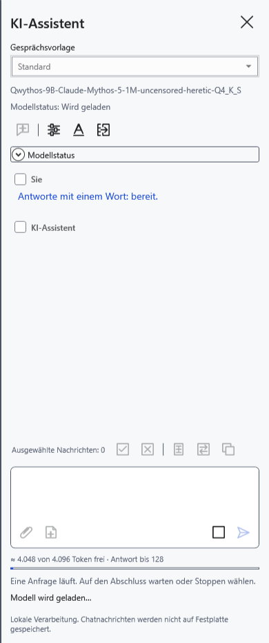
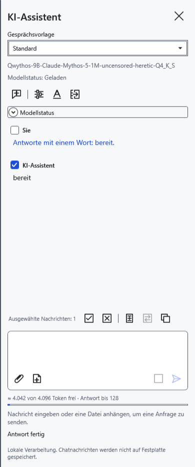
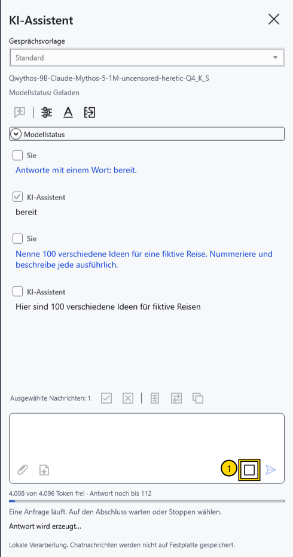
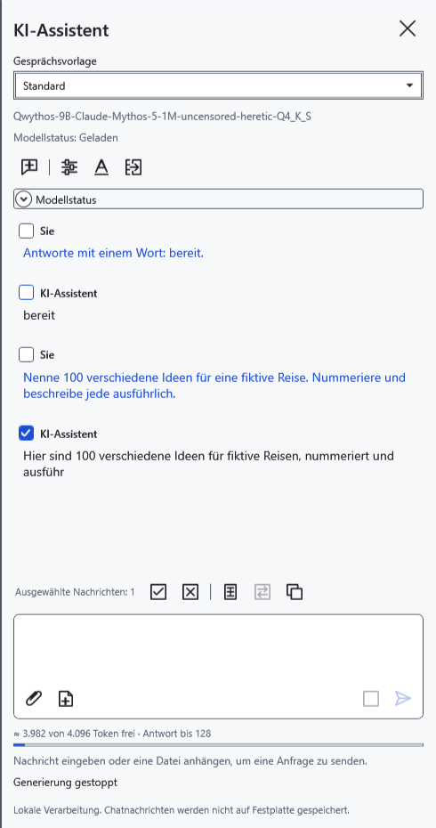
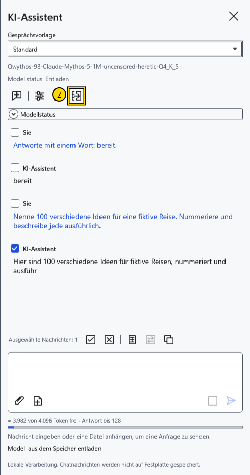

# Modell laden, stoppen und entladen

**Modellstatus** unter dem Modellnamen beschreibt den Zustand der Gewichte. Fortschritt und Fehler erscheinen separat. **Geladen** bedeutet nicht, dass noch eine Antwort erzeugt wird: Das Modell kann auf die nächste Anfrage warten.

## Laden und Abschluss einer Antwort

Wählen und speichern Sie ein Modell und senden Sie eine Frage. Normalerweise lädt die erste Anfrage die Gewichte. Ist **Modell beim Öffnen des Assistentenbereichs laden** aktiviert, beginnt das Laden bereits beim Öffnen. Laden und Generieren können Speicher und Prozessor beanspruchen.

Warten Sie, bis die Antwort abgeschlossen ist. **Senden** wird mit der nächsten eingegebenen Frage wieder verfügbar; die Gewichte bleiben für die Fortsetzung geladen.

## Aktuelle Antwort stoppen

1. Klicken Sie während der Generierung neben dem Eingabefeld auf **Stoppen** (1).

Warten Sie, bis das Stoppen abgeschlossen ist. Empfangener Text bleibt im Chat und kann mitten im Satz enden. Ein regulär bestätigter Stopp erhält die Gewichte. Der Abbruch des anfänglichen Ladens gibt das Modell dagegen frei. Bestätigt der separate Modellprozess den Abbruch nicht innerhalb von etwa fünf Sekunden, beendet CryptoBook ihn zwangsweise; die nächste Anfrage muss das Modell erneut laden.

## Speicher freigeben

2. Klicken Sie oben im Assistentenbereich auf **Modell entladen** (2). Dies bricht laufende Arbeit ab und gibt Sprachmodell und Vision-Projektor frei. Warten Sie auf **Entladen**. Empfangene Nachrichten bleiben erhalten; die nächste Frage lädt das Modell erneut.

Legen Sie unter **Modelleinstellungen → Entladen nach Inaktivität (Minuten)** 0–120 Minuten fest. Standard sind 10; 0 deaktiviert die automatische Entladung. Das Intervall gilt gemeinsam, obwohl Antwortparameter pro Modell gespeichert werden. Automatisches Entladen wartet auf das Ende aktiver Vorgänge; die Zeitprüfung erfolgt regelmäßig und ist keine sekundengenaue Stoppuhr. Das Schließen des Bereichs erhält normalerweise die Gewichte; das Beenden des Programms gibt sie frei. Das Zurücksetzen des Schlüssels stoppt KI, leert den Chat und entlädt das Modell.

**Neuer Chat** löscht Nachrichten, Entwurf, Anhänge und Berechnungscache ohne Archivierung; die Gewichte bleiben geladen. Verwechseln Sie dies nicht mit Entladen. Auch ein unerwartetes Prozessende im Leerlauf wird erkannt und ändert den Zustand zu **Entladen**. Empfangener Text bleibt; senden Sie bei Bedarf eine neue Anfrage. Nach einem Fehler mit Teilantwort wiederholt das Programm die Antwort nicht automatisch.

- [Modell auswählen](help:ai.models)
- [Fehler des Assistenten](help:ai.troubleshoot)
- [Kontext und Vorladen](help:ai.context)
- [Schlüssel zurücksetzen](help:security.lock)
