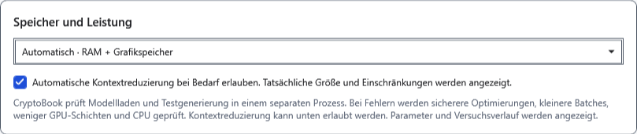
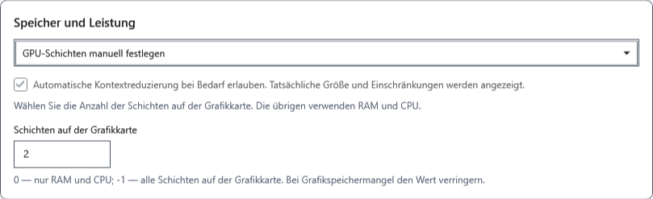
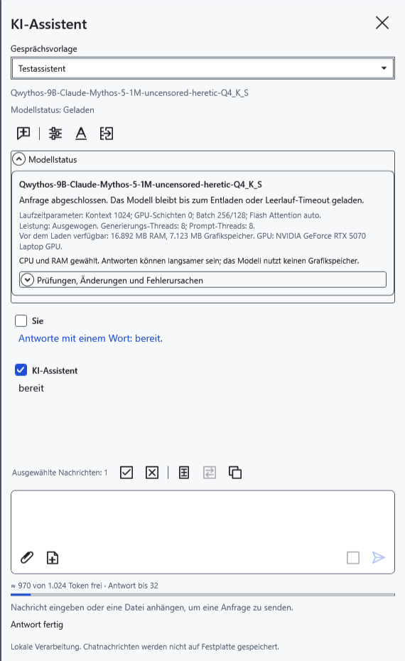
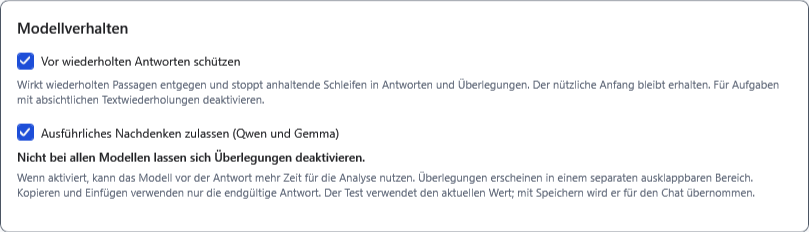
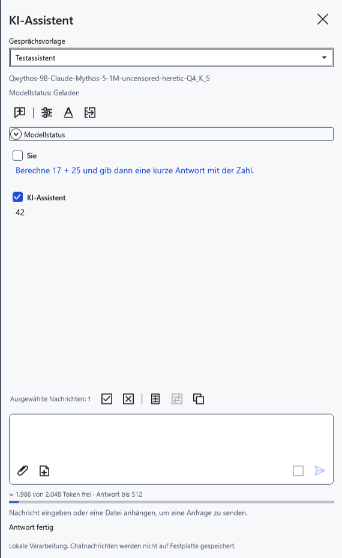

# Speicher, GPU und Antwortverhalten

Die Parameter werden getrennt für die ausgewählte GGUF-Datei gespeichert. Kopieren Sie benötigte Antworten vorher: Änderungen an Kontext, Speichermodus oder Antwortverhalten können den aktuellen Chat leeren und erneutes Laden erfordern.

## Modellplatzierung wählen

1. Öffnen Sie **Modelleinstellungen → Erweiterte Einstellungen → Speicher und Leistung**.
2. Beginnen Sie mit **Automatisch · RAM + Grafikspeicher**. Die Anwendung wählt die Platzierung anhand des verfügbaren Speichers; nach fehlgeschlagenem Laden kann sie GPU-Schichten reduzieren oder auf CPU zurückfallen. Dies garantiert nicht, dass jedes Modell passt.
3. Erlauben Sie bei Bedarf die automatische Kontextverkleinerung. Das wirksame Fenster kann dann kleiner als angefordert sein. Ohne Erlaubnis soll ein großer Kontext nicht stillschweigend schrumpfen. Prüfen Sie Größe und Warnungen unter **Modellstatus**.

4. Wählen Sie für manuelle Platzierung **GPU-Schichten manuell festlegen** und **Schichten auf der Grafikkarte**. Null belässt Schichten auf der CPU; −1 fordert alle Schichten auf der GPU an; eine positive Zahl fordert diese Anzahl an. „Alle“ bedeutet nicht, dass genug Speicher vorhanden ist. Die Unterstützung hängt von Modell, Treiber und Hardware ab.

5. Wählen Sie **Nur CPU · RAM**, um keine Schichten auf die GPU auszulagern. Klicken Sie auf **Speichern**, senden Sie eine kurze Frage und öffnen Sie **Modellstatus**. Vergleichen Sie tatsächliche GPU-Schichten, Kontext und Threads mit Ihren Erwartungen. CPU kann langsamer sein und benötigt weiterhin RAM.

Bei Speichermangel verkleinern Sie den Kontext, wählen eine kleinere GGUF-Datei oder entladen ein unbenutztes Modell. Erhöhen Sie GPU-Schichten nicht allein wegen erhoffter Geschwindigkeit. Die Anwendung schließt keine anderen Programme. Die automatische Kontextverkleinerung gilt nicht für die Leistungsmessung: Diese prüft die gewählte Kontextgröße.

## Nachdenken und Wiederholungsschutz

Im selben Abschnitt stehen Verhaltensoptionen:

- **Ausführliches Nachdenken zulassen (Qwen und Gemma)** erlaubt einem unterstützten Modell, Analyse auszugeben. Die Option ergänzt diese Fähigkeit nicht bei anderen Modellen und garantiert nicht, dass eine bestimmte GGUF-Datei sie beachtet. Nachdenken beansprucht Zeit und gemeinsamen Kontext. Ausschalten garantiert nicht, dass normaler Antworttext keinerlei Erklärungen enthält.
- **Vor wiederholten Antworten schützen** kombiniert Wiederholungsbegrenzung bei der Tokenauswahl mit dem Stoppen dauerhafter exakter Schleifen. Bereits erhaltener nützlicher Text bleibt erhalten. Umformulierte Wiederholungen können unerkannt bleiben. Schalten Sie den Schutz für absichtlich gleiche Zeilen vorübergehend aus und danach wieder ein.

Liefert das Modell eine getrennte Analyse, können Sie diese in der Nachricht aufklappen. Kopieren und Übertragen verwenden die Antwort ohne separat markiertes Nachdenken. Nicht jede GGUF-Datei liefert diesen Kanal; ein fehlender Analysebereich ist allein kein Fehler.

Vor dem Speichern wählen Sie **Abbrechen**. Nach dem Speichern stellen Sie frühere Werte wieder her und speichern erneut; gelöschte Nachrichten kehren dadurch nicht zurück. Lädt der manuelle Modus nicht, wechseln Sie zu automatisch oder CPU und prüfen eine kurze Frage.

- [Kontext und Antwortgrenze](help:ai.context)
- [Leistung und Messung](help:ai.performance)
- [Modell wählen und testen](help:ai.models)
- [Probleme des Assistenten](help:ai.troubleshoot)
