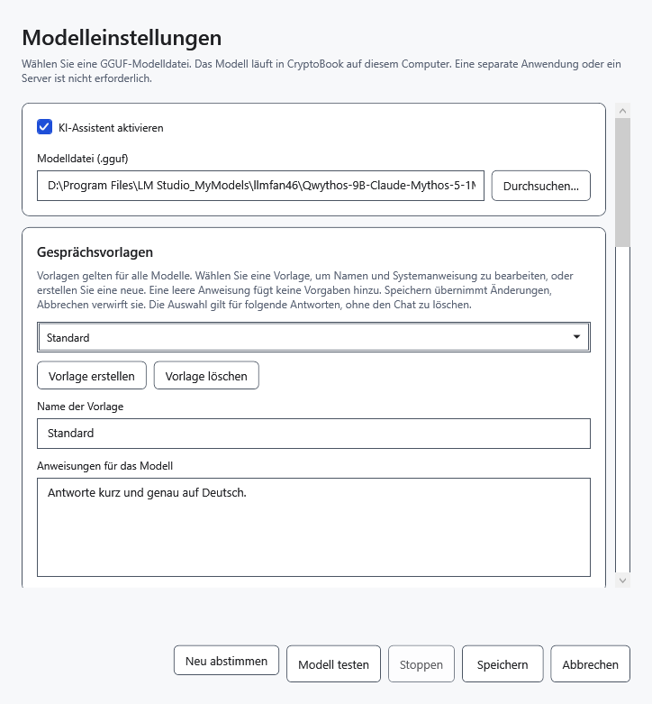
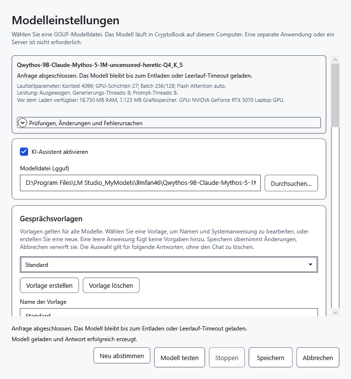
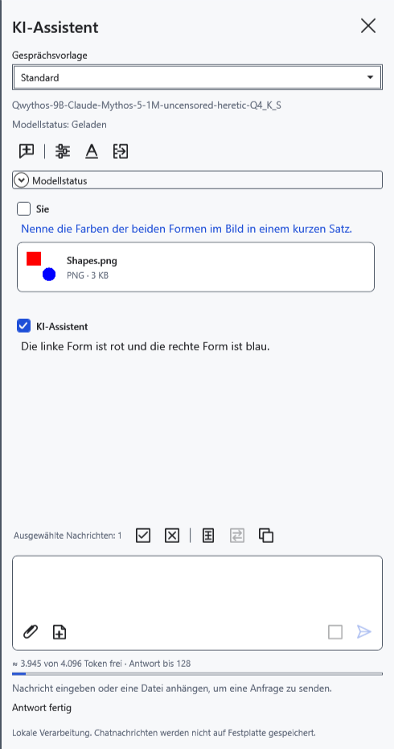

# Modell auswählen und testen

Ein Sprachmodell ist eine lokale `.gguf`-Datei. Wählen Sie das Modell selbst, keine zusätzliche `mmproj`-Datei. Architektur und verfügbarer Speicher müssen durch einen tatsächlichen Start geprüft werden; die GGUF-Endung allein garantiert keine Kompatibilität.

## Modell einrichten

Übertragen Sie benötigte Antworten vor einem Modellwechsel in ein Dokument: Der Wechsel löscht Chat, Entwurf und Anhänge und entlädt die bisherigen Gewichte.

1. Öffnen Sie **Einstellungen → KI-Assistent → Modelleinstellungen** oder das Zahnrad im Assistentenbereich.
2. Wählen Sie **KI-Assistent aktivieren**. Klicken Sie neben **Modelldatei (.gguf)** auf **Durchsuchen…** und wählen Sie ein vorhandenes Sprachmodell. Alternativ geben Sie den vollständigen Pfad ein oder wählen ein bereits eingerichtetes Modell aus der Liste, die bei mehreren Modellen erscheint.
3. Klicken Sie bei Bedarf auf **Modell testen**. Der Test verwendet die aktuellen Fensterwerte, lädt das Modell tatsächlich und fordert eine kurze Antwort an. **Stoppen** bricht den Test ab. Ein erfolgreicher Texttest bestätigt noch keine Bildunterstützung.
4. Klicken Sie auf **Speichern**, um die Einstellungen anzuwenden und das Fenster zu schließen. **Abbrechen** oder Schließen verwirft ungespeicherte Änderungen; ein abgeschlossener Test kann das Modell geladen lassen.

## Für Bilder

Sie benötigen ein Modell mit Bildverständnis und einen dazu kompatiblen Projektor. Legen Sie genau eine GGUF-Datei mit `mmproj` im Namen neben das Sprachmodell. CryptoBook findet sie automatisch; es gibt keine gesonderte Projektorauswahl. Bei keiner oder mehreren solchen Dateien schlagen Bildanfragen fehl. Der Name allein bestätigt keine Kompatibilität: Ein ungeeigneter Projektor kann einen Verarbeitungsfehler verursachen.

Hängen Sie nach dem Speichern ein unbedenkliches Testbild an und fragen Sie nach sichtbaren Einzelheiten. Erst eine tatsächliche Bildantwort prüft diese Fähigkeit. Der Bildencoder verwendet CPU und RAM; die Verarbeitung kann länger dauern als eine Textantwort.

## Speichern und Fehler

Parameter werden pro Modelldatei gespeichert; Gesprächsvorlagen gelten gemeinsam für alle Modelle. **Neu abstimmen** wiederholt die automatische Speicherabstimmung; es lädt keine neue GGUF-Version herunter und ermittelt keinen schnellsten Leistungsmodus. Verwenden Sie nach Tests oder Änderungen bei Bedarf **Modell entladen** im Assistentenbereich. Wurde die Datei verschoben, wählen Sie den neuen Pfad. Bei einem Speicherfehler bleibt das Fenster offen: Beheben Sie die Ursache oder klicken Sie auf **Abbrechen**.

- [Assistent aktivieren](help:ai.start)
- [Lebenszyklus des Modells](help:ai.lifecycle)
- [Fehlerbehebung](help:ai.troubleshoot)
- [Anhänge](help:ai.attachments)
- [Modellspeicher](help:ai.memory)
