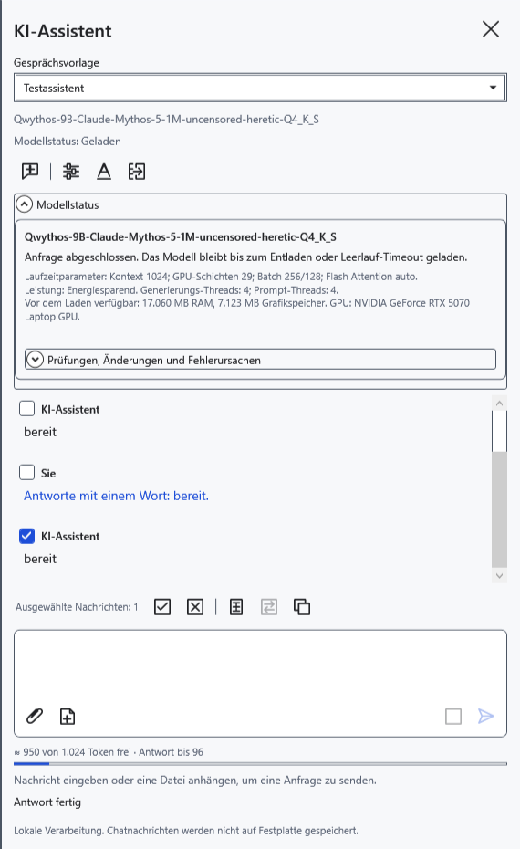
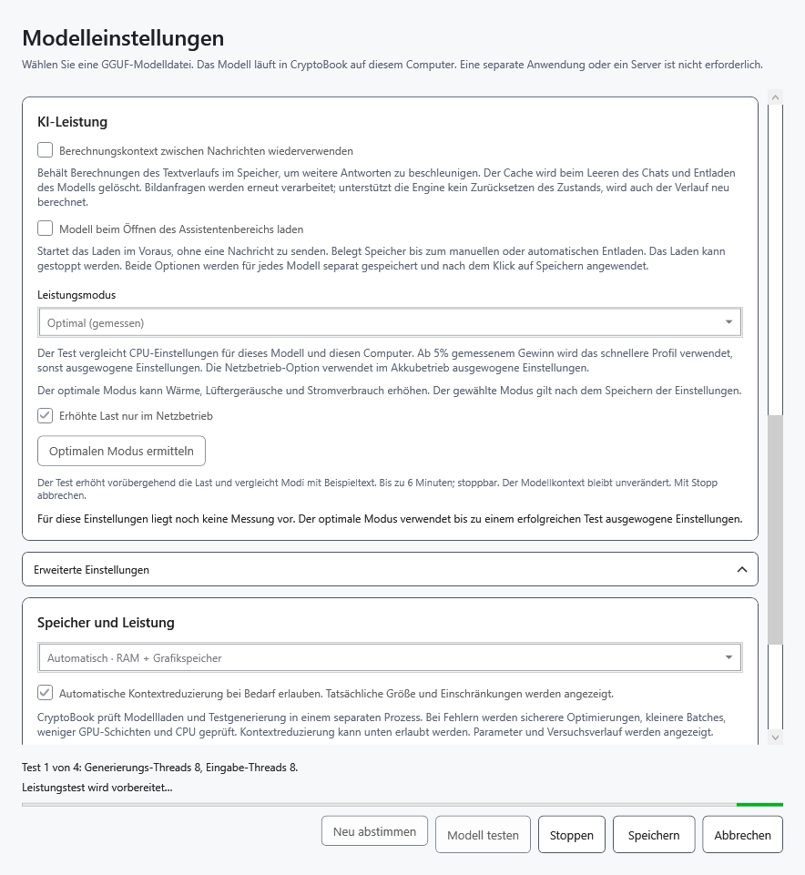
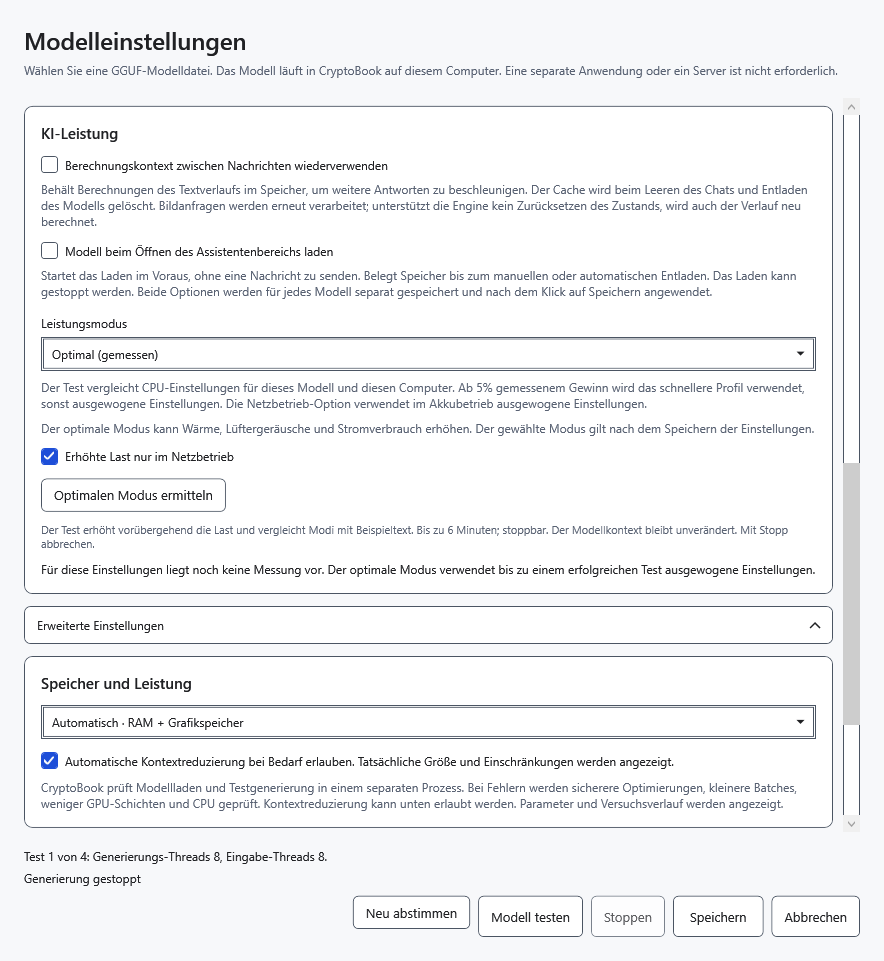
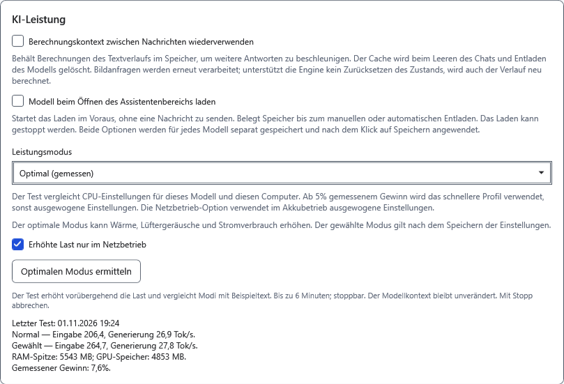

# KI-Leistung und Messung

Der Modus ist eine freiwillige Wahl und wird getrennt für jede Modelldatei gespeichert. Geschwindigkeit hängt von Hardware, Modell, Kontext und aktueller Last ab. Höhere Last garantiert keine schnellere Antwort.

## Modus wählen

1. Öffnen Sie **Modelleinstellungen → KI-Leistung → Leistungsmodus**.
2. Wählen Sie **Ausgewogen** für den normalen Einsatz. **Energiesparend** reduziert Threadzahlen und fordert energiesparende Windows-Planung an. Das ist weder eine feste GPU-Leistungsgrenze noch eine Zusage bestimmter Akkulaufzeit.
3. Klicken Sie auf **Speichern** und senden Sie eine kurze Frage. **Modellstatus** zeigt das aktive Profil. Ein Moduswechsel erhält Gespräch und Entwurf, gibt aber den bisherigen Worker frei; die nächste Anfrage lädt das Modell erneut.

## Optimalen Modus ermitteln

Beenden Sie zuerst die aktuelle Antwort. Tests können Last, Wärme und Lüftergeräusche erhöhen; führen Sie nicht mehrere Messungen gleichzeitig aus.

4. Wählen Sie **Optimal (gemessen)** in den Einstellungen. **Erhöhte Last nur im Netzbetrieb** ist standardmäßig aktiv. Im Akkubetrieb verhindert diese Einschränkung erhöhte Last; schalten Sie sie nur bewusst aus.
5. Klicken Sie auf **Optimalen Modus ermitteln**. Der Chatmodus ändert sich erst durch **Speichern**. Die Messung wärmt das Modell auf und vergleicht ein normales Profil mit verfügbaren Kandidaten höherer Last; sie kann bis zu sechs Minuten dauern. Geprüft wird der gewählte Kontext ohne automatische Verkleinerung.

6. Klicken Sie bei Bedarf auf **Stoppen**. Der Testworker wird freigegeben; **Optimalen Modus ermitteln** steht erneut bereit. Abbruch gilt nicht als erfolgreiche Messung.

7. Lesen Sie das Ergebnis: Eingabeverarbeitung und Generierungsgeschwindigkeit sowie Vergleich des normalen und gewählten Profils. Erhöhte Last wird nur bei mindestens 5% gemessenem Gewinn gewählt; sonst bleibt normale Last. Die Zahlen gelten für diesen Test und versprechen keine identische Geschwindigkeit bei langem Chat oder Bildern.

8. Klicken Sie auf **Speichern**, um den Modus im Chat anzuwenden. Stromversorgung und verfügbarer Speicher werden auch später geprüft; Einschränkungen können erhöhte Last verhindern.

## Wiederholen oder zurückkehren

**Neu abstimmen** entfernt das gespeicherte automatische Profil und Leistungsergebnis dieses Modells und testet es erneut. Es lädt keine neueren Gewichte herunter. Wiederholen Sie die Messung nach Änderungen an Modell oder Bedingungen. Auch **Optimalen Modus ermitteln** führt jedes Mal eine neue Messung aus.

**Abbrechen** verwirft ungespeicherte Fenstereinstellungen; eine abgeschlossene Messung kann den Ergebniscache bereits aktualisiert haben. Für normalen Betrieb wählen Sie **Ausgewogen** und speichern. Die Messung selbst löscht keine Nachrichten. Bei unzureichenden Ressourcen wird der Test beendet oder die Kandidatenauswahl eingeschränkt; andere Programme werden nicht geschlossen. Verkleinern Sie den Kontext, wählen Sie ein kleineres Modell oder versuchen Sie es später. CPU/GPU-Platzierung kann das Ergebnis verändern.

- [Speicherplatzierung](help:ai.memory)
- [Kontext](help:ai.context)
- [Laden und Stoppen](help:ai.lifecycle)
- [Probleme des Assistenten](help:ai.troubleshoot)
