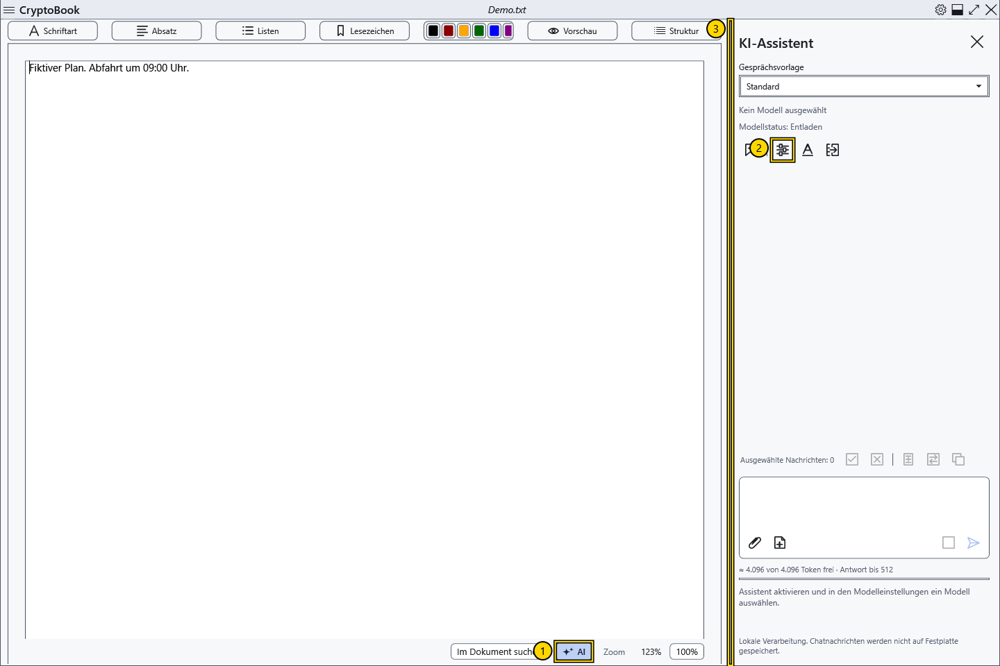

# Den lokalen KI-Assistenten aktivieren

Der Assistent antwortet im rechten Bereich und verarbeitet Anfragen mit einem lokalen Modell auf Ihrem Computer. Ein eigener Server ist nicht erforderlich. Modelldateien und Vision-Projektoren gehören nicht zum Lieferumfang von CryptoBook; besorgen Sie diese separat.

## Öffnen und aktivieren

1. Öffnen Sie ein normales Dokument und klicken Sie unten im Editor auf **AI** (1). In anderen Fensterzuständen verwenden Sie **Einstellungen → KI-Assistent** und den Befehl zum Öffnen des Bereichs.
2. Klicken Sie im rechten Bereich auf das Zahnrad **Modelleinstellungen** (2). Das Fenster ist auch über **Einstellungen → KI-Assistent → Modelleinstellungen** erreichbar.
3. Wählen Sie **KI-Assistent aktivieren**, wählen Sie ein Sprachmodell im GGUF-Format und klicken Sie auf **Speichern**. Einzelheiten stehen im Artikel zur Modellauswahl.

4. Geben Sie eine erfundene Testfrage ein und klicken Sie auf **Senden**, oder drücken Sie im Eingabefeld Strg+Enter. Warten Sie auf die Antwort und prüfen Sie sie vor der Verwendung.

## Ergebnis und Rückkehr

Der Bereich zeigt den Modellnamen, **Modellstatus** und den Grund, weshalb Senden nicht verfügbar ist. Ein aktivierter Assistent bedeutet noch kein geladenes Modell: normalerweise beginnt das Laden mit der ersten Anfrage. Ist **Senden** nicht verfügbar, lesen Sie die Erklärung unter dem Eingabefeld.

Ziehen Sie den linken Rand des Bereichs (3), um die Breite zu ändern. Sie bleibt beim Schließen und erneuten Öffnen des Bereichs erhalten und wird durch den verfügbaren Platz begrenzt. Ein weiterer Klick auf **AI** blendet den Bereich aus. Dabei bleiben Chat und normalerweise auch Modellgewichte erhalten; **Modell entladen** gibt Speicher frei. Das Ausblenden bricht einen noch laufenden Vorladevorgang ab.

Deaktivieren Sie **KI-Assistent aktivieren** in den Einstellungen, um den Assistenten auszuschalten. Dies beendet die Modellarbeit und leert den aktuellen Dialog. Chat, Entwurf und Anhänge bleiben nur im Arbeitsspeicher: Sie werden zwischen Programmstarts nicht archiviert und beim Leeren oder Zurücksetzen des Schlüssels gelöscht. Modellparameter und Gesprächsvorlagen werden getrennt von Nachrichten gespeichert. Lokale Verarbeitung bestätigt weder die Richtigkeit einer Antwort noch verleiht sie dem Modell fehlende Fähigkeiten.

- [Modell auswählen und testen](help:ai.models)
- [Laden, Stoppen und Entladen](help:ai.lifecycle)
- [Wenn der Assistent nicht antwortet](help:ai.troubleshoot)
- [Chat und Nachrichten](help:ai.chat)
