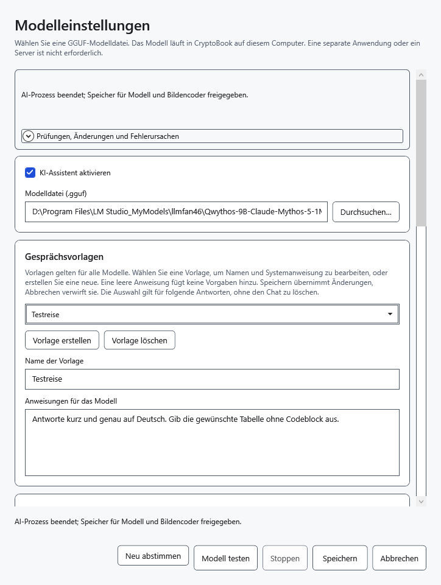
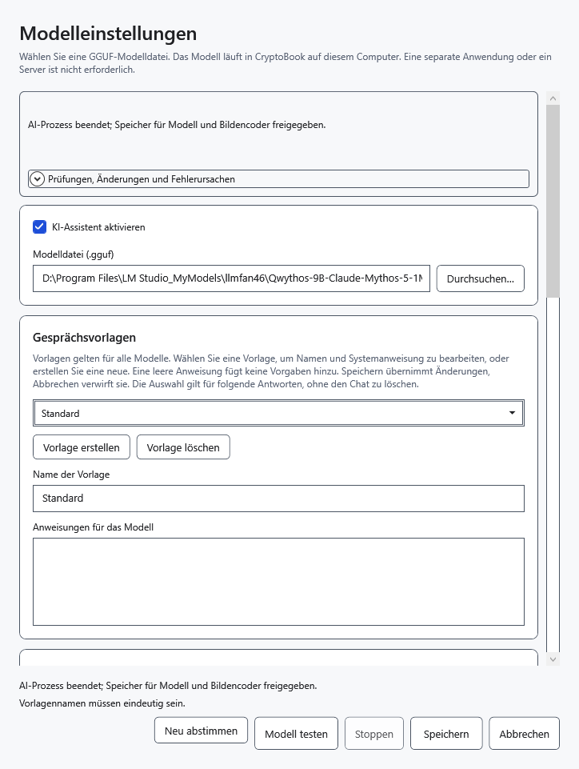
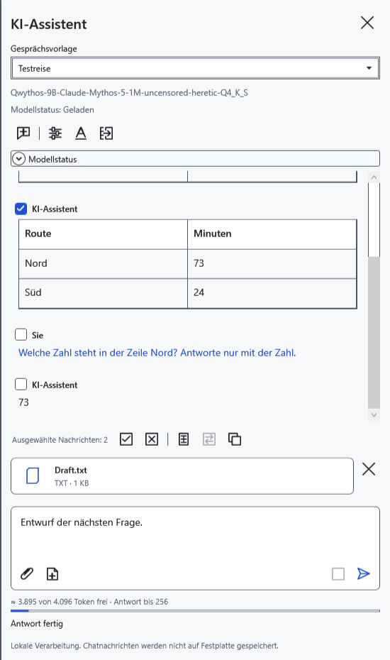
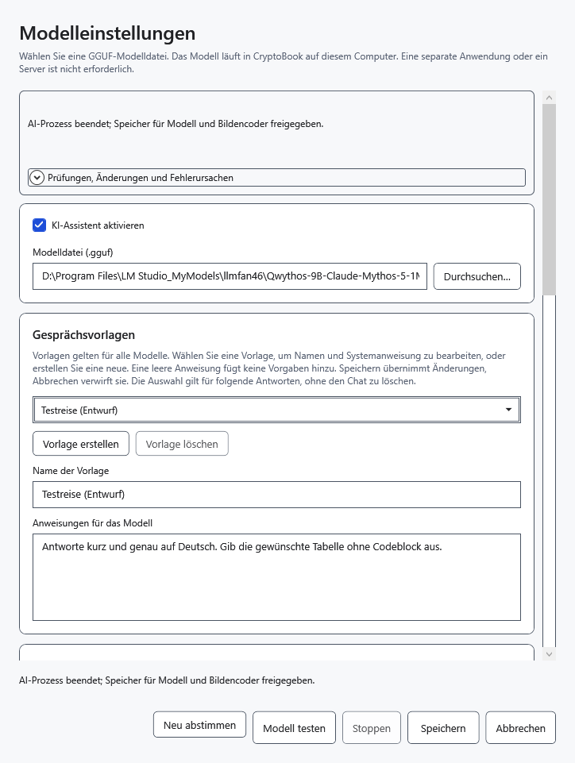

# Gemeinsame Gesprächsvorlagen einrichten

Eine Vorlage liefert gemeinsame Anweisungen für folgende Anfragen an jedes ausgewählte Modell. Sie ist kein eigener Chat oder Speicherprofil. Sechs Vorgaben sind enthalten: **Standard**, **Kurze Antworten**, **Ausführliche Erklärungen**, **Textredaktion**, **Analyse**, **Programmierassistent**.

## Erstellen oder bearbeiten

1. Öffnen Sie im KI-Bereich **Modelleinstellungen** und scrollen Sie zu **Gesprächsvorlagen**.
2. Klicken Sie auf **Vorlage erstellen** oder wählen Sie einen vorhandenen Eintrag.
3. Geben Sie einen nicht leeren, eindeutigen Wert unter **Name der Vorlage** ein.
4. Füllen Sie **Anweisungen für das Modell** aus. Leere Anweisungen sind erlaubt und ergänzen keine eigenen Vorgaben. Klicken Sie zum Anwenden auf **Speichern**.

Bei einem fehlenden Namen fordert das Fenster zur Eingabe auf. Doppelte Namen, auch bei Unterschieden nur in der Großschreibung, lassen sich nicht speichern. Korrigieren Sie den Namen und klicken Sie erneut auf **Speichern**.

## Für die nächste Anfrage auswählen

Wählen Sie oben im Assistentenbereich eine **Gesprächsvorlage**. Die Auswahl wird gespeichert und gilt modellübergreifend. Vorhandene Antworten werden nicht umgeschrieben; Verlauf, Entwurf, Anhänge und geladene Gewichte bleiben erhalten. Während einer Antwort ist die Auswahl im Bereich nicht verfügbar. Änderungen im Einstellungsfenster gelten für die nächste Anfrage.

Anweisungen beschreiben ein gewünschtes Verhalten, garantieren aber nicht, dass das Modell folgt. Namen der Vorgaben folgen der Oberflächensprache; eigene Namen und Anweisungstexte werden nicht automatisch übersetzt. Updates erhalten gespeicherte Änderungen, Ergänzungen und Löschungen, statt den Ausgangssatz wiederherzustellen. Ältere modellspezifische Anweisungen können als zusätzliche gemeinsame Vorlagen erscheinen.

## Löschen oder abbrechen

Wählen Sie einen Eintrag, klicken Sie auf **Vorlage löschen**, dann auf **Speichern**. Damit wird er aus dem gemeinsamen Satz entfernt. Die letzte verbleibende Vorlage kann nicht gelöscht werden.

**Abbrechen** oder Schließen verwirft ungespeichertes Erstellen, Bearbeiten, Löschen und Auswählen. Nach dem Speichern gibt es kein allgemeines Rückgängigmachen des Löschens. Reine Vorlagenänderungen erhalten den Chat; ein Modellwechsel oder andere Modellparameter im selben Fenster können ihn leeren. Übertragen Sie benötigte Antworten deshalb vorher in ein Dokument.

- [Chat und Nachrichtenauswahl](help:ai.chat)
- [Modellauswahl](help:ai.models)
- [Antwort übertragen](help:ai.apply)
