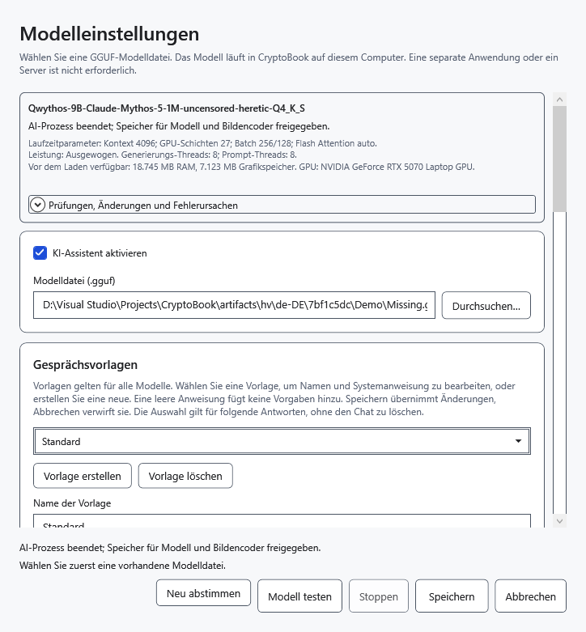

# Wenn der KI-Assistent nicht antwortet

Lesen Sie zuerst die Erklärung unter dem Eingabefeld, den Fehlertext und **Modellstatus**. Sie beschreiben unterschiedliche Dinge: Gewichte können nach einer abgeschlossenen oder gestoppten Antwort im Speicher bleiben.

## Senden ist nicht verfügbar

- Assistent deaktiviert: Öffnen Sie **Modelleinstellungen**, wählen Sie **KI-Assistent aktivieren**, wählen Sie eine GGUF-Datei und speichern Sie.
- Leere Frage ohne Anhänge: Geben Sie eine Frage ein. Werden Anhänge gelesen, warten Sie auf den Abschluss.
- Vorherige Anfrage läuft: Warten Sie auf die Antwort oder klicken Sie auf **Stoppen**.
- Arbeitsbereich tatsächlich gesperrt: Entsperren Sie ihn zuerst mit dem bisherigen Schlüssel. Ein gespeicherter Schnappschuss allein verhindert keine normalen Anfragen.

## Modell- oder Bildfehler

**Wählen Sie zuerst eine vorhandene Modelldatei.** bedeutet, dass der Pfad leer oder die Datei nicht erreichbar ist. Verbinden Sie das Laufwerk oder wählen Sie eine vorhandene Datei. Die Auswahl von `mmproj` als Sprachmodell oder ein falscher Dateikopf führt zur Formatabweisung. Das Umbenennen einer anderen Datei in `.gguf` macht sie nicht zum Modell. Ungültige Einstellungen ersetzen die bisher gespeicherte Konfiguration nicht.

Text funktioniert, Bilder nicht: Prüfen Sie Bildunterstützung, Projektorkompatibilität und genau eine GGUF-Datei mit `mmproj` im Namen neben dem Modell. Wählen Sie diese nicht anstelle des Sprachmodells. Ein Encoderfehler kann Inkompatibilität, ein beschädigtes Bild oder Speichermangel bedeuten; versuchen Sie ein kleines gültiges Bild. Ein Texttest prüft kein Bildverständnis.

## Speichermangel, langer Chat oder Prozessfehler

1. Läuft noch ein Vorgang, klicken Sie auf **Stoppen** und warten Sie. **Modell entladen** gibt die Gewichte frei.
2. Öffnen Sie **Modellstatus → Prüfungen, Änderungen und Fehlerursachen**. Dort stehen tatsächliche Versuche und Parameter, die nach automatischer Abstimmung von den gewünschten Werten abweichen können.
3. Wählen Sie bei Speichermangel ein kleineres Modell oder einen kleineren Kontext. In den erweiterten Einstellungen sind automatische Speicherbelegung oder reiner RAM-Betrieb möglich. Das kann langsamer sein. **Neu abstimmen** wiederholt im automatischen Modus die Abstimmung; der Erfolg jedes Modells ist nicht garantiert.
4. Überschreitet der Dialog den Kontext, übertragen Sie benötigte Antworten zuerst in ein Dokument. Beginnen Sie dann mit **Neuer Chat** oder verringern Sie die Anhänge. Leeren entfernt den Dialog unwiderruflich aus dem Speicher. Ein größerer Kontext benötigt mehr Speicher.

Keine sichtbare Antwort bedeutet nicht zwangsläufig Entladen: Erhöhen Sie die Antwortgrenze und prüfen Sie die Einstellungen für das Nachdenken. Der Wiederholungsschutz kann längere wörtliche Schleifen stoppen; er erkennt nicht jede sinngleiche Wiederholung.

Bei einem Fehler des separaten Prozesses bleibt das Dokument offen. Bewahren Sie benötigte Teilantworten auf und wiederholen Sie die Anfrage nach Behebung der Ursache manuell. Vor der Textausgabe kann die automatische Abstimmung mit sichereren Parametern erneut starten; nach Teiltext erfolgt keine automatische Wiederholung. Ein unerwartetes Ende im Leerlauf ändert den Zustand zu **Entladen**; eine neue Anfrage lädt das Modell wieder. Stoppen, ausdrückliches Entladen und Prozessfehler sind unterschiedliche Ergebnisse.

- [Modell auswählen und testen](help:ai.models)
- [Stoppen und Entladen](help:ai.lifecycle)
- [Speicher](help:ai.memory)
- [Anhänge](help:ai.attachments)
- [Wiederherstellung nach Schlüsselrücksetzung](help:recovery.lock)
