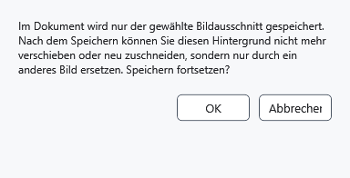

# Seitenhintergrund und Bildausschnitt

Der Hintergrund füllt das Papier hinter dem Text. Anders als ein eingefügtes Bild lässt er sich innerhalb des Seitenrahmens verschieben. Bewahren Sie vor dem endgültigen Speichern das Originalbild separat auf.

## Schritte

1. Klicken Sie unter **Schriftart** im Bereich **Papier** auf **Hintergrundbild des Dokuments auswählen. Mit Strg + linker Maustaste auf der Seite verschieben.** und wählen Sie eine Datei.
2. Halten Sie Strg gedrückt und ziehen Sie den Hintergrund mit der linken Maustaste. Esc bricht das laufende Ziehen ab. **Hintergrundbild des Dokuments entfernen** entfernt den Hintergrund.
3. Speichern Sie als XamlPackage. Beim ersten Speichern eines verschiebbaren Hintergrunds erscheint eine Warnung zur Fixierung des Ausschnitts. Abbrechen lässt Datei und Hintergrund ohne endgültige Fixierung.

## Prüfung, Rückgängigmachen und Grenzen

Nach erfolgreichem Schreiben bleibt nur der sichtbare Bereich: Verdeckte Ränder werden verworfen und das Verschieben dieses Ausschnitts gesperrt. Für einen anderen Ausschnitt wählen Sie das Original erneut. Fehlgeschlagenes oder abgebrochenes Schreiben gilt nicht als Speichern. Strg+Z kann Bearbeitung rückgängig machen, aber verworfene Pixel nicht aus einer bereits geschriebenen Datei zurückholen. RTF/TXT/XAML erhalten diesen Hintergrund nicht; prüfen Sie XamlPackage durch erneutes Öffnen.

## Verwandte Themen

- [Seiteneinstellungen und Papierfarbe](help:edit.page)
- [Speichern und Speichern unter](help:doc.save)
