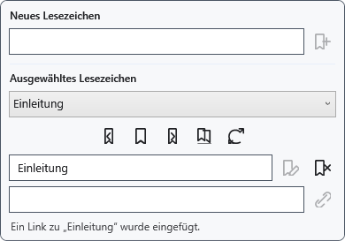
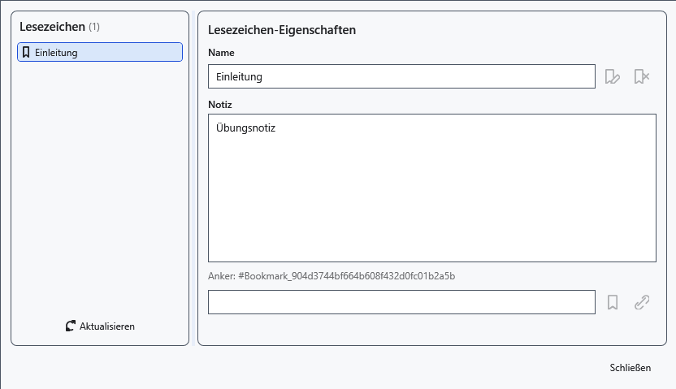

# Lesezeichen, Notizen und interne Links

Ein Lesezeichen markiert eine Position im normalen Dokument. Die aktuelle XamlPackage-Speicherung stellt Lesezeichenanker und Notizen nach erneutem Öffnen nicht wieder her. Der Linktext kann bleiben, während sein Ziel nicht mehr funktioniert. Verlassen Sie sich bei gespeicherten Dateien nicht allein auf Lesezeichen.

## Schritte

1. Setzen Sie die Einfügemarke und öffnen Sie **Lesezeichen** über dem Dokument. Geben Sie einen Namen ein und klicken Sie **An Cursorposition hinzufügen**.
2. Wählen Sie einen Eintrag. **Zum ausgewählten Lesezeichen wechseln**, **Vorheriges Lesezeichen** und **Nächstes Lesezeichen** bewegen die Einfügemarke; die Nachbarnavigation läuft am Dokumentende wieder zum Anfang.
3. Geben Sie einen neuen Namen ein und klicken Sie **Ausgewähltes Lesezeichen umbenennen**. Für einen Link setzen Sie die Einfügemarke anderswo, geben Linktext ein und klicken **Link zum ausgewählten Lesezeichen einfügen**.
4. Öffnen Sie **Lesezeichen-Manager öffnen**, wählen Sie einen Eintrag und ändern Sie seine Notiz. **Index aus Dokument aktualisieren** liest die Anker des aktuellen Dokuments neu ein.

## Prüfung, Rückgängigmachen und Grenzen

Prüfen Sie Name und Ziel. **Ausgewähltes Lesezeichen löschen** entfernt den Anker, nicht die Datei. Korrigieren Sie leere oder doppelte Namen gemäß Panelmeldung. Das Schließen des Managers verwirft vorgenommene Änderungen nicht; speichern Sie ausdrücklich. Aktualisieren Sie den Index, wenn Textverschiebungen oder Löschungen ein Lesezeichen entfernen. TXT, XAML und RTF garantieren den Erhalt von Ankern und Notizen nicht.

## Verwandte Themen

- [Weblinks und sichtbarer Text](help:edit.links)
- [Der Dokumentstrukturbaum](help:content.structure)
