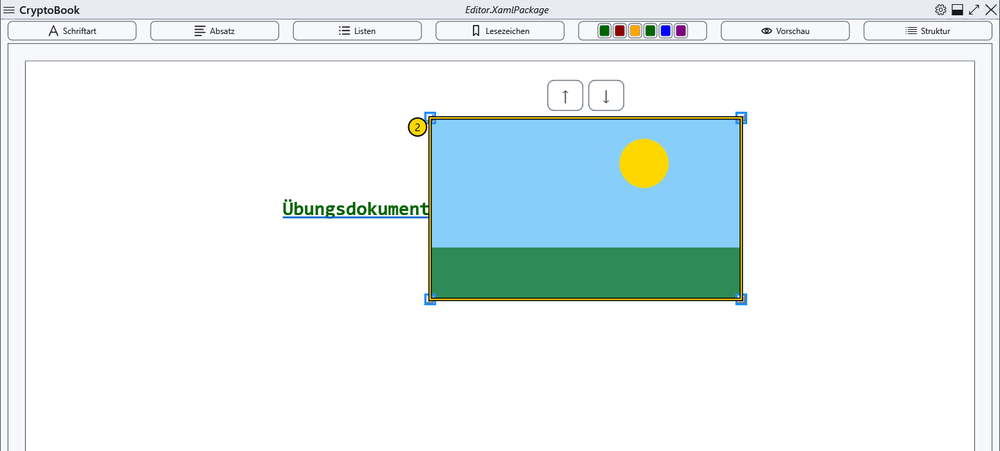
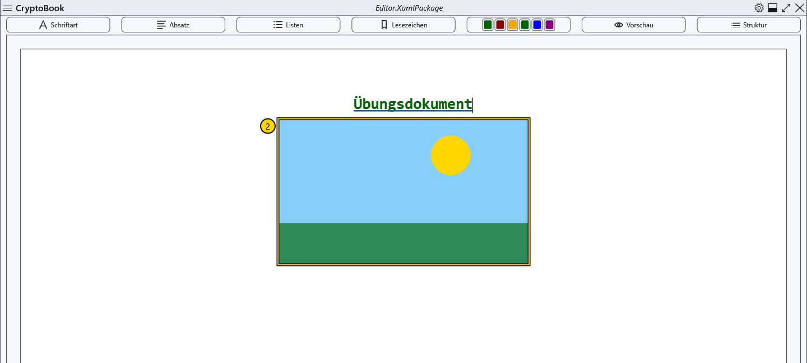
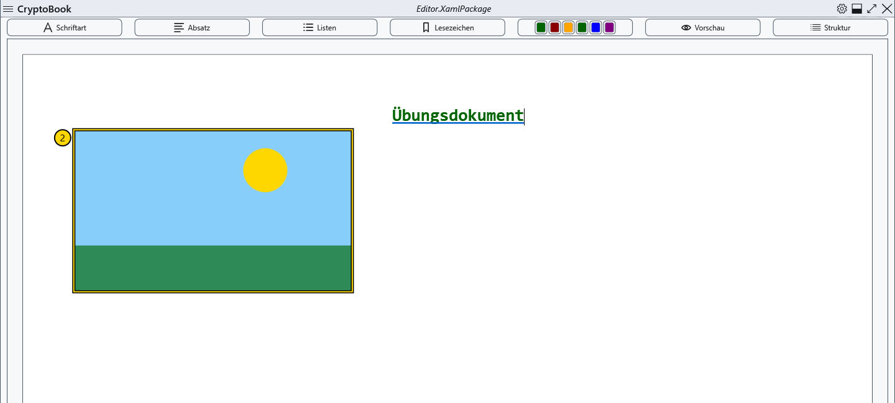
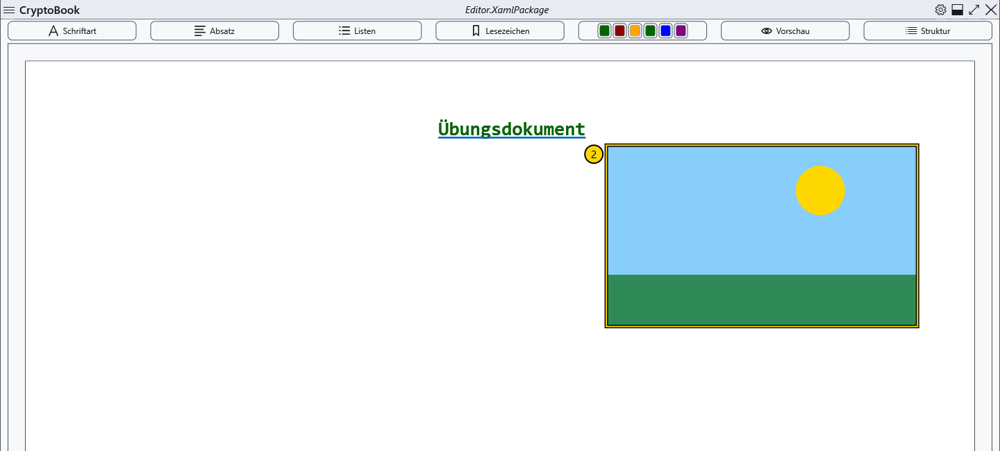

# Eingebettete Bilder

Bilder lassen sich in normale Dokumente einfügen. Arbeiten Sie zunächst mit einer Übungskopie im Bearbeitungsmodus; XamlPackage erhält die vollständige Platzierung.

## Schritte

1. Setzen Sie die Einfügemarke und öffnen Sie **Inhalt** → den Befehl zum Einfügen eines Bilds oder den entsprechenden Kontextmenüpunkt. Wählen Sie eine Datei; Abbrechen verändert das Dokument nicht.
2. Klicken Sie das Bild an, um Größenanfasser anzuzeigen. Ziehen Sie einen Anfasser und prüfen Sie Proportionen und Seitengrenzen.
3. Wählen Sie im Bildkontextmenü die Platzierung: in der Zeile, zentrierter Block, links oder rechts mit Textumfluss. Die vier Abbildungen zeigen diese Ergebnisse in dieser Reihenfolge.

## Prüfung, Rückgängigmachen und Grenzen

Ziehen ändert die Position; die Befehle nach oben/unten und Alt+Auf/Ab verschieben das ausgewählte Bild an erlaubte Nachbarpositionen. Entf entfernt die Einfügung, Esc hebt die Auswahl auf. Die ursprüngliche Bilddatei bleibt erhalten. Rückgängigmachen garantiert die Wiederherstellung des Bilds nicht. Speichern Sie vorher eine Kopie; stellt Strg+Z das Bild nicht wieder her, fügen Sie die Originaldatei erneut ein. Öffnen Sie eine gespeicherte Kopie und prüfen Sie Maße und Platzierung. Markdown verwendet stattdessen einen relativen Verweis auf ein lokales Bild.

## Verwandte Themen

- [Seitenhintergrund und Bildausschnitt](help:content.background)
- [Formate und Kodierungen](help:doc.formats)
