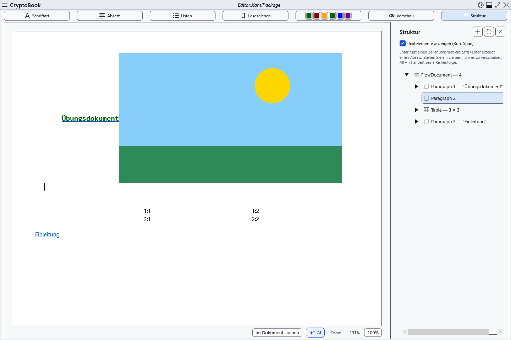

# Der Dokumentstrukturbaum

Die Strukturansicht hilft, Teile eines normalen Dokuments zu finden und neu anzuordnen. Erstellen Sie vor größeren Löschungen eine Kopie.

## Schritte

1. Klicken Sie über dem Dokument **Struktur**. Klappen Sie Knoten auf und aktivieren Sie Textelemente für Details. Aktualisieren Sie den Baum bei Bedarf nach Änderungen.
2. Wählen Sie einen Knoten zum Navigieren. Über sein Kontextmenü fügen Sie einen Absatz vor, innerhalb oder nach einem zulässigen Element ein. Die Hinzufügen-Schaltfläche und Strg+Eingabe verwenden die aktuelle Auswahl.
3. Auf/Ab-Befehle, Alt+Auf/Ab und Ziehen ändern die Reihenfolge, wenn das Ziel das Element erlaubt. Das Löschen eines Knotens entfernt dessen Dokumentinhalt.

## Prüfung, Rückgängigmachen und Grenzen

Prüfen Sie Text und Nachbarknoten. Strg+Z macht unterstützte Editoränderungen rückgängig; Schließen der Ansicht verwirft nichts. Nicht jedes Element darf gelöscht oder beliebig verschachtelt werden: Wurzel und geschützte Anker haben Einschränkungen. Die Vorschau deaktiviert Navigation und Änderungen im Baum; wechseln Sie zurück zur Bearbeitung. Speichern Sie nach größeren Umstellungen eine XamlPackage-Kopie und öffnen Sie sie erneut.

## Verwandte Themen

- [Grundlegende Textbearbeitung](help:edit.basic)
- [Vorhandene Tabellen bearbeiten](help:content.tables)
