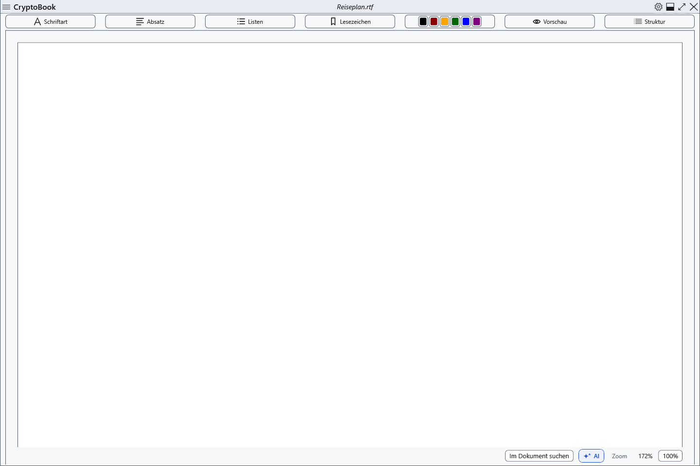
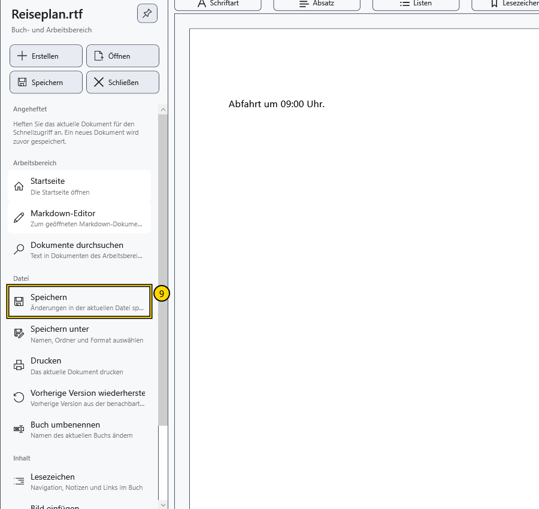
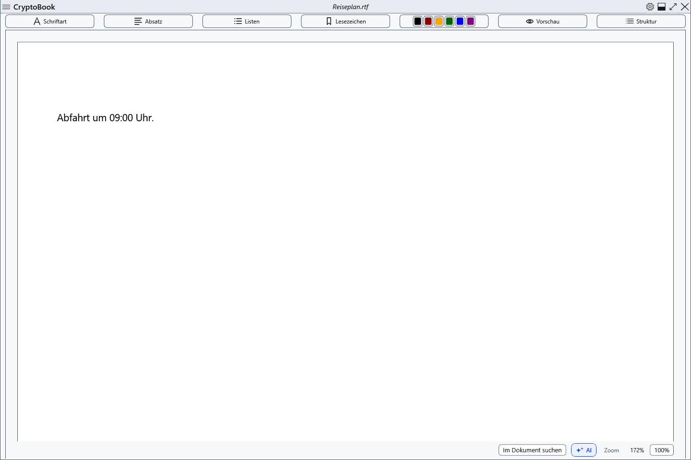

# Ein Dokument erstellen und speichern

Erstellen Sie eine leere RTF-Datei, geben Sie eine kurze Zeile ein und speichern Sie die Änderungen. RTF eignet sich für ein gewöhnliches Dokument mit Textformatierung.

## Vor dem Beginn

Verwenden Sie einen lokalen Ordner, in dem Sie Dateien erstellen können, und einen noch nicht vergebenen Dateinamen. In diesem Beispiel entsteht **Reiseplan.rtf**. Speichern Sie vorher die Änderungen an einem bereits geöffneten Dokument. Eine RTF-Datei ist nicht durch ein Passwort geschützt.

## Vorgehen

1. Wählen Sie auf dem Startbildschirm **Neues Dokument**. Wenn bereits ein Dokument geöffnet ist, verwenden Sie stattdessen die Schnellaktion **Erstellen** im Seitenmenü.
2. Wählen Sie unter **Ordner:** über **Durchsuchen...** Ihren Beispielordner aus.
3. Wählen Sie unter **Dateityp:** das **Rich-Text-Format** und prüfen Sie, ob unter **Dateierweiterung:** **.rtf** ausgewählt ist.
4. Geben Sie unter **Dateiname:** **Reiseplan.rtf** ein. Tragen Sie den Namen nach der Wahl des Dateityps ein, da ein Typwechsel den vorgeschlagenen Namen ersetzt.
5. Wählen Sie unter **Dokumentvorlage** die Vorlage **Leeres Dokument**.
6. Stellen Sie **Papierformat** auf **A4** und **Ausrichtung** auf **Hochformat**. Lassen Sie **Schreibgeschützt** und **Versteckt** für dieses Beispiel deaktiviert.

7. Wählen Sie **Erstellen**. Warten Sie, bis die neue Datei im gewöhnlichen Editor geöffnet wird, und prüfen Sie ihren Namen in der oberen Leiste.

8. Klicken Sie auf die Seite und geben Sie **Abfahrt um 09:00 Uhr.** ein.
9. Öffnen Sie das Seitenmenü und wählen Sie im Bereich **Datei** den Befehl **Speichern**. Alternativ drücken Sie **Ctrl+S**, während der Editor den Fokus hat.

## Ergebnis prüfen

Öffnen Sie dieselbe RTF-Datei erneut über die Schnellaktion **Öffnen** im Seitenmenü. Die Zeile **Abfahrt um 09:00 Uhr.** sollte weiterhin auf der Seite stehen. Prüfen Sie den tatsächlichen Dokumentnamen, falls die Anwendung wegen einer Namenskollision einen anderen freien Namen gewählt hat.

## Abbrechen und zurückkehren

Bevor Sie **Erstellen** wählen, können Sie den Dialog mit **Abbrechen** verlassen. Nach dem Erstellen löscht das Schließen des Dokuments die Datei nicht. Für einen anderen Namen oder Speicherort verwenden Sie **Datei → Speichern unter**; ein Wechsel des Dateityps kann beeinflussen, welche Formatierung erhalten bleibt.

## Wenn etwas nicht funktioniert

Wenn **Erstellen** nicht verfügbar ist, prüfen Sie die Auswahl von Ordner, Dateityp und Namen sowie die Schreibberechtigung für den Ordner. Lesen Sie eine Fehlermeldung und korrigieren Sie den Namen oder wählen Sie einen anderen Ordner. Bei **Die Datei wurde erstellt, konnte aber nicht geöffnet werden.** prüfen Sie zuerst den Ordner: Die Datei kann bereits vorhanden sein. **Speichern** kann deaktiviert sein, wenn es keine neuen Änderungen gibt oder das gewöhnliche Dokument im Lesemodus geöffnet ist.

## Verwandte Themen

- [Die wichtigsten Bereiche des Fensters](help:start.interface)
- [Speichern und Speichern unter](help:doc.save)
