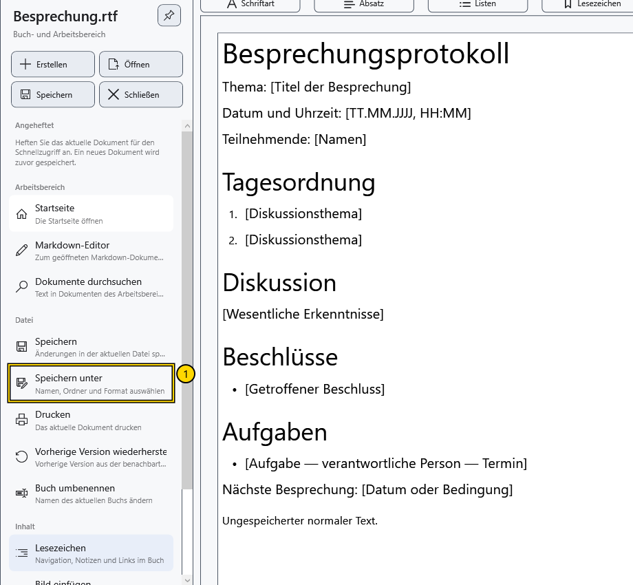

# Formate und Kodierungen

Das Format bestimmt, was nach dem Speichern und erneuten Öffnen erhalten bleibt. TXT eignet sich für Text ohne Formatierung; für formatierte Dokumente wählen Sie RTF oder XamlPackage. Prüfen Sie eine Kopie, bevor Sie eine wichtige Datei konvertieren.

## Was erhalten bleibt

| Format | Verhalten in CryptoBook |
| --- | --- |
| RTF (`.rtf`) | Formatierter Text und eingebettete Bilder. Prüfen Sie die Kompatibilität komplexer Layouts mit anderen Editoren gesondert |
| XamlPackage (`.XamlPackage`) | Formatiertes Dokument mit eingebetteten Ressourcen; geeignet für CryptoBook-Inhalte einschließlich Seitenhintergrund |
| TXT und andere normale Texttypen | Text ohne Schriftformatierung, Farben, Bilder oder Tabellenstruktur |
| XAML (`.xaml`) | Die aktuelle Anwendung öffnet und speichert es als einfachen Text; es ersetzt XamlPackage nicht |
| Markdown (`.md`, `.markdown`) | Ausgezeichneter Quelltext in einem eigenen Editor; daraus wird die Vorschau erzeugt |
| Geschütztes Dokument (`.cbook`) | CryptoBook-Container, der zum Lesen und Schreiben den passenden Schlüssel benötigt |

Beim Textexport können Wörter einer Tabelle erhalten bleiben, die Tabelle selbst und Bilder gehen jedoch verloren. Das Ändern einer Erweiterung im Dateimanager konvertiert keine Daten. Verlassen Sie sich nicht auf eine obligatorische Warnung vor Formatierungsverlust.

## Format auswählen

1. Öffnen Sie **Datei → Speichern unter**.
2. Wählen Sie Typ und passende Erweiterung. Markdown bietet sein Quellformat und eine Textdatei; ein normales Dokument lässt sich nicht rückwärts in Markdown umwandeln.
3. Speichern Sie unter einem neuen Namen. Schließen und öffnen Sie die Kopie erneut und vergleichen Sie Text, Formatierung und Bilder mit dem Original.

## Kodierungen

Die Oberfläche bietet keine gesonderte Auswahl einer beliebigen Kodierung. Normaler Textexport schreibt UTF-8 ohne BOM. RTF und XamlPackage verwenden eigene Darstellungen und sind kein einfacher UTF-8-Text.

Neues Markdown wird in UTF-8 ohne BOM erstellt. Geöffnetes Markdown behält erkanntes UTF-8, UTF-16 oder UTF-32 mit dessen BOM und vorhandenen Zeilenenden bei. Ohne BOM wird UTF-8 erwartet; ältere Einbyte-Kodierungen werden nicht automatisch erraten. Passen die Bytes nicht zur erkannten Kodierung, können Ersatzzeichen und beim nächsten Speichern ein Wechsel zu UTF-8 entstehen. Überschreiben Sie kein Original mit unlesbarem Text: Brechen Sie die Bearbeitung ab und erstellen Sie in einem externen Editor eine korrekt umkodierte Kopie.

## Ergebnis prüfen und zurückkehren

Prüfen Sie nach erneutem Öffnen kyrillische und ukrainische Buchstaben, Umlaute, Zeilenenden und wesentliche Formatierung. Ein Dialogabbruch ändert das aktuelle Format nicht. Öffnen Sie nach erfolgreichem **Speichern unter** die alte Datei, um zum Original zurückzukehren: Weitere Speichervorgänge betreffen bereits die Kopie.

PDF und Medien sind in diesem Dialog keine Speicherformate für normale Dokumente. Ihre Anzeige wird gesondert behandelt. Der Schutz einer Datei stellt durch Textexport bereits verlorene Informationen nicht wieder her.

## Verwandte Themen

- [Speichern und Speichern unter](help:doc.save)
- [Dokumentvorlagen](help:doc.templates)
- [Markdown speichern](help:md.save)
- [PDF anzeigen](help:view.pdf)
- [Kompatibilität geschützter Dateien](help:security.compatibility)
