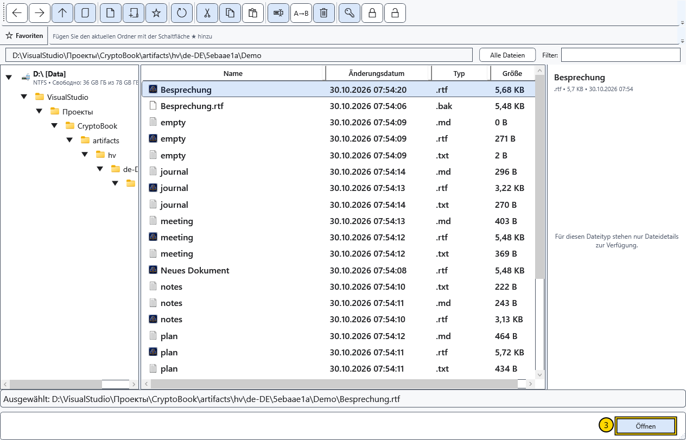

# Dokument öffnen

Öffnen Sie eine vorhandene Datei zum Lesen oder Bearbeiten. Normale Dokumente und Markdown verwenden zwei unabhängige Editoren. Eine andere Datei derselben Art ersetzt das Dokument im jeweiligen Editor.

## Vor dem Beginn

Speichern Sie Änderungen, die Sie behalten möchten. Fragt das Ersetzen nach ungespeicherten Änderungen, lässt ein Abbruch das aktuelle Dokument geöffnet. Eine geschützte Datei benötigt den passenden Schlüssel. Andere Dateitypen werden an ihre jeweiligen Betrachter weitergeleitet.

## Vorgehen

1. Wählen Sie **Datei öffnen** auf dem Startbildschirm oder **Öffnen** in den Schnellaktionen des Seitenmenüs.
2. Wechseln Sie im Dateimanager zum Ordner der Datei. Die Adressleiste gehört zu diesem Fenster und kann vom Arbeitsverzeichnis abweichen.

3. Markieren Sie eine Datei und wählen Sie **Öffnen** oder doppelklicken Sie darauf. Bei einem Ordner zeigt dieselbe Aktion dessen Inhalt an.
4. Wählen Sie bei einer Frage zu ungespeicherten Änderungen Speichern, Fortfahren ohne Speichern oder Abbrechen. Schlägt das Speichern fehl, lassen Sie das ursprüngliche Dokument geöffnet und beheben Sie zuerst die Ursache oder speichern Sie eine Kopie.

## Wo Dateien geöffnet werden

| Inhalt | Ergebnis |
| --- | --- |
| RTF, XamlPackage und normale Textdateien | Normaler Editor auf der **Startseite** |
| Markdown | **Markdown-Editor** mit Quelltext und Vorschau |
| Unterstützte Bilder und Videos | Entsprechender Betrachter oder Mediaplayer |
| PDF | Das in Windows zugewiesene externe Programm |
| Geschützte CryptoBook-Datei | Öffnen nach Formatprüfung mit passendem Schlüssel |

Eine Erweiterung konvertiert den Dateiinhalt nicht. Benennen Sie keine beliebige Datei in `.rtf` oder `.cbook` um, um sie umzuwandeln. Ein Doppelklick im Windows-Explorer hängt von den eingerichteten Dateizuordnungen ab.

## Ergebnis prüfen und zurückkehren

Prüfen Sie den Namen oben im Fenster und einige Textzeilen. Zum anderen Editor wechseln Sie über **Arbeitsbereich → Startseite / Markdown-Editor**. Das Schließen des Dateimanagers schließt ein bereits im Hauptfenster geöffnetes Dokument nicht.

In einer Ordner- oder Dateiauswahl liefert die Bestätigung die Auswahl an die aufrufende Aktion; das unterscheidet sich vom normalen Dateimanager. **Abbrechen** beendet die Auswahl. Lässt sich eine Datei nicht öffnen, prüfen Sie Laufwerksverbindung, Lesezugriff, tatsächliches Format und einen gegebenenfalls erforderlichen Schlüssel. Eine Fehlermeldung bestätigt kein erfolgreiches Öffnen.

## Verwandte Themen

- [Formate und Kodierungen](help:doc.formats)
- [Zwei Editoren, Umbenennen und Schließen](help:doc.switch)
- [Speichern und Speichern unter](help:doc.save)
- [Kompatibilität geschützter Dateien](help:security.compatibility)
