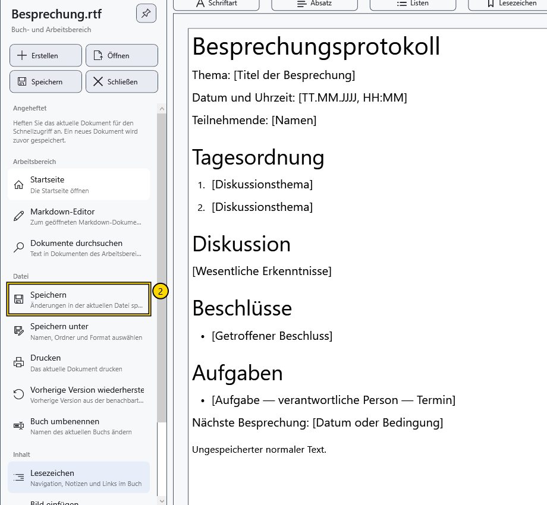

# Speichern und Speichern unter

**Speichern** schreibt Änderungen des aktiven Dokuments an dessen aktuellen Pfad. **Speichern unter** wählt einen anderen Namen, Ordner oder ein anderes Format und macht nach erfolgreichem Schreiben den neuen Pfad zum aktuellen.

## Vor dem Beginn

Prüfen Sie den Namen oben im Fenster und den aktiven Editor. Das normale Dokument und Markdown werden unabhängig gespeichert.

> Bewahren Sie das benötigte Original separat auf, bevor Sie eine vorhandene Datei ersetzen oder zu einem Textformat wechseln. Textexport verliert Formatierung; eine gesonderte Warnung erscheint nicht in jedem Fall.

## Aktuelle Datei speichern

1. Bearbeiten Sie das Dokument.
2. Öffnen Sie das Seitenmenü und wählen Sie **Speichern** in den Schnellaktionen oder **Datei → Speichern**. Im Editor können Sie auch **Ctrl+S** verwenden.
3. Warten Sie das Ende des Schreibens ab. Für ein Dokument ohne Pfad muss zunächst ein Ziel gewählt werden.

Ohne neue Änderungen kann der Befehl deaktiviert sein. Wechseln Sie bei einem normalen Dokument im Lesemodus zuerst zur Bearbeitung.

## Anderen Speicherort oder anderes Format wählen

1. Wählen Sie **Datei → Speichern unter** oder verwenden Sie im Editor **Ctrl+Shift+S**.

2. Wählen Sie im Systemdialog Ordner, Namen und Dateityp. Prüfen Sie die Erweiterung: Auch sie beeinflusst das gewählte Format. Die Bestätigung des Überschreibens ersetzt eine vorhandene Datei. Die Beschriftung des Systemdialogs hängt von der Windows-Sprache ab.
3. Bestätigen Sie das Schreiben und prüfen Sie den neuen Namen oben. Weiteres **Speichern** verwendet den neuen Pfad; die alte Datei erhält spätere Änderungen nicht.

Ein normales formatiertes Dokument kann nicht direkt nach Markdown exportiert werden. Bei Markdown können Sie den Quelltext oder eine Textkopie speichern; die angezeigte Vorschau ersetzt beim Speichern nicht den Quelltext.

## Ungespeicherte Änderungen

Beim Schließen eines bearbeiteten Dokuments oder Ersetzen durch eine andere Datei stehen drei Entscheidungen zur Wahl. Eine Zustimmung speichert und setzt die Aktion fort. Eine Ablehnung fährt ohne Schreiben der letzten Änderungen fort. Abbrechen lässt das Dokument geöffnet und stoppt die Aktion. Die Beschriftungen dieser Systemschaltflächen hängen von Windows ab.

Wird das Speichern abgebrochen oder schlägt es fehl, sollte das Schließen oder Ersetzen nicht abgeschlossen werden. Beim Beenden werden beide Editoren geprüft. Der Wechsel zwischen dem bereits geöffneten normalen Dokument und Markdown erfordert kein Verwerfen ihrer Änderungen.

## Ergebnis prüfen

Schließen Sie die gespeicherte Beispieldatei und öffnen Sie sie erneut. Prüfen Sie die letzten Zeilen und die benötigte Formatierung. Eine Datei mit der richtigen Erweiterung beweist nicht, dass der letzte Speichervorgang abgeschlossen wurde.

## Abbruch und Fehler

**Abbrechen** in der Zielauswahl behält den bisherigen Pfad und ungespeicherten Text bei. Lassen Sie den Editor nach einem Schreibfehler geöffnet. Geben Sie die Datei in einem anderen Programm frei, prüfen Sie Speicherplatz und Ordnerzugriff und wiederholen Sie **Speichern**, oder wählen Sie mit **Speichern unter** ein anderes Ziel.

Geschütztes Speichern benötigt einen Schlüssel und eine gesonderte Bestätigung. Ein vorhandener Schlüssel kann auch das Angebot auslösen, eine geschützte Kopie einer normalen Datei zu erstellen: Lesen Sie die gewählte Aktion und den resultierenden Pfad. Nicht jede gespeicherte RTF- oder TXT-Datei ist verschlüsselt.

## Verwandte Themen

- [Formate und Kodierungen](help:doc.formats)
- [Zwei Editoren, Umbenennen und Schließen](help:doc.switch)
- [Schreibfehler und Wiederherstellung](help:recovery.write)
- [Dokumente schützen](help:security.protect)
