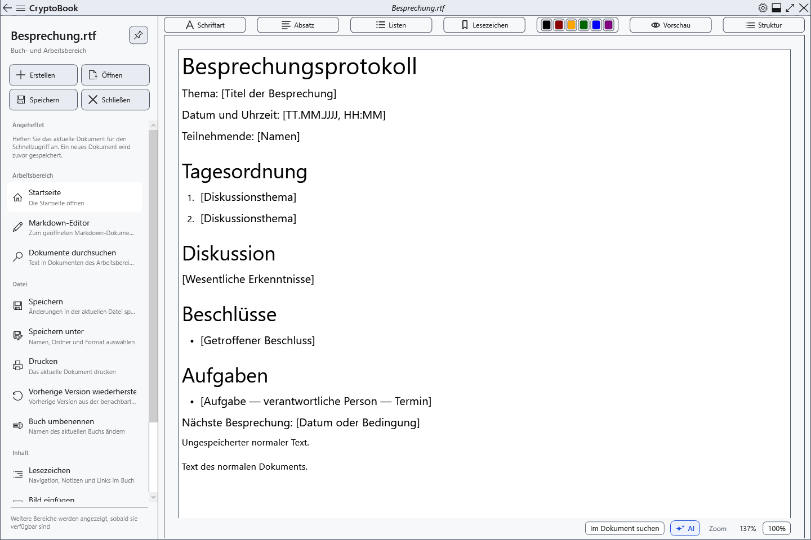
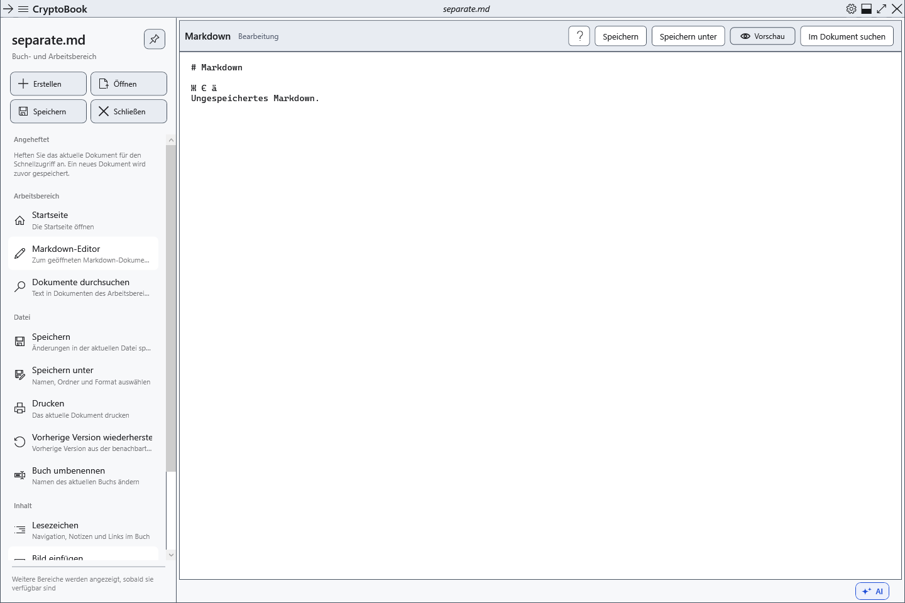
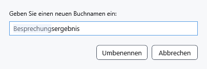

# Zwei Editoren, Umbenennen und Schließen

CryptoBook hält ein normales Dokument und Markdown unabhängig vor. Lassen Sie beispielsweise RTF-Notizen auf der **Startseite**, öffnen Sie einen Markdown-Plan und kehren Sie mit den ungespeicherten Änderungen zu den Notizen zurück. Es handelt sich um zwei Editoren, nicht um beliebig viele Registerkarten.

## Zwischen Dokumenten wechseln

1. Öffnen Sie ein normales Dokument und anschließend über **Öffnen** eine Markdown-Datei.
2. Öffnen Sie **Arbeitsbereich** im Seitenmenü und wählen Sie **Startseite** oder **Markdown-Editor**. Der Markdown-Befehl ist verfügbar, wenn bereits ein Markdown-Dokument geöffnet ist.

3. Prüfen Sie vor **Speichern** den Namen oben. Das Speichern eines Editors speichert den anderen nicht.

Die Pfeile zurück und vorwärts oben wechseln zwischen bereits geöffneten Anwendungsseiten. Sie machen keine Änderungen rückgängig und stellen nach dem Ersetzen durch eine andere Datei derselben Art die vorherige Datei nicht wieder her. Bei diesem Ersetzen werden ungespeicherte Änderungen gesondert geprüft.

## Buch umbenennen

1. Wählen Sie den gewünschten Editor und öffnen Sie **Datei → Buch umbenennen**.
2. Geben Sie den neuen Namen ein und bestätigen Sie mit **Umbenennen**. Die Erweiterung bleibt erhalten; das Format lässt sich mit diesem Befehl nicht ändern.

Bei einer Datei auf dem Datenträger ändert sich ihr Name im selben Ordner. Bei einem Dokument ohne Pfad ändert sich der Sitzungsname; eine Datei entsteht erst beim Speichern. Umbenennen ersetzt nicht das Speichern der letzten Änderungen. **Abbrechen** behält den Namen bei. Ist der Name belegt oder ungültig oder die Datei gesperrt, beheben Sie die Ursache und prüfen Sie nach einer Fehlermeldung den tatsächlichen Namen.

## Dokument oder Anwendung schließen

Die Schnellaktion **Schließen** betrifft das aktive Dokument. Wählen Sie bei ungespeicherten Änderungen Speichern, Fortfahren ohne Schreiben oder Abbrechen. Abbrechen lässt das Dokument geöffnet; das Ablehnen des Speicherns verliert dessen letzte Änderungen. Das erfolgreiche Schließen eines Editors schließt das unabhängige zweite Dokument nicht.

Die Schaltfläche zum Schließen des Hauptfensters beendet die Anwendung und prüft Änderungen beider Editoren. Ein Speicherfehler oder Abbruch unterbricht das Schließen. Das Schließen eines Dokuments löscht dessen Datei nicht. Öffnen Sie die gespeicherte Datei erneut, um zurückzukehren; verworfene ungespeicherte Änderungen werden dadurch nicht wiederhergestellt.

## Ergebnis prüfen

Tragen Sie unterschiedliche Zeilen in entbehrliche RTF- und Markdown-Dateien ein, wechseln Sie in beide Richtungen und prüfen Sie, dass sich die Texte nicht vermischen. Speichern Sie beide einzeln und öffnen Sie sie erneut. Wird eine unerwartete Datei angezeigt, prüfen Sie zuerst aktive Seite und Namen, bevor Sie speichern oder umbenennen.

## Verwandte Themen

- [Dokument öffnen](help:doc.open)
- [Speichern und Speichern unter](help:doc.save)
- [Angeheftete Dokumente](help:files.pinned)
- [Zuletzt verwendete Dokumente](help:files.recent)
