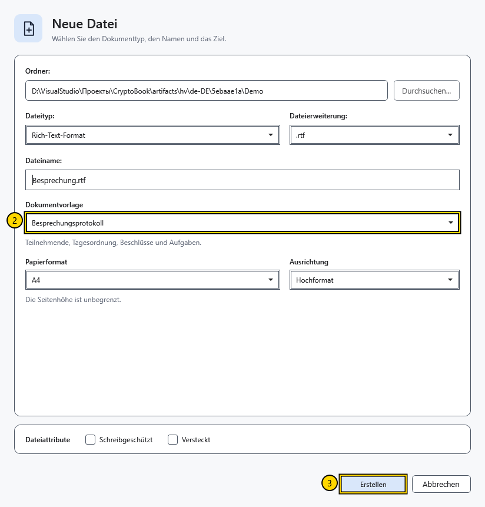

# Dokumentvorlage auswählen

Eine Vorlage füllt eine neue Datei mit einem Ausgangstext. **Besprechungsprotokoll** liefert beispielsweise eine Gliederung für Tagesordnung und Beschlüsse. Der Dateityp bestimmt die Speicherung, die Dokumentvorlage den anfänglichen Text.

## Vorgehen

1. Wählen Sie **Neues Dokument** auf dem Startbildschirm oder **Erstellen** im Seitenmenü. Wählen Sie Ordner, Dateityp und Namen.
2. Wählen Sie unter **Dokumentvorlage** eine Vorlage. Lesen Sie die Beschreibung unter der Liste.

3. Passen Sie bei Bedarf Papierformat und Ausrichtung an und wählen Sie **Erstellen**. Bei Markdown sind die Papiereinstellungen ausgeblendet.

| Vorlage | Verwendungszweck |
| --- | --- |
| Leeres Dokument | Ohne vorbereiteten Text beginnen |
| Notizen | Kurze Einträge sammeln |
| Projektplan | Arbeit in Abschnitte gliedern |
| Besprechungsprotokoll | Diskussion, Beschlüsse und Aufgaben festhalten |
| Tagebuch | Einen persönlichen Eintrag schreiben |
| Bericht | Ein strukturiertes Ergebnis vorbereiten |

RTF und XamlPackage wandeln die Vorlage in ein formatiertes Dokument um. In einer Textdatei geht die Formatierung verloren. Markdown behält den Quelltext mit Auszeichnungen. Neue Inhalte verwenden die Anwendungssprache zum Zeitpunkt der Erstellung; ein Sprachwechsel übersetzt bereits geschriebene Dateien nicht.

## Standardvorlage

Öffnen Sie **Einstellungen → Darstellung → Standardvorlage für neue Dokumente**. Die Auswahl gilt für den nächsten Erstellungsdialog und überschreibt weder vorhandene Dokumente noch einen bereits geöffneten Dialog. In jedem neuen Dialog können Sie eine andere Vorlage wählen.

## Ergebnis prüfen und abbrechen

Prüfen Sie nach der Erstellung Überschriften und Text in der geöffneten Datei. Schließen und öffnen Sie die Datei erneut, um die Speicherung zu prüfen. **Abbrechen** vor der Erstellung erzeugt keine Datei. Ein Abbruch nach der Erstellung löscht eine bereits geschriebene Datei nicht.

Wenn Sie Formatierung erwartet haben, prüfen Sie den Dateityp: **Textdatei** und **XAML-Datei** speichern nur Text. Eine Änderung der Standardvorlage ersetzt den Text des aktuellen Dokuments nicht.

## Verwandte Themen

- [Dokument erstellen und speichern](help:doc.create)
- [Formate und Kodierungen](help:doc.formats)
- [Darstellung einstellen](help:settings.appearance)
