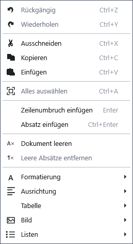

# Grundlegende Textbearbeitung

Markieren Sie einen Abschnitt, um ihn zu ersetzen, zu kopieren oder zu entfernen. Diese Befehle gelten im normalen Dokumenteditor; klicken Sie zuerst in seinen Text.

## Schritte

1. Markieren Sie mit der Maus oder Umschalt und den Pfeiltasten. Strg+A markiert das gesamte Dokument.
2. Öffnen Sie das Kontextmenü: **Kopieren** (Strg+C), **Ausschneiden** (Strg+X), **Einfügen** (Strg+V). Einfügen ersetzt die Auswahl.
3. Korrigieren Sie mit **_Rückgängig** (Strg+Z) und **_Wiederholen** (Strg+Y). Eingabe erzeugt einen Zeilenumbruch im aktuellen Absatz; Strg+Eingabe beginnt einen neuen Absatz.

## Prüfung, Rückgängigmachen und Grenzen

**Dokument _leeren** entfernt den gesamten aktuellen Inhalt: Speichern Sie vorher eine Kopie. **Leere Absätze _entfernen** entfernt leere Absätze und damit möglicherweise gewollte Abstände. Prüfen Sie den Text und machen Sie unerwünschte Änderungen rechtzeitig rückgängig. Der Verlauf ersetzt keine Dateisicherung. Bei nicht verfügbaren Befehlen prüfen Sie Auswahl, Tastaturfokus und Bearbeitungsmodus.

## Verwandte Themen

- [Schrift, Textfarbe und Hervorhebung](help:edit.font)
- [Der Dokumentstrukturbaum](help:content.structure)
