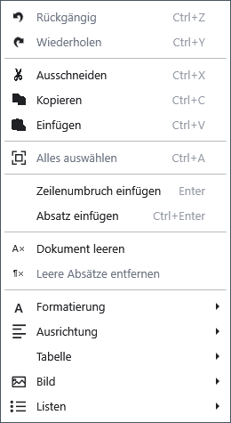

# Grundlegende Textbearbeitung

Markieren Sie einen Abschnitt, um ihn zu ersetzen, zu kopieren oder zu entfernen. Diese Befehle gelten im normalen Dokumenteditor; klicken Sie zuerst in seinen Text.

## Schritte

1. Markieren Sie mit der Maus oder Umschalt und den Pfeiltasten. Strg+A markiert das gesamte Dokument.
2. Öffnen Sie das Kontextmenü: **Kopieren** (Strg+C), **Ausschneiden** (Strg+X), **Einfügen** (Strg+V). Einfügen ersetzt die Auswahl.
3. Korrigieren Sie mit **Rückgängig** (Strg+Z) und **Wiederholen** (Strg+Y). Eingabe erzeugt einen Zeilenumbruch im aktuellen Absatz; Strg+Eingabe beginnt einen neuen Absatz.

## Textvorschläge von Windows

Während der Eingabe kann Windows Wortvorschläge über dem Cursor anzeigen. Sie können ein Wort ohne Maus auswählen:

1. Sobald Vorschläge erscheinen, drücken Sie **↑**, um zu ihnen zu wechseln.
2. Wählen Sie mit **←/→** das gewünschte Wort aus.
3. Drücken Sie die **Eingabetaste**, um den ausgewählten Vorschlag einzufügen.

**Esc** schließt die Vorschläge, ohne ein Wort einzufügen. Die Eingabetaste bestätigt ein Wort, nachdem Sie zu den Vorschlägen gewechselt sind; bei der normalen Texteingabe erzeugt sie weiterhin einen Zeilenumbruch.

Dies ist eine Windows-Funktion. Öffnen Sie zum Aktivieren **Einstellungen → Zeit und Sprache → Eingabe** unter Windows 11 oder **Einstellungen → Geräte → Eingabe** unter Windows 10. Aktivieren Sie die Textvorschläge für die physische Tastatur. Die Verfügbarkeit hängt von den Windows-Einstellungen und der Eingabesprache ab.

## Prüfung, Rückgängigmachen und Grenzen

**Dokument leeren** entfernt den gesamten aktuellen Inhalt: Speichern Sie vorher eine Kopie. **Leere Absätze entfernen** entfernt leere Absätze und damit möglicherweise gewollte Abstände. Prüfen Sie den Text und machen Sie unerwünschte Änderungen rechtzeitig rückgängig. Der Verlauf ersetzt keine Dateisicherung. Bei nicht verfügbaren Befehlen prüfen Sie Auswahl, Tastaturfokus und Bearbeitungsmodus.

## Verwandte Themen

- [Schrift, Textfarbe und Hervorhebung](help:edit.font)
- [Tastenkürzel und Fokus](help:settings.hotkeys)
- [Der Dokumentstrukturbaum](help:content.structure)
