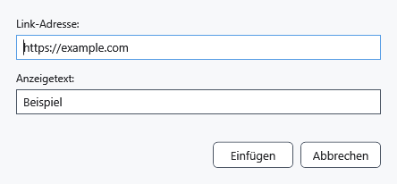

# Weblinks und sichtbarer Text

Ein Hyperlink verbindet sichtbaren Text mit einer Webadresse. Für Sprünge innerhalb des Dokuments verwenden Sie einen Lesezeichenlink.

## Schritte

1. Markieren Sie die künftige Beschriftung oder setzen Sie die Einfügemarke. Klicken Sie unter **Absatz** auf **Hyperlink einfügen**.
2. Geben Sie unter **Link-Adresse:** eine HTTP/HTTPS-Adresse ein. Fehlt das Schema, wird https:// ergänzt. **Anzeigetext:** enthält die Beschriftung; ein leeres Feld übernimmt die Adresse.
3. Klicken Sie **Einfügen**. Prüfen Sie Beschriftung und Ziel in der Vorschau; externe Links öffnen sich über die Systemanwendung.

## Prüfung, Rückgängigmachen und Grenzen

**Abbrechen** schließt ohne Einfügung, Strg+Z macht die Einfügung rückgängig. Bei ungültiger Adresse bleibt der Dialog zur Korrektur offen. Dieser Dialog akzeptiert Webadressen; Markdown hat eigene Linkregeln. Speichern Sie formatierte Dokumente als RTF/XamlPackage und prüfen Sie Links nach erneutem Öffnen. Die Grenzen beim Speichern von Lesezeichen sind separat beschrieben.

## Verwandte Themen

- [Lesezeichen, Notizen und interne Links](help:content.bookmarks)
- [Markdown-Vorschau, Links und Bilder](help:md.preview)
