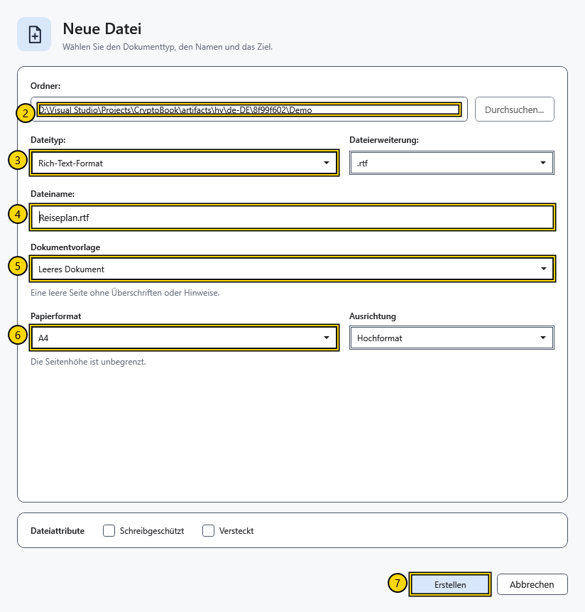

# Seiteneinstellungen und Papierfarbe

Die Papiergröße bestimmt Textbreite und Vorschauseiten. Die Papierfarbe gehört zum Dokument und unterscheidet sich vom Oberflächendesign.

## Schritte

1. Wählen Sie beim Erstellen eines normalen Dokuments Papierformat und Ausrichtung vor der Bestätigung. Für bereits geöffnete Dokumente gibt es keinen separaten Befehl zum Ändern von Format oder Ausrichtung.
2. Öffnen Sie **Schriftart**. Wählen Sie unter **Papier** die Option **Hintergrundfarbe des Dokuments** oder ein Hintergrundbild.
3. Wechseln Sie zur Vorschau und prüfen Sie die Seiten. Beim Bearbeiten ist die Seitenhöhe fortlaufend; Vorschauseiten hängen von Papiergröße und Inhalt ab.

## Prüfung, Rückgängigmachen und Grenzen

Strg+Z macht Farbänderungen rückgängig. Für ein anderes Ausgangsformat erstellen Sie ein Dokument mit passenden Einstellungen und übertragen den Inhalt, wobei Sie das Original behalten. XamlPackage erhält Papierfarbe, Hintergrund und Seiteneinstellungen. RTF erhält nicht alle Seitenparameter; TXT/XAML verlieren Formatierung. Zoom ändert die Papiermaße nicht.

## Verwandte Themen

- [Seitenhintergrund und Bildausschnitt](help:content.background)
- [Vorschau, Seiten und Zoom](help:edit.view)
- [Ein Dokument erstellen und speichern](help:doc.create)
