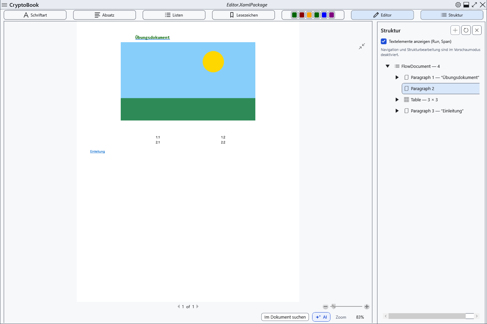

# Vorschau, Seiten und Zoom

Normale Dokumente bieten Bearbeitung und seitenweise Vorschau. In der Vorschau können Sie das Layout prüfen, während das Ausgangsdokument erhalten bleibt.

## Schritte

1. Klicken Sie über dem Dokument **Vorschau**. **Editor** führt zurück.
2. Im Editor ändert Strg+Mausrad den Zoom. **100%** unten stellt die tatsächliche Größe wieder her; die Anzeige zeigt den aktuellen Prozentsatz.
3. In der Vorschau verwenden Sie die Schaltfläche zum Einpassen und die üblichen Zoomregler. Bei Fokus im Betrachter wechseln Links/Bild auf und Rechts/Bild ab die Seite; Pos1/Ende führen zur ersten/letzten Seite.

## Prüfung, Rückgängigmachen und Grenzen

Prüfen Sie Prozentsatz und Seitennummer; ein Moduswechsel erhält den Inhalt. Die Vorschau deaktiviert Navigation und Bearbeitung im Strukturbaum: Kehren Sie für Änderungen zum Editor zurück. Einpassen wird bei Größenänderungen des Fensters neu berechnet. Bildschirmzoom ändert weder Papiergröße noch gespeicherte Schriftgröße oder Druckeinstellungen. Markdown hat eine eigene Vorschau ohne Bearbeitung des Ergebnisses.

## Verwandte Themen

- [Seiteneinstellungen und Papierfarbe](help:edit.page)
- [Dokument drucken](help:view.print)
