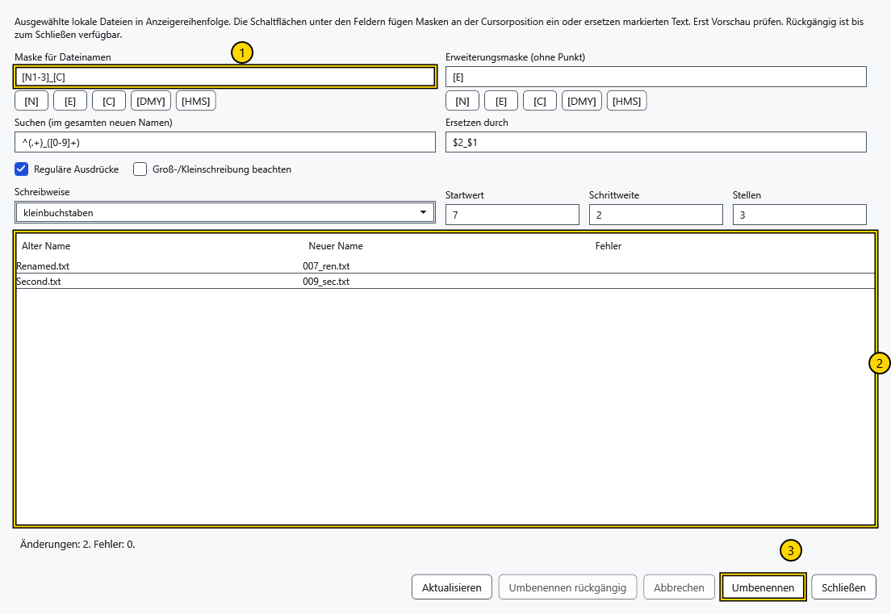
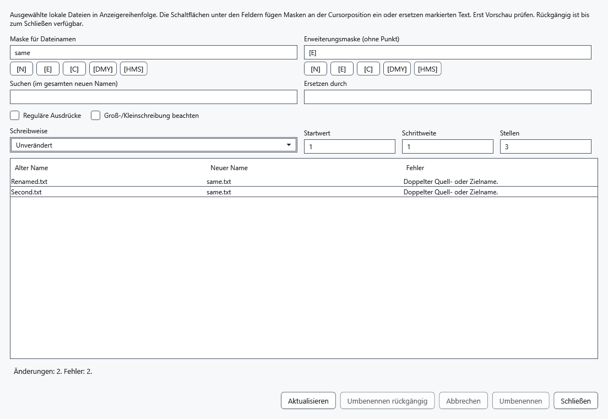
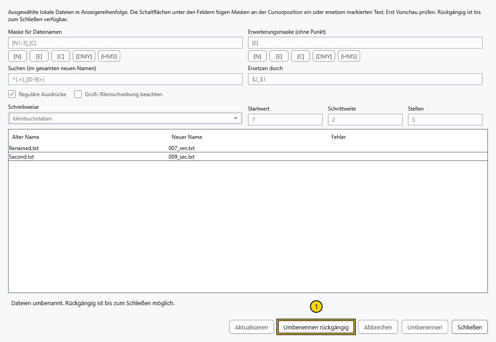

# Mehrere Dateien umbenennen

Das Werkzeug benennt mindestens zwei lokale Dateien nach einem Plan um. Ordner und Android/MTP-Objekte sind ausgeschlossen. Bewahren Sie wichtige Dateien separat auf; Abbruch und Wiederherstellung benötigen Zugriff auf die Ordner.

## Namen vorbereiten

1. Markieren Sie mindestens zwei lokale Dateien. Sortieren Sie zuerst die Liste: Der Zähler folgt der sichtbaren Reihenfolge, nicht der Auswahlreihenfolge. Drücken Sie Strg+M, klicken Sie A→B oder wählen Sie **Mehrfach-Umbenennen** im Zeilenmenü. Für eine Datei verwenden Sie normales Umbenennen.
2. Legen Sie **Maske für Dateinamen** und **Erweiterungsmaske (ohne Punkt)** fest. Die Tokenschaltflächen fügen an der Schreibmarke ein oder ersetzen markierten Text im jeweiligen Feld. Geben Sie normalen Text um die Token ein. Die Erweiterungsmaske enthält keinen führenden Punkt; eine leere Maske entfernt die Erweiterung.

Die Bereiche zeigen 1 — Namensmaske, 2 — Vorschau, 3 — Anwenden. Beide Masken unterstützen:

| Token | Ersetzung |
| --- | --- |
| [N] / [E] | Bisheriger Name ohne Erweiterung / Erweiterung ohne Punkt |
| [N1-5], [N3-], [E1-2] | Zeichen 1–5, Name ab Zeichen 3, Zeichen 1–2 der Erweiterung; Positionen beginnen bei 1 |
| [C] | Zähler aus **Startwert**, **Schrittweite** und **Stellen** |
| [DMY] / [HMS] | Lokales Datum ddMMyyyy / Uhrzeit HHmmss, einmal für die gesamte Vorschau erfasst |

Beispiel: Maske Photo_[C], Erweiterung [E], Startwert 1, Schrittweite 1 und 3 Stellen ergeben Photo_001.jpg und Photo_002.jpg für JPG-Quelldateien. Startwert muss nicht negativ, Schrittweite positiv und Stellenzahl 1–18 sein. Ein Bereich außerhalb des Quelltextes liefert eine leere Zeichenfolge.

3. Legen Sie bei Bedarf **Suchen (im gesamten neuen Namen)** und **Ersetzen durch** fest. Die Ersetzung verarbeitet den gesamten gebildeten Namen samt Erweiterung; **Schreibweise** folgt danach. **Groß-/Kleinschreibung beachten** steuert den Vergleich. **Reguläre Ausdrücke** aktiviert reguläre .NET-Ausdrücke und Ersetzungsgruppen wie $1. Ein ungültiger Ausdruck verhindert eine gültige Vorschau.
4. Vergleichen Sie **Alter Name**, **Neuer Name** und **Fehler** jeder Zeile. Doppelte Namen, belegte Ziele, ungültige und von Windows reservierte Namen blockieren die Ausführung. **Aktualisieren** prüft den Ordner neu und aktualisiert Datum/Uhrzeit der Token. Ausgeführt werden die bereits angezeigten Namen.

## Anwenden und rückgängig machen

Wählen Sie **Umbenennen** erst nach der Prüfung. Namenstausch und reine Änderungen der Großschreibung sind möglich. Dateien erhalten zunächst temporäre Namen in ihren Ordnern, dann endgültige Namen; vorhandene Ziele werden nicht überschrieben. Passende Pfade des aktiven, angehefteter und zuletzt verwendeter Dokumente folgen dem tatsächlichen Ergebnis. Eine Warnung beim Speichern von Verweisen ist getrennt vom Erfolg der Dateiumbenennung.

**Umbenennen rückgängig** stellt die Namen der letzten erfolgreichen Operation wieder her, solange dieses Fenster geöffnet bleibt. Konflikte werden erneut geprüft; eine neu belegte ursprüngliche Position kann das Rückgängigmachen blockieren. Dies ist getrennt von Strg+Z im Editor. Schließen Sie nach der Ergebniskontrolle das Fenster.

## Abbruch und Fehler

Vor dem Anwenden schließen Sie das Fenster ohne Änderungen. Während der Arbeit fordert **Abbrechen** oder Schließen den Abbruch an und wartet auf die ursprünglichen Namen. Bei externen Sperren oder belegten Namen bleiben Daten und Protokoll erhalten; der Status nennt aktuelle Pfade. Nach Beseitigung der Ursache oder einem Prozessabbruch öffnen Sie den Ordner der ersten Quelldatei im Dateimanager und wählen **Vorgänge wiederherstellen**. Das Protokoll im versteckten .cryptobook-operation-*-Ordner erlaubt erneute Wiederherstellung nach einem Neustart und überschreibt keine vorhandenen Objekte. Bewahren Sie Ordner mit unvollständiger Wiederherstellung auf.

## Verwandte Themen

- [Dateien sortieren, filtern und auswählen](help:files.views)
- [Öffnen, umbenennen und löschen](help:files.manage)
