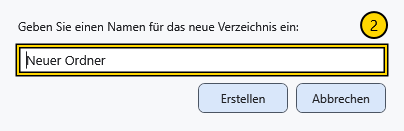

# Datei oder Ordner erstellen

Erstellen Sie Objekte in einem beschreibbaren Ordner und prüfen Sie vorher die Adresse. Der Dialog zum Erstellen einer Datei besitzt ein eigenes Ziel, das Sie gesondert kontrollieren müssen.

## Ordner erstellen

1. Wechseln Sie zum übergeordneten Ordner und wählen Sie **Ordner erstellen** auf der Leiste oder im Hintergrundmenü.
2. Geben Sie einen einzelnen Ordnernamen ein und bestätigen Sie. **Abbrechen** schließt ohne Erstellung.

Leere Namen, Pfadtrenner und ungültige Zeichen werden abgewiesen. Ein bereits vorhandener gleichnamiger Ordner führt zu einer Fehlermeldung und wird nicht ersetzt. Korrigieren Sie den Namen und versuchen Sie es erneut. Prüfen Sie, ob der neue Ordner am richtigen Ort erscheint.

## Datei erstellen

Wählen Sie **Datei erstellen**. Kontrollieren Sie im Dokumentdialog Zielordner, Typ, Namen und Vorlage, dann bestätigen Sie. Das neue Dokument öffnet sich im Editor; bei einem ungespeicherten aktuellen Dokument kann vorher eine Entscheidung nötig sein. Formate, Seitenoptionen und Attribute erklärt der Artikel zur Dokumenterstellung.

Ungültige oder reservierte Namen, Pfadtrennzeichen sowie abschließende Punkte oder Leerzeichen werden mit einer Meldung abgelehnt; es wird keine Ersatzdatei erstellt. Korrigieren Sie den Namen im geöffneten Dialog und versuchen Sie es erneut. Bei einem belegten gültigen Namen kann weiterhin ein freier Standardname gewählt werden. Prüfen Sie anschließend den tatsächlichen Namen und Pfad.

## Auswahldialoge

Derselbe Manager kann als Datei- oder Ordnerauswahl erscheinen. Die untere Aktionsschaltfläche bestätigt, **Abbrechen** kehrt ohne Auswahl zurück. Eine Ordnerauswahl bestätigt den angegebenen Ordner; **Öffnen** im normalen Manager öffnet ein Objekt. Prüfen Sie Fenstertitel, Pfad und Bestätigungsschaltfläche.

## Verwandte Themen

- [Ein Dokument erstellen und speichern](help:doc.create)
- [Namenskonflikte lösen](help:files.conflicts)
