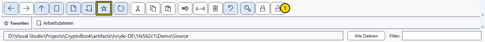

# Favoritenordner

Favoriten sind Verweise auf Ordner im Dateimanager. Sie kopieren keinen Ordner, heften kein Dokument an und legen kein Arbeitsverzeichnis für Suchvorgänge fest.

## Hinzufügen und öffnen

1. Wechseln Sie zum gewünschten Ordner und klicken Sie auf den Stern der Leiste. Der Verweis erscheint im Favoritenbereich.

Klicken Sie auf einen Verweis und prüfen Sie die Adresse. Erneutes Hinzufügen desselben Ordners erstellt keinen weiteren physischen Ordner. Der Pfad bestimmt das Ziel, nicht der Anzeigename.

## Verweis umbenennen oder entfernen

Öffnen Sie per Rechtsklick das Favoritenmenü und wählen Sie **Umbenennen**. Geben Sie einen Anzeigenamen ein und speichern Sie; **Abbrechen** verwirft die Änderung. Dies ändert nur die Beschriftung des Favoriten, weder den wirklichen Ordnernamen noch den Pfad. Die Aktion **Aus Favoriten entfernen** im Kontextmenü löscht den Verweis; Ordner und Inhalt bleiben auf dem Datenträger.

## Wenn der Ordner nicht verfügbar ist

Ein nicht verfügbarer Favorit lässt sich nicht öffnen. Stellen Sie den Zugriff wieder her und öffnen Sie den Manager erneut, um die Verfügbarkeit zu aktualisieren. Eine andere Beschriftung repariert keinen verschobenen Ordner. Wechseln Sie zum richtigen Ordner, entfernen Sie den alten Verweis und fügen Sie den aktuellen hinzu. Für regelmäßig bearbeitete Dateien verwenden Sie angeheftete Dokumente.

## Verwandte Themen

- [In Ordnern navigieren](help:files.navigate)
- [Angeheftete Dokumente](help:files.pinned)
