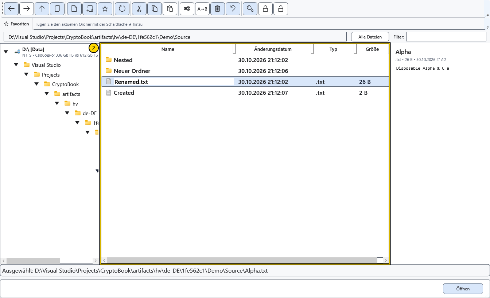

# Öffnen, umbenennen und löschen

Ein Befehl verwendet die ausgewählte Zeile. Bewahren Sie vor Änderungen wichtiger Dateien eine separate Kopie auf. Lokales Löschen fragt nach einer Bestätigung und bewahrt Objekte zur Wiederherstellung in CryptoBook auf.

## Öffnen oder Pfad kopieren

Ein Doppelklick öffnet einen Ordner. Wählen Sie für eine Datei **Öffnen**: Unterstützte Dokumente öffnen sich in CryptoBook, andere vorgesehene Aktionen können eine externe Anwendung nutzen. **Öffnen mit** ruft für eine lokale Datei die Windows-Programmauswahl auf. **Im Datei-Explorer anzeigen** zeigt ein lokales Objekt im Windows-Datei-Explorer. Diese Aktionen benötigen ein geeignetes lokales Objekt und Windows-Unterstützung.

**Pfad kopieren** kopiert ausgewählte Pfade zeilenweise in die Windows-Zwischenablage, keine Dateiinhalte. Prüfen Sie Auswahl sowie lokale oder Geräteadresse, bevor Sie den Text weiterverwenden.

## Ein Objekt umbenennen

1. Wählen Sie genau eine Datei oder einen Ordner und **Umbenennen**.
2. Bearbeiten Sie den Namen in der Zeile. Ohne neue Erweiterung bleibt die bisherige automatisch erhalten. Eine ausdrücklich eingegebene Erweiterung ersetzt die alte. Zum gezielten Entfernen verwenden Sie das Mehrfach-Umbenennen mit leerer Erweiterungsmaske.

3. Enter wendet die Änderung an. Esc fragt nach der Bestätigung zum Verwerfen der Bearbeitung; bestätigen Sie den Abbruch, um den alten Namen wiederherzustellen. Bei einem Fehler wird der bisherige Name mit einer Meldung wiederhergestellt.

Aktualisieren Sie anschließend die Liste und prüfen Sie den vollständigen Pfad. Einzelnes Umbenennen aktualisiert den passenden Pfad des aktiven Dokuments und angeheftete sowie zuletzt verwendete Verweise. Eine separate Warnung kann auf fehlgeschlagene Verweisaktualisierung hinweisen. Ordnerbäume und externe Verknüpfungen verfolgen Dokumente nicht allgemein. Für mindestens zwei lokale Dateien gibt es das Mehrfach-Umbenennen.

## Löschen

Markieren Sie die lokalen Objekte, wählen Sie **Löschen** und bestätigen Sie die Auswahl. **Abbrechen** im Bestätigungsdialog lässt die Dateien unverändert. Ein Abbruch des Vorgangs stellt den lokalen Stapel wieder her. Falls dies blockiert wird, nennt die Meldung die aufbewahrten Daten.

Öffnen Sie nach einem abgeschlossenen Löschen den ursprünglichen Ordner und wählen Sie **Dateien wiederherstellen** in der Symbolleiste. Bei einer Auswahl aus mehreren Ordnern liegt das Protokoll neben dem ersten Quellobjekt. Die Wiederherstellung funktioniert auch nach einem Neustart, bringt vollständige Dateien und Ordner zurück und überschreibt keine belegten Namen. Schließen Sie störende Programme oder geben Sie den ursprünglichen Namen frei und versuchen Sie es erneut.

Die Objekte bleiben in versteckten .cryptobook-operation-*-Ordnern neben den Originalen und belegen Speicherplatz, bis sie wiederhergestellt oder diese Ordner ausdrücklich entfernt werden. Das Entfernen im Windows-Datei-Explorer macht das Löschen endgültig. Hier werden weder Windows-Papierkorb noch Editorverlauf verwendet. Für Android und andere entfernte Quellen bleibt die separate Warnung vor dauerhaftem Löschen bestehen.

## Verwandte Themen

- [Mehrere Dateien umbenennen](help:files.batch)
- [Möglichkeiten und Grenzen der Quellen](help:devices.limits)
- [Zwei Editoren, Umbenennen und Schließen](help:doc.switch)
