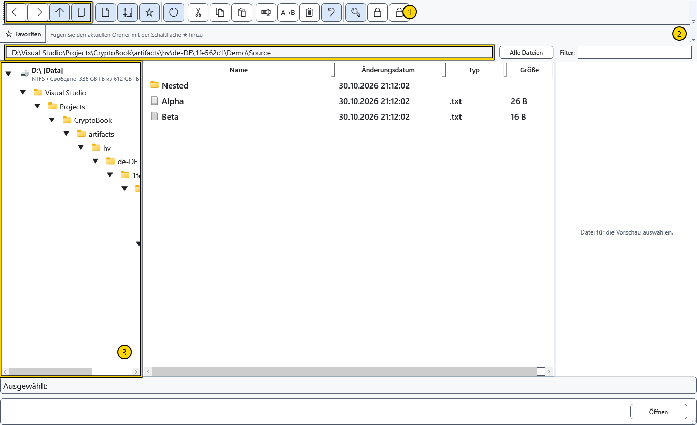
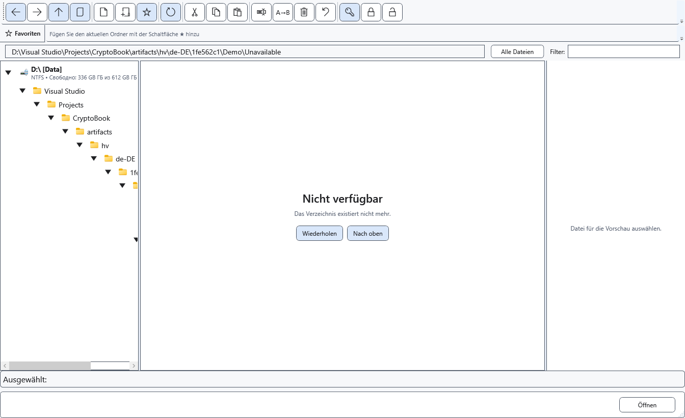

# In Ordnern navigieren

Der Dateimanager besitzt einen eigenen aktuellen Ordner und Verlauf. Das Durchsuchen ändert weder das Arbeitsverzeichnis für Suchvorgänge noch das bereits geöffnete Dokument.

## Einen Ordner wählen

1. Öffnen Sie den Dateimanager über das Dokumentmenü. Wählen Sie links im Baum ein Laufwerk und einen Ordner; der Pfeil klappt einen Zweig auf. Ein Doppelklick auf einen Ordner in der Liste öffnet ihn.
2. Alternativ geben Sie einen vollständigen lokalen Ordnerpfad in die Adresszeile ein und drücken Enter. Esc stellt die aktuelle Adresse ohne Navigation wieder her.
3. Mit den Pfeilen gelangen Sie zurück, vorwärts oder zum übergeordneten Ordner. **Aktuelles Dokument anzeigen** öffnet den Ordner des Dokuments mit gespeichertem Pfad. **Aktualisieren** liest den aktuellen Ordner erneut ein.

Die Bereiche zeigen 1 — Navigationsschaltflächen, 2 — Adresse, 3 — Ordnerbaum. Prüfen Sie die Adresse vor dem Erstellen, Einfügen oder Löschen. Der im Baum gewählte Ordner und markierte Dateien in der Liste werden von unterschiedlichen Befehlen verwendet.

## Wenn ein Ordner nicht verfügbar ist

Eine Meldung kann die Liste ersetzen. Prüfen Sie Pfad, Laufwerksverbindung und Berechtigungen. Stellen Sie den Zugriff wieder her und wählen Sie die Schaltfläche zum Wiederholen, oder wechseln Sie zum übergeordneten Ordner. Eine leere oder nicht verfügbare Ansicht beweist keine Löschung.

Schließen Sie den Manager, um zum Dokument zurückzukehren. Dadurch werden abgeschlossene Dateioperationen nicht rückgängig gemacht. Geräteadressen und ihre Möglichkeiten unterscheiden sich von lokalen Pfaden; behandeln Sie eine Geräteadresse nicht als gewöhnlichen Windows-Pfad.

## Verwandte Themen

- [Arbeitsverzeichnis auswählen](help:start.workspace)
- [Android-Geräte](help:devices.android)
- [Dateien sortieren, filtern und auswählen](help:files.views)
