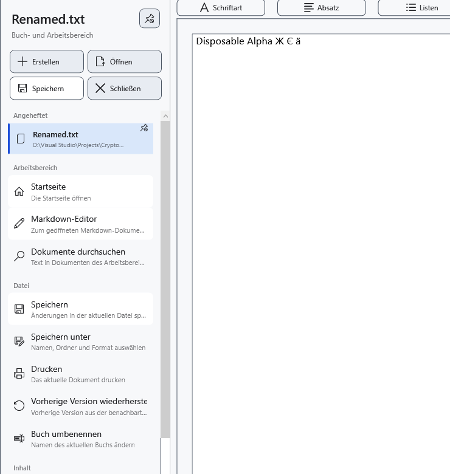

# Angeheftete Dokumente

Heften Sie ein Dokument an, um seinen Dateiverweis im Seitenmenü zu behalten. Anheften speichert keine Änderungen und erstellt keine Sicherung. Das Dokument benötigt einen brauchbaren gespeicherten Pfad.

1. Öffnen Sie das Dokument und das Seitenmenü. Wählen Sie in den Schnellaktionen **Aktuelles Dokument anheften**. Die Datei erscheint unter **Angeheftet**; dieselbe Schaltfläche wird zu **Aktuelles Dokument lösen**.

Klicken Sie zum Öffnen auf den angehefteten Eintrag. Aktives Dokument und ungespeicherte Änderungen werden getrennt von der Verfügbarkeit angezeigt. Beim Öffnen eines anderen Dokuments kann eine Entscheidung über ungespeicherte Änderungen nötig sein; ein Abbruch des Wechsels behält das aktuelle Dokument.

## Liste verwalten

Öffnen Sie das Kontextmenü eines Eintrags. **Nach oben** und **Nach unten** ändern nur die Reihenfolge. **Im Datei-Explorer anzeigen** zeigt die lokale Datei in Windows. Das Öffnen des Kontextmenüs aktualisiert die Verfügbarkeit. **Aus angehefteten Dokumenten entfernen** entfernt nur den Verweis, die Datei bleibt bestehen.

## Verschobene Datei finden

Verbinden Sie bei fehlender Datei zunächst ihr Laufwerk. Wählen Sie bei einer tatsächlich verschobenen Datei **Neuen Speicherort auswählen…** und den vorhandenen neuen Speicherort. Ein Abbruch behält den bisherigen Verweis. Dies repariert den Verweis, ohne die Datei zu verschieben. Prüfen Sie Namen und Inhalt, damit keine fremde Datei zugeordnet wird.

Einzelnes und mehrfaches Umbenennen im Manager aktualisiert passende Pfade des aktuellen, angehefteter und zuletzt verwendeter Dokumente. Prüfen Sie bei einer Warnung zur Verweisspeicherung den tatsächlichen Pfad und reparieren Sie den Verweis. Beliebige externe Verschiebungen werden nicht automatisch verfolgt.

## Verwandte Themen

- [Zuletzt verwendete Dokumente](help:files.recent)
- [Zwei Editoren, Umbenennen und Schließen](help:doc.switch)
