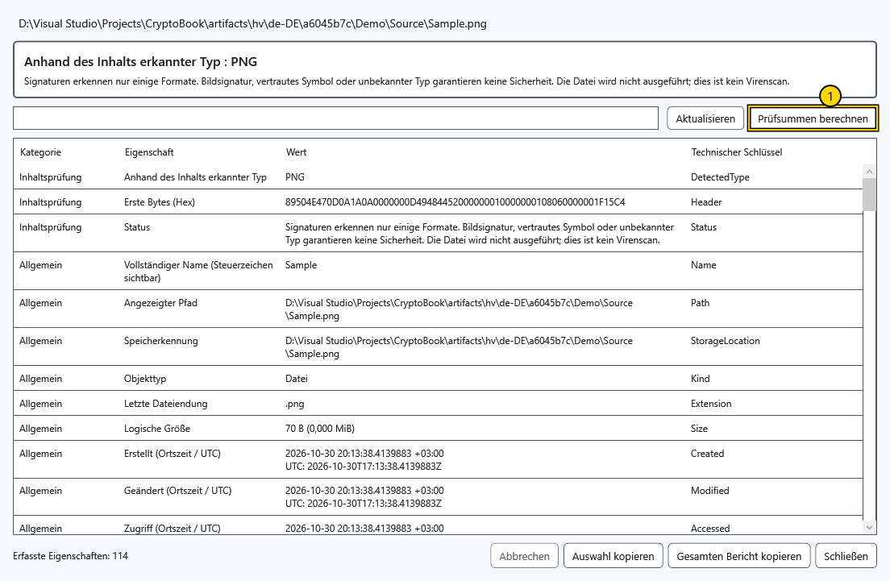
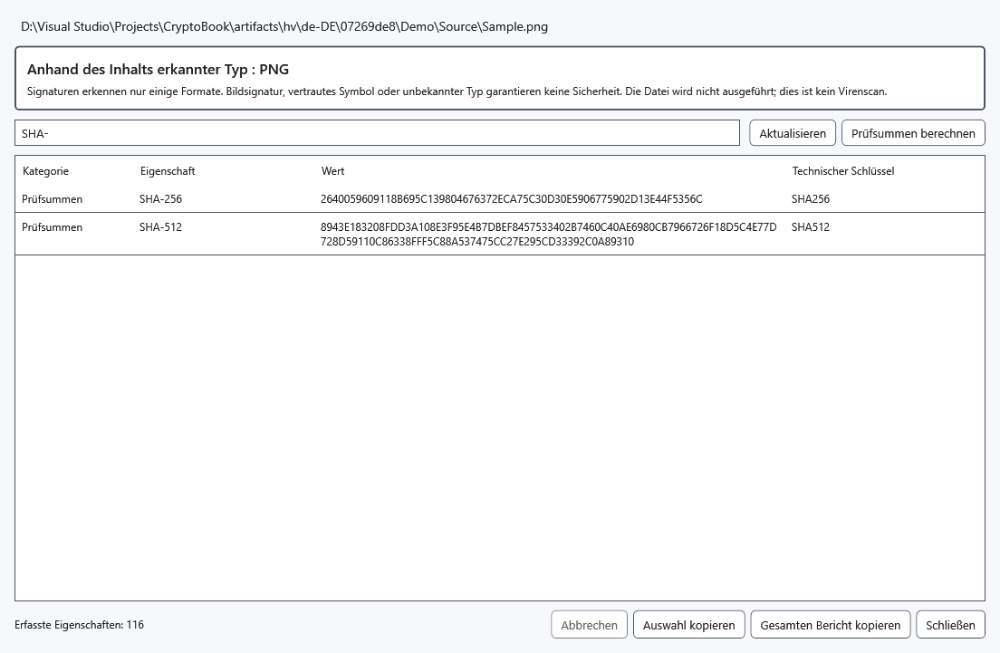

# Ausführliche Eigenschaften und Prüfsummen

Der ausführliche Bericht untersucht ein ausgewähltes Objekt, ohne es auszuführen. Er hilft beim Dateivergleich und beim Erkennen widersprüchlicher Namen und Inhalte. Ein erkanntes Format oder eine gültige Signatur garantiert keine harmlosen Inhalte.

1. Wählen Sie eine Datei und **Ausführliche Eigenschaften** im Kontextmenü oder drücken Sie Alt+Enter mit Fokus in der Dateiliste. Für Ordner gibt es den Kontextmenübefehl. **Eigenschaften** ist eine separate Windows-Eigenschaftenaktion.
2. Warten Sie das Einlesen ab. Der erkannte Typ beruht auf unterstützten Dateikopfzeilen, nicht nur der Erweiterung. Unbekannte Formate und Abschnittsfehler werden gemeldet, ohne andere verfügbare Angaben zu verwerfen.

Die markierte Schaltfläche berechnet Prüfsummen. Bei lokalen Dateien kann der Bericht Größe, lokale/UTC-Zeiten, Attribute, Verknüpfungsziel, belegten Platz, Volume-/Dateikennungen, harte Verknüpfungen, Besitzer und gespeicherte Zugriffsregeln enthalten. Diese Regeln berechnen keine effektiven Benutzerrechte. NTFS-Datenströme und begrenzter Zone.Identifier-Text, Werte des Windows Property System, Medien-/EXIF- und Dokumentdaten hängen vom Dateisystem, installierten Handlern und Zugriffsrechten ab.

Bei unterstützten ausführbaren Dateien werden Version, PE/CLR-Angaben und Signaturen gelesen, ohne die Datei als Programm zu laden. Signaturprüfungen nutzen lokal verfügbare Informationen ohne Online-Aktualisierung der Sperrlisten; Zertifikatsdaten und Vertrauensbewertung sind getrennt. ZIP/OLE-Erkennung bezeichnet einen Container, keine sicheren Inhalte. Ein verschlüsseltes .cbook wird ohne automatische Entschlüsselung als Container untersucht.

Von Windows-Eigenschaftshandlern gelieferte Bezeichnungen können der Windows-Sprache folgen; technische Schlüssel und gespeicherte Werte werden unverändert angezeigt.

## Prüfsummen und Kopieren

3. Wählen Sie **Prüfsummen berechnen** für SHA-256 und SHA-512 in einem Lesedurchlauf. Vergleichen Sie die vollständigen Werte mit einer vertrauenswürdigen Referenz genau dieser Datei. **Abbrechen** stoppt kooperativ; laufende native Windows-Aufrufe können später zurückkehren. Eine beschriebene oder während des Lesens veränderte Datei kann einen Fehler verursachen. Beenden Sie den Schreibzugriff und versuchen Sie es erneut.

Geben Sie einen Teil von Abschnitt, Eigenschaftsname, Wert oder technischem Schlüssel in das Suchfeld ein. Leeren zeigt alle Zeilen. Markieren Sie Zeilen mit Strg/Umschalt und wählen Sie **Auswahl kopieren**, oder **Gesamten Bericht kopieren** für sämtliche gesammelten Angaben trotz aktivem Filter. **Aktualisieren** liest Eigenschaften neu ein; berechnen Sie danach Prüfsummen erneut. Schließen kehrt zurück, ohne die untersuchte Datei zu verändern.

Entfernte Quellen liefern nur verfügbare Objektmetadaten. Inhaltsprüfung, Windows-/NTFS-Daten, Signaturen und Prüfsummen benötigen eine lokale Kopie. Fehlende Felder können Format-, Handler- oder Zugriffsgrenzen widerspiegeln. Der Bericht ist weder Virenscanner noch universelles Verzeichnis sämtlicher interner Felder jedes Formats.

## Verwandte Themen

- [Möglichkeiten und Grenzen der Quellen](help:devices.limits)
- [Kompatibilität geschützter Dateien](help:security.compatibility)
