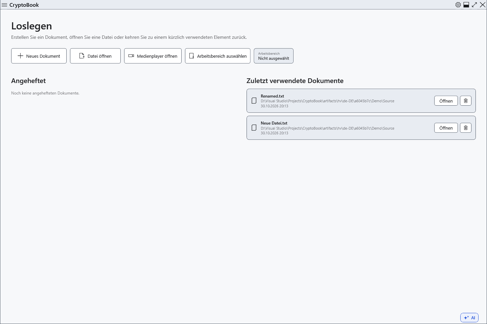

# Zuletzt verwendete Dokumente

Der Startbildschirm listet Dokumente nach erfolgreichem Öffnen oder Speichern. Dies ist ein Verlauf von Dateiverweisen, keine Sammlung gespeicherter Kopien und kein Inhaltsarchiv.

1. Schließen Sie das aktuelle Dokument nach der Entscheidung über ungespeicherte Änderungen, um zum Startbildschirm zurückzukehren. Dort steht **Zuletzt verwendete Dokumente**.

Klicken Sie zum Öffnen auf einen Eintrag. Prüfen Sie Dateinamen und übergeordneten Ordner, besonders bei gleichen Namen. Ein Verlaufseintrag garantiert weder ein verbundenes Laufwerk noch eine weiterhin vorhandene Originaldatei.

## Fehlende oder verschobene Dateien

Verbinden Sie zuerst das Laufwerk. Wählen Sie für eine verschobene Datei **Speicherort suchen…** und ihren vorhandenen neuen Speicherort. Ein Abbruch behält den bisherigen Verweis. Der neue Pfad aktualisiert den Verweis; er stellt keine gelöschten Inhalte wieder her und verschiebt keine Datei. Angeheftete und zuletzt verwendete Dokumente bilden getrennte Listen. Prüfen Sie bei manueller Reparatur beide.

**Aus Verlauf entfernen** entfernt einen nicht mehr benötigten Eintrag. Die Datei bleibt bestehen; erfolgreiches Öffnen oder Speichern kann sie erneut aufnehmen. Das Entfernen eines Eintrags löscht kein Dokument. Heften Sie ein Dokument für eine bewusst gepflegte Schnellzugriffsliste im Seitenmenü an.

Kann der Verlauf nicht aktualisiert werden, sind die geöffnete Datei und der gespeicherte Verweis getrennte Ergebnisse. Prüfen Sie den tatsächlichen Pfad und die Meldung; ein alter Eintrag allein beweist keinen Fehler beim Speichern der Datei.

## Verwandte Themen

- [Angeheftete Dokumente](help:files.pinned)
- [Dokument öffnen](help:doc.open)
