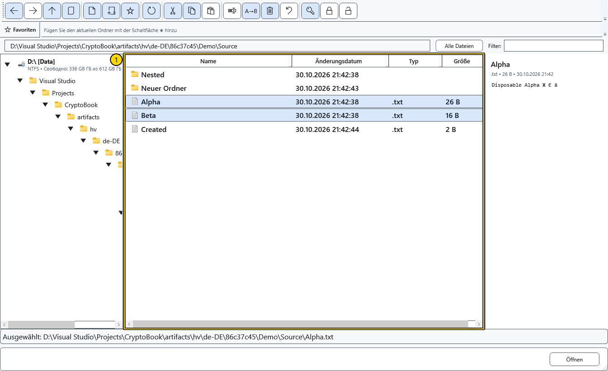
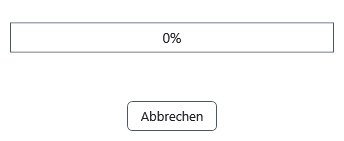

# Dateien kopieren und verschieben

Diese Schritte gelten für lokale Dateien und Ordner. Bewahren Sie vor dem Übertragen wichtiger Daten eine separate Kopie auf und prüfen Sie Quelle und Ziel. Bei Abbruch oder Fehler stellt CryptoBook den lokalen Stapel anhand seines Protokolls wieder her.

1. Markieren Sie die Quellzeilen mit Strg oder Umschalt. **Kopieren** behält die Originale, **Ausschneiden** bereitet das Verschieben vor. Diese Befehle merken eine Dateioperation innerhalb von CryptoBook; **Pfad kopieren** kopiert dagegen Text in die Windows-Zwischenablage.

2. Wechseln Sie zum Zielordner und wählen Sie **Einfügen**. Alternativ wählen Sie **Verschieben** für die Quellauswahl und bestimmen das Ziel im Ordnerdialog. Dessen Abbruch lässt die Dateien unverändert. Lösen Sie Namenskonflikte vor dem Übertragungsbeginn.
3. Warten Sie auf das Ende des Fortschrittsfensters. **Abbrechen** oder das Schließen fordert den Abbruch an. Das Fenster bleibt offen, bis die Arbeit beendet und die Ansicht aktualisiert ist.

Sie können die Auswahl auch auf einen Zielordner im Baum oder in der Liste ziehen. Mit gedrückter Strg-Taste wird kopiert, sonst verschoben. Prüfen Sie das Ziel vor dem Loslassen. Ein Ordner kann nicht in sich selbst oder einen Unterordner verschoben werden; eine Laufwerkswurzel ist kein gewöhnliches verschiebbares Objekt.

## Ergebnis prüfen

Aktualisieren Sie das Ziel und öffnen Sie eine kopierte Beispieldatei. Prüfen Sie nach dem Verschieben beide Ordner. Erfolgreiches Ausschneiden/Einfügen leert die gemerkte Verschiebeoperation. Erwarten Sie beim Verschieben keine Aktualisierung sämtlicher gespeicherter Dokumentverweise; einzelne und mehrfache Umbenennungen besitzen eigene Pfadaktualisierungen.

## Abbruch und Fehler

Abbruch oder Fehler setzt den gesamten lokalen Stapel zurück, einschließlich abgeschlossener Elemente und vorheriger Zielobjekte. Beim Verschieben zwischen Volumes wird die Kopie vor dem Entfernen der gesicherten Quelle geprüft. Blockieren belegte Namen oder externe Sperren die Wiederherstellung, bleiben Daten und Protokoll erhalten; die Meldung nennt den Protokollordner. Beseitigen Sie die Ursache, öffnen Sie diesen Ordner und wählen Sie **Vorgänge wiederherstellen**. Nach einem Prozessabbruch verwenden Sie denselben Befehl im Zielordner. Eine erfolgreich abgeschlossene Übertragung behält kein separates Rückgängigmachen. Geräteübertragungen besitzen eigene Regeln.

## Verwandte Themen

- [Namenskonflikte lösen](help:files.conflicts)
- [Geräteübertragungen](help:devices.transfers)
