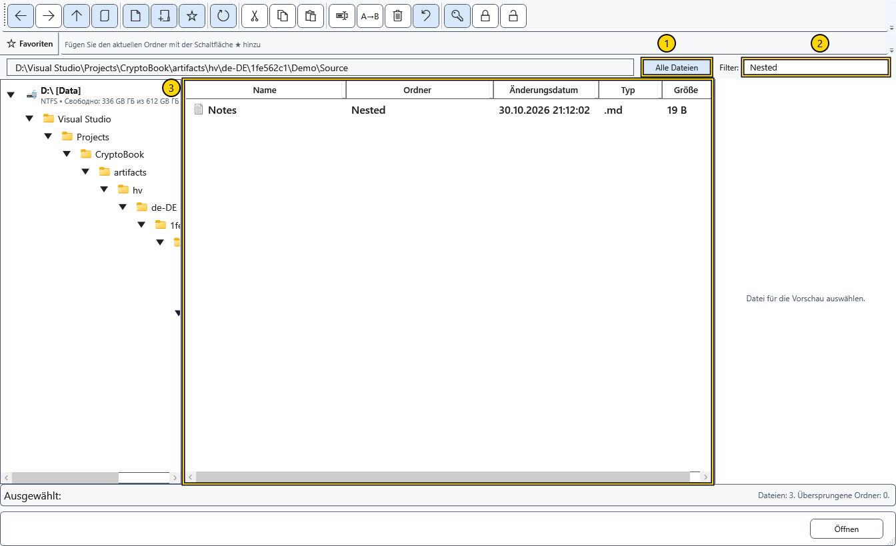

# Dateien sortieren, filtern und auswählen

Richten Sie die Liste vor einer Dateioperation ein. Ein Filter verändert nur die sichtbaren Zeilen; er verschiebt und löscht nichts.

## Ansicht anpassen

Klicken Sie zum Sortieren auf eine Spaltenüberschrift, erneut zum Umkehren der Richtung. Name, Änderungsdatum, Typ und Größe stehen bereit. Ziehen Sie eine Spaltengrenze, um die Breite zu ändern. Die senkrechten Trenner verändern die Bereiche für Baum, Liste und Vorschau.

Aktivieren Sie **Alle Dateien**, um Dateien des aktuellen Ordners samt Unterordnern aufzulisten. Die zusätzliche Ordnerspalte zeigt den relativen Speicherort; Ordner selbst erscheinen hier nicht als Zeilen. Bei der Ordnerauswahl in einem Dialog ist dieser Modus nicht verfügbar.

Die Bereiche zeigen 1 — rekursive Ansicht, 2 — Filter, 3 — Liste. Text in **Filter:** wird im Namen einschließlich Erweiterung gesucht; in der rekursiven Ansicht auch im relativen Ordner. Leeren Sie das Feld für die vollständige Ansicht. Dies ist ein Teilzeichenfolgenfilter, keine Suche im Dokumentinhalt.

## Einlesen und auswählen

Die Statuszeile zeigt den Scan, Dateizahlen und übersprungene Ordner. Die Schaltfläche zum Abbrechen beendet das Einlesen eines großen Baums; die Liste kann unvollständig bleiben. Aktualisieren Sie für einen neuen Versuch oder deaktivieren Sie **Alle Dateien**. Übersprungene oder unzugängliche Ordner beweisen keine leere Quelle.

Ein Klick wählt ein Objekt, Strg-Klick einzelne Zeilen, Umschalt-Klick einen Bereich. Prüfen Sie die Markierung vor dem Befehl: Baum-, Hintergrund- und Zeilenmenüs haben unterschiedliche Ziele. Der Zähler beim Mehrfach-Umbenennen folgt der sichtbaren Dateireihenfolge, nicht der Reihenfolge Ihrer Klicks.

## Verwandte Themen

- [In Ordnern navigieren](help:files.navigate)
- [Mehrere Dateien umbenennen](help:files.batch)
- [Dateien nach Namen suchen](help:search.name)
