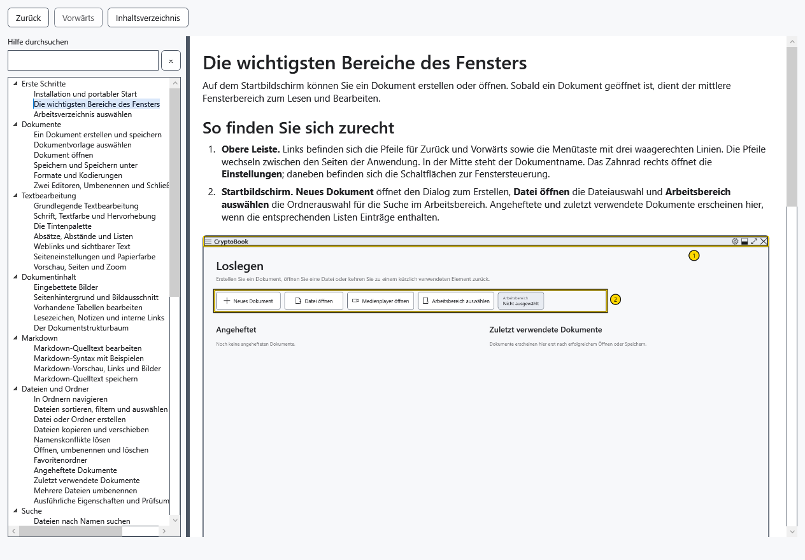
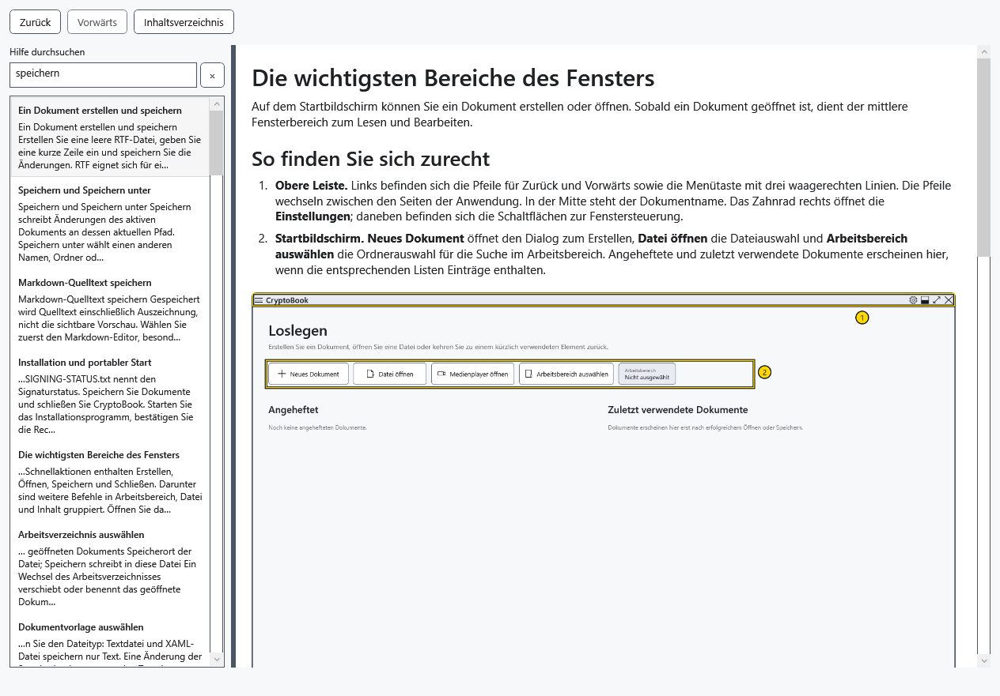
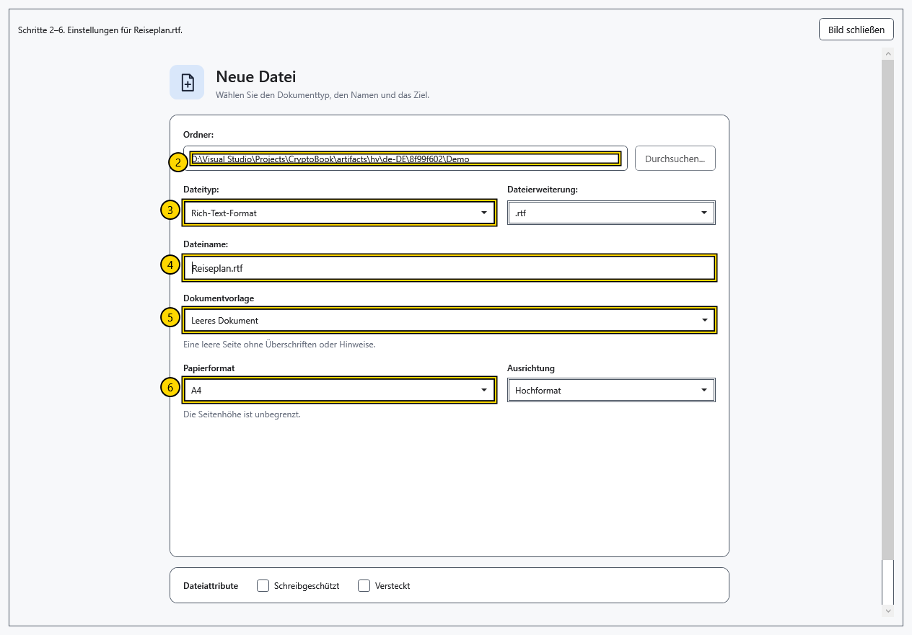

# Inhaltsverzeichnis, Suche und Hilfebilder

Die integrierte Hilfe funktioniert ohne Netzwerk und ohne geöffnetes Dokument. Sie öffnet ein eigenes nicht modales Fenster; Sie können weiterarbeiten und den Artikel geöffnet lassen.

## Thema öffnen

1. Wählen Sie **Hilfe** im Seitenmenü des Hauptfensters oder drücken Sie dort **F1**. Ein erneuter Aufruf aktiviert das vorhandene Fenster, auch ein minimiertes.
2. Klappen Sie links einen Abschnitt auf und wählen Sie einen Artikel. Der Trenner ändert die Breite von Inhalt und Text; der Artikel lässt sich scrollen.

## Suchen und zurückkehren

3. Geben Sie Wörter in **Hilfe durchsuchen** ein oder drücken Sie Ctrl+F. Die Suche berücksichtigt Titel, Stichwörter und Artikeltexte der aktuellen Sprache, verlangt alle Wörter und durchsucht keine Benutzerdokumente.
4. Klicken Sie einen Treffer an oder wählen Sie ihn und drücken Enter. Ohne Treffer kürzen Sie die Anfrage oder versuchen ein anderes Wort.

5. **Inhaltsverzeichnis** und **×** leeren die Anfrage und stellen den Baum wieder her; sie öffnen nicht den ersten Artikel. **Zurück / Vorwärts** oder Alt+←/→ wechseln durch den Themenverlauf und stellen Lesepositionen wieder her. Ein neuer Navigationszweig ersetzt den bisherigen Vorwärtsverlauf.

## Bild vergrößern

6. Klicken Sie auf ein Bild oder wechseln Sie mit Tab zu seiner Schaltfläche und drücken Enter. Große Bilder lassen sich scrollen.

7. Wählen Sie **Bild schließen** oder drücken Esc. Im Suchfeld leert Esc zuerst die Anfrage und verschiebt bei leerer Anfrage den Fokus zum Artikel. Schließen Sie das Fenster mit seinem Schließen-Symbol oder Alt+F4.

Letztes Thema und Fenstergröße werden gespeichert; der Verlauf besteht nur bis zum Schließen. Ein Sprachwechsel öffnet dasselbe Thema übersetzt, leert die Suche und setzt Lesepositionen zurück. Die Markdown-Hilfe des Editors öffnet das Syntaxthema in diesem selben Fenster. Fehlt ein Bild, folgen Sie den Textschritten und melden Sie die Programmversion; normalerweise ist kein separater Bilddownload nötig.

- [Bereiche des Hauptfensters](help:start.interface)
- [Anwendungssprache](help:settings.language)
- [Markdown-Editor](help:md.edit)
- [Tastenkürzel](help:settings.hotkeys)
