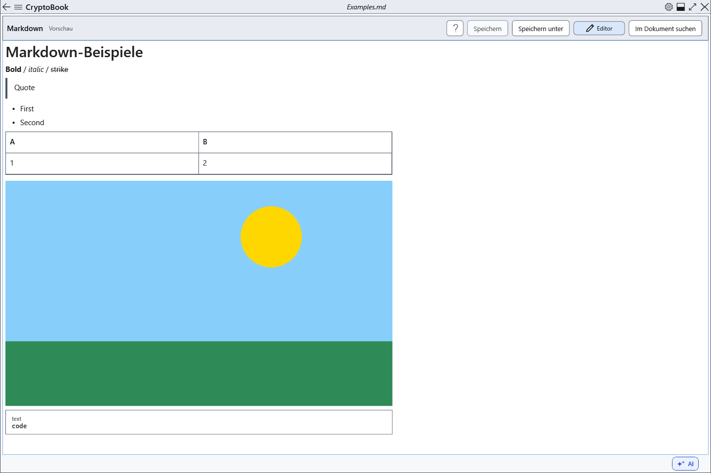

# Markdown-Vorschau, Links und Bilder

Die Vorschau zeigt eine formatierte Kopie des aktuellen Markdown. Ändern Sie den Quelltext statt des angezeigten Ergebnisses.

## Schritte

1. Klicken Sie **Vorschau**. Überschriften, Listen, Code und Tabellen entstehen aus dem Text. Öffnen Sie die Vorschau nach einer Quelltextänderung erneut.
2. HTTP/HTTPS-Weblinks und mailto können über Systemanwendungen geöffnet werden. Relative Dokumentlinks sowie file: und ftp: bleiben inaktiv.
3. Legen Sie ein Bild neben die .md-Datei oder in einen Unterordner und geben Sie `` ein. Erlaubt sind lokale relative Bildpfade bis 25 MiB Dateigröße; die Dekodierung ist auf 1600 Pixel begrenzt. Entfernte und absolute Bildpfade werden nicht geladen.

## Prüfung, Rückgängigmachen und Grenzen

HTML bleibt inaktiver Text. Erscheint statt des Bilds die Beschriftung, prüfen Sie den Pfad relativ zur Markdown-Datei, das Vorhandensein und die Größe. Verschieben Sie beide Dateien gemeinsam. **Editor** führt zum erhaltenen Quelltext zurück. Erwarten Sie von nicht unterstützten Erweiterungen keine Sonderfunktionen: Aufgaben, Fußnoten und Formeln werden nicht zu vollständigen interaktiven Elementen oder Berechnungen.

## Verwandte Themen

- [Markdown-Syntax mit Beispielen](help:md.syntax)
- [Im Dokument suchen](help:search.document)
