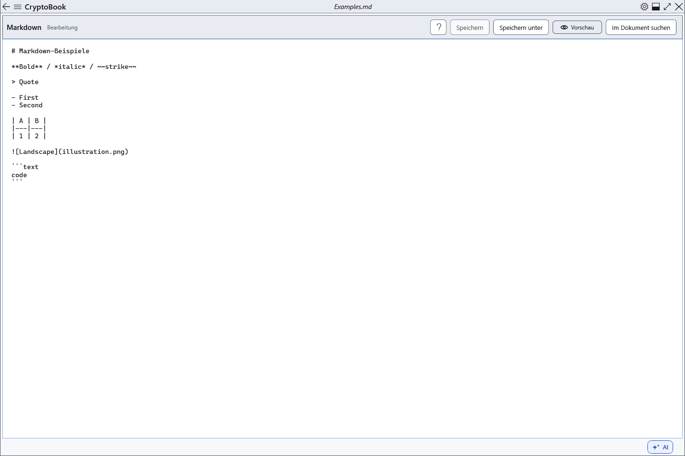

# Markdown-Quelltext speichern

Gespeichert wird Quelltext einschließlich Auszeichnung, nicht die sichtbare Vorschau. Wählen Sie zuerst den Markdown-Editor, besonders wenn auch ein normales Dokument geöffnet ist.

## Schritte

1. Klicken Sie **Speichern** oder Strg+S, um die aktuelle Datei zu schreiben.
2. **Speichern unter** oder Strg+Umschalt+S speichert anderswo. Bei abgebrochener Zielwahl bleibt der Quelltext mit Änderungen geöffnet.
3. Öffnen Sie eine Kopie und prüfen Sie Text, Auszeichnung und relative Bilder. Bilder werden nicht in .md eingebettet: Übertragen Sie sie separat mit unveränderten relativen Pfaden.

## Prüfung, Rückgängigmachen und Grenzen

Beim Öffnen werden UTF-8/16/32 mit BOM erkannt; ohne BOM wird UTF-8 erwartet. Speichern erhält die erkannte Kodierung, BOM und Quelltext-Zeilenenden. Neues Markdown nutzt UTF-8 ohne BOM; eine freie Kodierungsauswahl gibt es nicht. Geschütztes Markdown speichert ebenfalls Quelltext; die Schutzbedingungen sind separat beschrieben. Der Rückexport normaler formatierter Dokumente nach Markdown wird nicht unterstützt. Bei Schreibfehlern speichern Sie anderswo und lassen den ungespeicherten Text geöffnet.

## Verwandte Themen

- [Speichern und Speichern unter](help:doc.save)
- [Formate und Kodierungen](help:doc.formats)
- [Kompatibilität geschützter Formate](help:security.compatibility)
