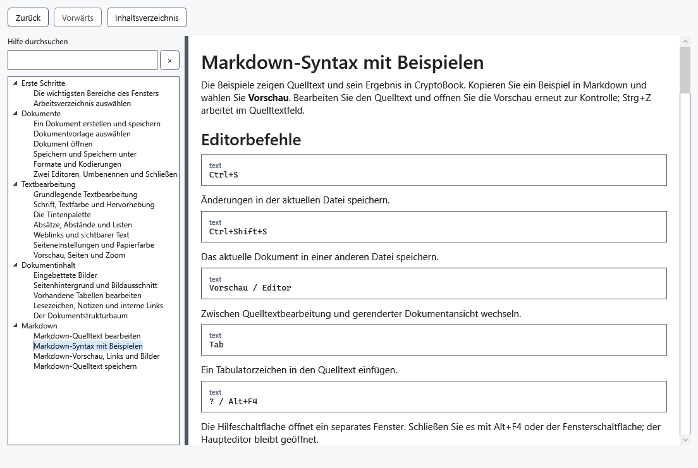

# Markdown-Syntax mit Beispielen

Die Beispiele zeigen Quelltext und sein Ergebnis in CryptoBook. Kopieren Sie ein Beispiel in Markdown und wählen Sie **Vorschau**. Bearbeiten Sie den Quelltext und öffnen Sie die Vorschau erneut zur Kontrolle; Strg+Z arbeitet im Quelltextfeld.

## Editorbefehle

````text
Ctrl+S
````

Änderungen in der aktuellen Datei speichern.

````text
Ctrl+Shift+S
````

Das aktuelle Dokument in einer anderen Datei speichern.

````text
Vorschau / Editor
````

Zwischen Quelltextbearbeitung und gerenderter Dokumentansicht wechseln.

````text
Tab
````

Ein Tabulatorzeichen in den Quelltext einfügen.

````text
? / Alt+F4
````

Die Hilfeschaltfläche öffnet ein separates Fenster. Schließen Sie es mit Alt+F4 oder der Fensterschaltfläche; der Haupteditor bleibt geöffnet.

## Überschriften und Trennlinien

````text
# H1
## H2
…
###### H6
````

ATX-Überschriften der Ebenen 1–6. Am Ende kann optional dieselbe Anzahl #-Zeichen stehen.

````text
Heading 1
=========
````

Eine Setext-Überschrift der ersten Ebene.

````text
Heading 2
---------
````

Eine Setext-Überschrift der zweiten Ebene.

````text
---
***
___
````

Eine horizontale Trennlinie aus mindestens drei -, * oder _.

## Listen und Zitate

````text
> quote
>> nested
````

Ein Zitatblock. Zusätzliche >-Zeichen erzeugen verschachtelte Zitate.

````text
- item
+ item
* item
````

Eine Aufzählungsliste; -, + und * sind als Marker zulässig.

````text
1. item
2) item
````

Eine nummerierte Liste mit . oder ) nach der Zahl. Die erste Zahl bestimmt den Startwert.

````text
- parent
    - child
````

Ein eingerückter Eintrag erzeugt eine verschachtelte Liste. Einträge können Absätze, Zitate, Code und weitere Listen enthalten.

## Formatierung innerhalb einer Zeile

````text
*italic*
_italic_
````

Kursiver Text.

````text
**bold**
__bold__
````

Fett formatierter Text.

````text
***bold italic***
````

Fett-kursiver Text. Drei Unterstriche können statt Sternchen verwendet werden.

````text
~~strike~~
````

Durchgestrichener Text.

````text
`code`
``code with ` inside``
````

Ein Codefragment in Festbreitenschrift. Enthält es einen Backtick, verwenden Sie einen längeren Begrenzer.

````text
\*literal asterisks\*
````

Ein umgekehrter Schrägstrich zeigt Markdown-Satzzeichen wörtlich an, ohne sie als Markup auszuwerten.

````text
&copy;
&#169;
````

Eine benannte oder numerische HTML-Entität, die in ihr Unicode-Zeichen umgewandelt wird.

## Absätze und Zeilenumbrüche

````text
text

text
````

Eine Leerzeile beginnt einen neuen Absatz.

````text
text
text
````

Ein normaler Zeilenumbruch im Quelltext wird als Leerzeichen im selben Absatz angezeigt.

````text
text  ⏎
text
````

Zwei Leerzeichen am Zeilenende fügen einen Umbruch ohne neuen Absatz ein.

````text
text\
text
````

Ein umgekehrter Schrägstrich am Zeilenende fügt ebenfalls einen harten Zeilenumbruch ein.

## Links und Bilder

````text
[text](https://example.com)
````

Ein anklickbarer HTTP-, HTTPS- oder E-Mail-Link.

````text
[text][ref]

[ref]: https://example.com
````

Ein Link, dessen URL separat definiert ist. Auch die Kurzformen [text][] und [ref] werden unterstützt.

````text
<https://example.com>
````

Eine Webadresse ohne eigene Beschriftung, die als anklickbarer Link angezeigt wird.

````text
<name@example.com>
````

Eine E-Mail-Adresse, die in einen anklickbaren mailto-Link umgewandelt wird.

````text
https://example.com
````

Eine einfache HTTP- oder HTTPS-Adresse wird automatisch erkannt.

````text

````

Ein Bild neben der Markdown-Datei oder in einem relativen Unterordner.

````text
![alt][image]

[image]: images/picture.png
````

Ein lokales Bild, dessen relativer Pfad in einer Referenzdefinition angegeben ist.

## Codeblöcke

````text
```csharp
code
```
````

Ein umschlossener Codeblock. Text nach dem öffnenden Zaun wird als Sprachname angezeigt; Syntaxhervorhebung wird nicht angewendet.

````text
~~~text
code
~~~
````

Ein Codeblock mit drei oder mehr Tilden statt Backticks.

````text
    indented code
````

Ein Codeblock, bei dem jede Zeile um vier Leerzeichen oder einen Tabulator eingerückt ist.

## Tabellen

````text
| A | B |
|---|---|
| 1 | 2 |
````

Eine Pipe-Tabelle. Die Trennzeile erzeugt den Kopf; äußere Pipes sind optional.

````text
+---+---+
| A | B |
+===+===+
| 1 | 2 |
+---+---+
````

Eine Gittertabelle. = kennzeichnet die Kopfgrenze; Zeilen und Spalten können verbunden werden.

## Einschränkungen der Vorschau

````text
<b>HTML</b>
````

HTML-Code wird als inaktiver Quelltext angezeigt und niemals ausgeführt.

````text
[file](file:///…)
[ftp](ftp://…)
[relative](relative.md)
````

FTP-, Datei-, relative, JavaScript- und andere Nicht-HTTP-Links werden als Text statt als aktive Links angezeigt.

````text

````

Entfernte Bilder und Bilder mit absolutem Pfad werden nicht geladen; stattdessen erscheint der Alternativtext.

````text
- [x] task
[^1] footnote
$math$
````

Alle speziell dargestellten Konstrukte sind oben aufgeführt. Andere Markdig-Erweiterungen – darunter Aufgaben-Kontrollkästchen, Fußnoten, Formeln, Diagramme, Definitionslisten, Hinweise, Container, Medien, Abkürzungen, eingefügter/markierter Text sowie Tief- und Hochstellung – haben keine entsprechende Darstellung.




## Prüfung, Rückgängigmachen und Grenzen

H1…H6 stehen für Überschriftenebenen: Ersetzen Sie die Zeile mit Auslassungspunkten durch die erforderliche Anzahl #. Das Wort code bezeichnet Blockinhalt, keinen ausführbaren Befehl. Leerzeichen und Leerzeilen beeinflussen das Ergebnis: Zwei Leerzeichen am Zeilenende oder ein Rückstrich erzeugen einen harten Umbruch. Vergleichen Sie bei fehlender Formatierung Zeichen und Einrückung. Die Vorschau führt weder Code noch HTML aus. Speichern Sie .md, um die Auszeichnung selbst zu erhalten.

Im Umbruchbeispiel kennzeichnet ⏎ das Zeilenende: Geben Sie dieses Zeichen nicht ein, sondern lassen Sie zwei Leerzeichen vor dem Umbruch.

## Verwandte Themen

- [Markdown-Vorschau, Links und Bilder](help:md.preview)
- [Vorhandene Tabellen bearbeiten](help:content.tables)
