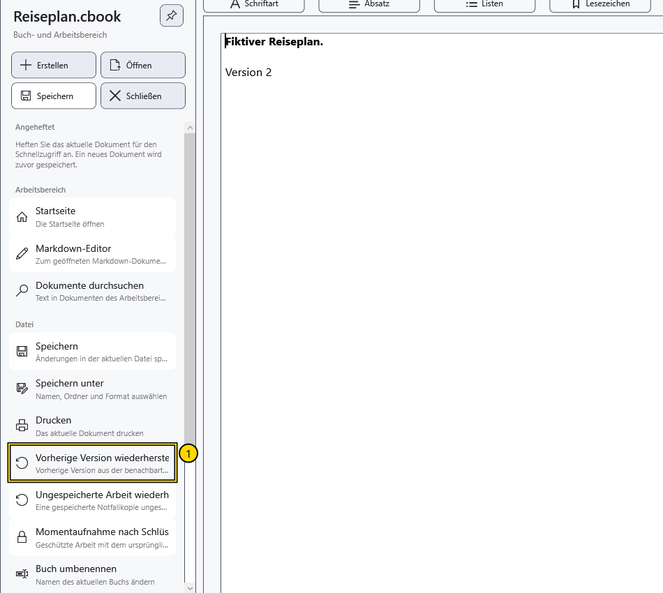
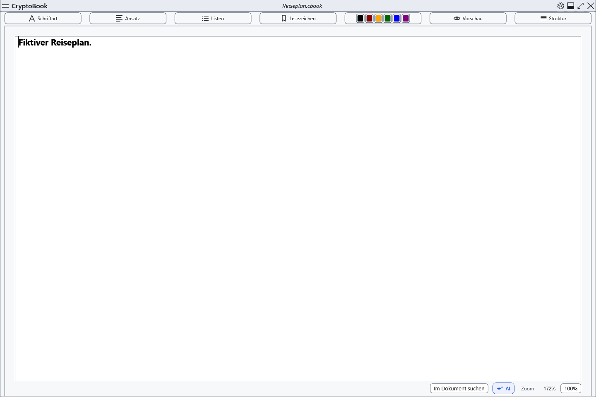

# Vorherige Version aus .bak wiederherstellen

Beim erfolgreichen Ersetzen eines vorhandenen lokalen Dokuments bleibt die vorherige Version daneben mit angehängtem .bak erhalten. Das ist eine vorherige Version, keine vollständige Änderungshistorie. Erstmaliges Speichern einer neuen Datei muss keine .bak erstellen.

## Vorgehen

1. Öffnen Sie das Originaldokument. Speichern Sie benötigte aktuelle Änderungen vorher separat: Das Laden der vorherigen Version ersetzt den Editorinhalt.
2. Öffnen Sie das Seitenmenü → **Vorherige Version wiederherstellen**. Der Befehl benötigt eine vorhandene .bak neben dem aktuellen Dokument.

3. Prüfen Sie den Pfad in der Bestätigung und stimmen Sie zu. Eine geschützte Kopie benötigt ihren passenden Schlüssel. Ablehnen lässt den aktuellen Text unverändert.
4. Prüfen Sie das wiederhergestellte Dokument. Es ist als geändert markiert; die aktuelle Datei auf dem Datenträger wurde noch nicht ersetzt. Speichern Sie ausdrücklich oder wählen Sie **Speichern unter**, um beide Versionen zu behalten.

## Grenzen und Rückkehr

Das nächste Speichern aktualisiert .bak. Gewöhnliche Sicherungen können lesbare Daten enthalten; die .bak eines geschützten Dokuments benötigt den Schlüssel. Ein Schlüsselwechsel synchronisiert eine inkompatible Sicherung mit der aktuellen geschützten Datei, sodass älterer Text nicht garantiert ist. Umbenennen in der Anwendung verschiebt die zugehörige .bak.

Prüfen Sie bei fehlendem Befehl, ob das richtige Dokument und seine .bak vorhanden sind. Notfall- und Sperrkopien sind getrennte Mechanismen. Zum Ablehnen nach der Prüfung schließen Sie ohne Speichern der wiederhergestellten Änderungen und öffnen das Original erneut. Sichern Sie benötigte aktuelle Arbeit vorher separat.

- [Speichern](help:doc.save)
- [Notfallkopie](help:recovery.crash)
- [Sperrkopie](help:recovery.lock)
