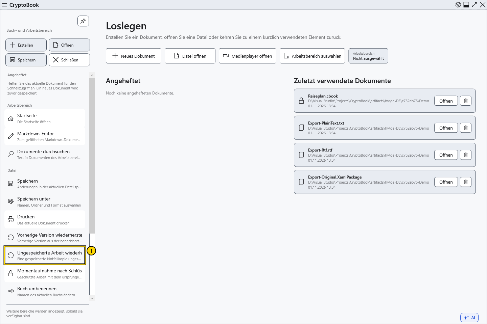
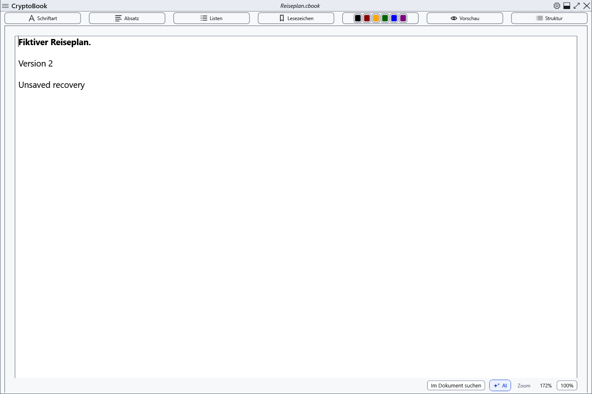

# Notfallkopie ungespeicherter Arbeit

CryptoBook speichert regelmäßig eine separate Momentaufnahme des geänderten Arbeitsbereichs. Sie hilft nach unerwartetem Beenden, ersetzt aber kein Speichern: Die letzten Aktionen können noch fehlen. Üblicherweise wird etwa 15 Sekunden nach Änderungen gewartet.

## Eine gespeicherte Kopie wiederherstellen

1. Aufbewahrte Notfallkopien werden getrennt von neuer Arbeit gespeichert. Die Anwendung startet ohne Wiederherstellungshinweise.
2. Öffnen Sie das Seitenmenü → **Datei** → **Ungespeicherte Arbeit wiederherstellen**. Ohne aufbewahrte Kopie ist der Befehl nicht verfügbar. Bei mehreren Kopien wird die zuletzt gespeicherte wiederhergestellt; ältere bleiben für einen späteren Abruf erhalten.
3. Bei geänderten aktuellen Dokumenten wählen Sie zuerst Speichern, Verwerfen dieser Änderungen oder Abbrechen. Eine geschützte Kopie benötigt den bei ihrer Erstellung verwendeten CryptoBook-Schlüssel, nicht das Windows-Kennwort.

4. Prüfen Sie den wiederhergestellten Inhalt und speichern Sie ausdrücklich. Er öffnet sich als geändert; prüfen Sie gegebenenfalls beide Dokumente. Bevor die ausgewählte beiseitegelegte Kopie entfernt wird, speichert CryptoBook eine neue Notfallkopie der wiederhergestellten Arbeit.

## Abbrechen und Fehler

Sie können ohne Wiederherstellung weiterarbeiten. Ein Abbruch der Schlüsseleingabe oder der Entscheidung über aktuelle Arbeit erhält die Kopie. Prüfen Sie bei falschem Kennwort oder Zugriffsfehler den ursprünglichen Schlüssel und versuchen Sie es erneut; bewahren Sie die Wiederherstellungsdateien auf.

Ältere Notfallkopien können den früheren Schutz durch das Windows-Konto verwenden, auch für zuvor geschützte Arbeit. Ein neues Kennwort ändert vorhandene Kopien nicht; der CryptoBook-Schlüssel ist für das neue geschützte Kopienformat erforderlich.

Die Kopien liegen in den Benutzerdaten, getrennt von .bak und Lock. Gewöhnliche Kopien verwenden den Schutz des aktuellen Windows-Kontos; geschützte Dokumente verwenden das CryptoBook-Kennwort. Ein anderes Windows-Konto kann eine übertragene gewöhnliche Kopie möglicherweise nicht lesen. Normales Beenden entfernt die aktuelle Notfallkopie; frühere beiseitegelegte Kopien bleiben. Das ist keine Sicherung auf einem anderen Datenträger.

- [Sperrkopie](help:recovery.lock)
- [Schreibfehler](help:recovery.write)
- [Zwei Editoren](help:doc.switch)
