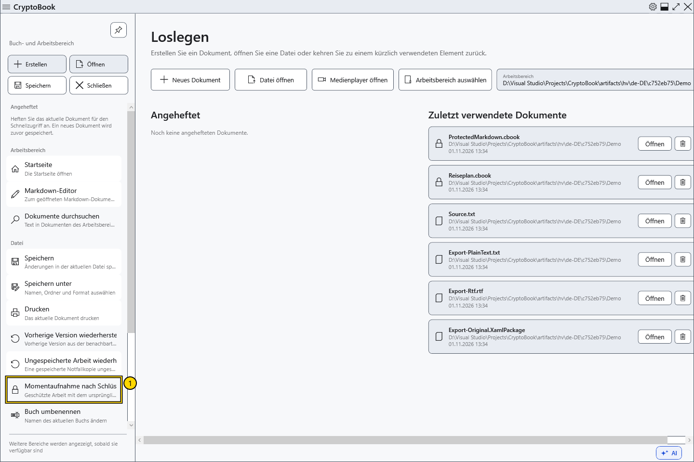
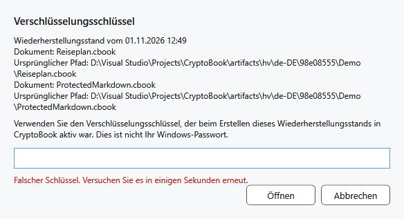
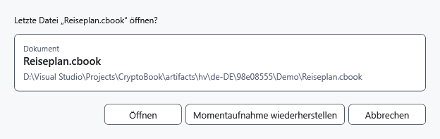

# Momentaufnahme nach Schlüsselreset wiederherstellen

Die Sperrkopie bewahrt geschützte Arbeit beim Zurücksetzen des Schlüssels. Sie liegt getrennt von .bak und der Notfallkopie, überschreibt kein gewöhnliches Original und benötigt den bisherigen CryptoBook-Schlüssel.

## Vorgehen

1. Öffnen Sie das Seitenmenü → **Datei** → **Momentaufnahme nach Schlüsselreset wiederherstellen**. Beim Start und nach erfolgreichem Zurücksetzen erscheinen keine Wiederherstellungshinweise. Ohne Momentaufnahme ist der Befehl nicht verfügbar. Für nach einem Fehler im Speicher verborgene Arbeit verwenden Sie **Entsperren** und lassen Sie die Anwendung geöffnet.

2. Prüfen Sie die Dokumentbeschreibung und geben Sie den Schlüssel zur Zeit der Erstellung ein. Es gibt ein verdecktes Feld ohne Wiederholung. **Öffnen** prüft den Schlüssel vor dem Zugriff. Ein falscher Schlüssel löscht die Kopie nicht; warten Sie vor einem weiteren Versuch einige Sekunden.

3. Wählen Sie nach erfolgreicher Prüfung **Öffnen** für die gespeicherte Originaldatei oder **Momentaufnahme wiederherstellen** für die ungespeicherten Inhalte der Kopie. Ist das Original nicht verfügbar, bleibt die Kopie. Prüfen Sie gegebenenfalls beide geschützten Dokumente. Öffnen nimmt die gespeicherte Originalversion statt der jüngsten Änderungen des aktiven Dokuments.

## Ergebnis und Abbruch

Erfolgreiche Wiederherstellung entfernt die Kopie. Inhalte aus der Momentaufnahme gelten als geändert und müssen gespeichert werden. Abbrechen der Eingabe/Auswahl erhält die Kopie. Nach Abbruch der Auswahl bei bereits geprüftem Schlüssel bleibt dieser im Speicher. Setzen Sie ihn bei Bedarf erneut zurück.

Scheiterte zuvor das Schreiben der Kopie, lässt sich verborgene Arbeit nur im noch laufenden Prozess mit dem bisherigen Schlüssel zurückholen. Es gibt keinen allgemeinen Weg zur Umgehung eines vergessenen Kennworts.

- [Schlüssel zurücksetzen](help:security.lock)
- [Notfallkopie](help:recovery.crash)
- [Vorherige Version](help:recovery.backup)
