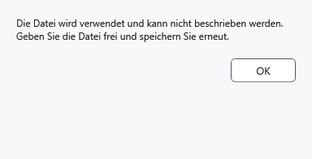

# Schreibfehler und sicheres Fortsetzen

Ein Fehler bedeutet, dass Speichern nicht abgeschlossen wurde. Lassen Sie die Anwendung geöffnet, solange das Dokument als geändert gilt, und behalten Sie Originale und Wiederherstellungskopien.

## Vorgehen

1. Lesen Sie die Meldung. Bei einer belegten Datei schließen Sie die blockierende Anwendung und wiederholen **Speichern**. Bei verweigertem Zugriff wählen Sie einen beschreibbaren Ordner mit **Speichern unter**. Bei Platzmangel geben Sie Platz frei oder wählen einen anderen Datenträger.
2. Behalten Sie für geschützte Arbeit das geschützte Format und den passenden Schlüssel. Ein Abbruch des Zieldialogs oder einer Warnung lässt Änderungen ungespeichert. Ein gewöhnliches Ausgabeformat kann den Inhalt offenlegen.

3. Prüfen Sie nach Erfolg, ob die Änderungsmarkierung verschwunden und der erwartete Pfad aktiv ist. Öffnen Sie bei Zweifeln eine gespeicherte Kopie und vergleichen Sie Text und Formatierung.

## Was erhalten bleibt

Lokales Speichern bereitet das Ergebnis vor dem Ersetzen des Ziels vor. Beim geprüften Fehler durch eine belegte Datei bleiben Originalbytes erhalten und der Text bleibt im Editor. Dies garantiert nichts bei Laufwerksausfall, Stromverlust oder jeder Geräteoperation. .bak bewahrt eine vorherige erfolgreiche Version, die Notfallkopie ungespeicherte Arbeit und die Sperrkopie geschützte Arbeit beim Schlüsselreset. Keine davon bedeutet erfolgreiches Speichern des Originaldokuments.

Ein Fortschrittsabbruch fordert einen Stopp an: Warten Sie auf das Ende und prüfen Sie Ergebnisse. Ein Stapel kann teilweise fertig sein; Schreiben und Verschlüsselung besitzen kein allgemeines Rückgängig. Entsperren Sie bei gescheiterter Sperrkopie verborgene Arbeit mit dem bisherigen Schlüssel, bevor Sie den Prozess schließen. Prüfen Sie bei MTP zusätzlich Verbindung, Rechte und das tatsächliche Ergebnis auf dem Gerät.

- [Speichern](help:doc.save)
- [Vorherige Version](help:recovery.backup)
- [Notfallkopie](help:recovery.crash)
- [Sperrkopie](help:recovery.lock)
