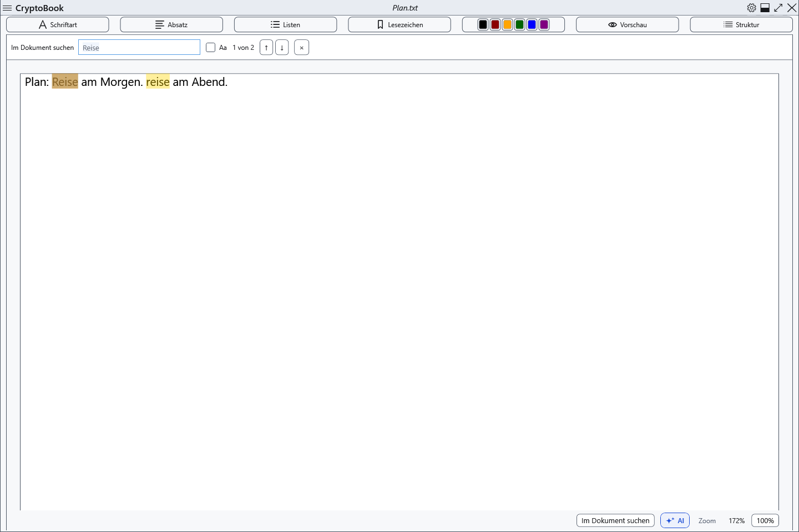
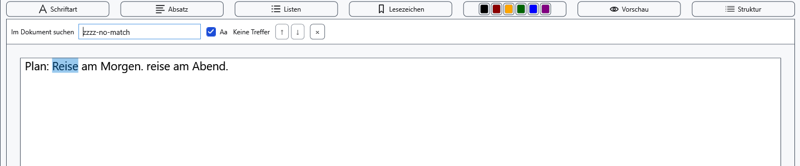
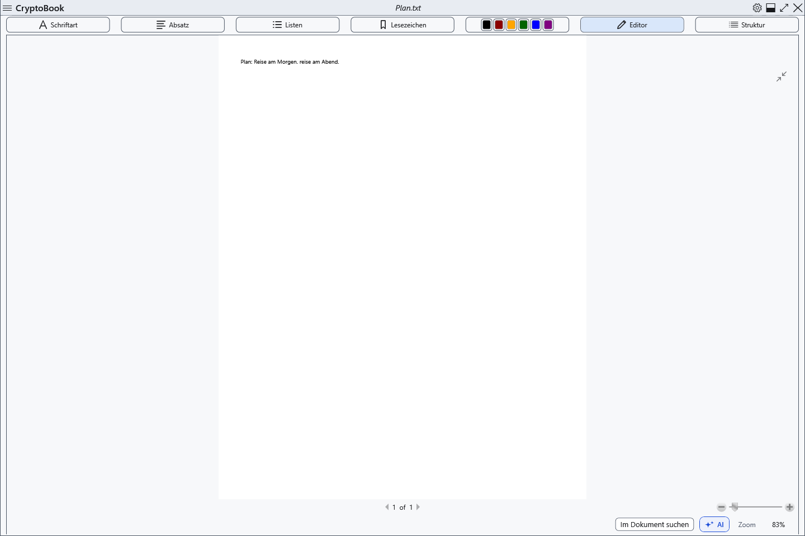
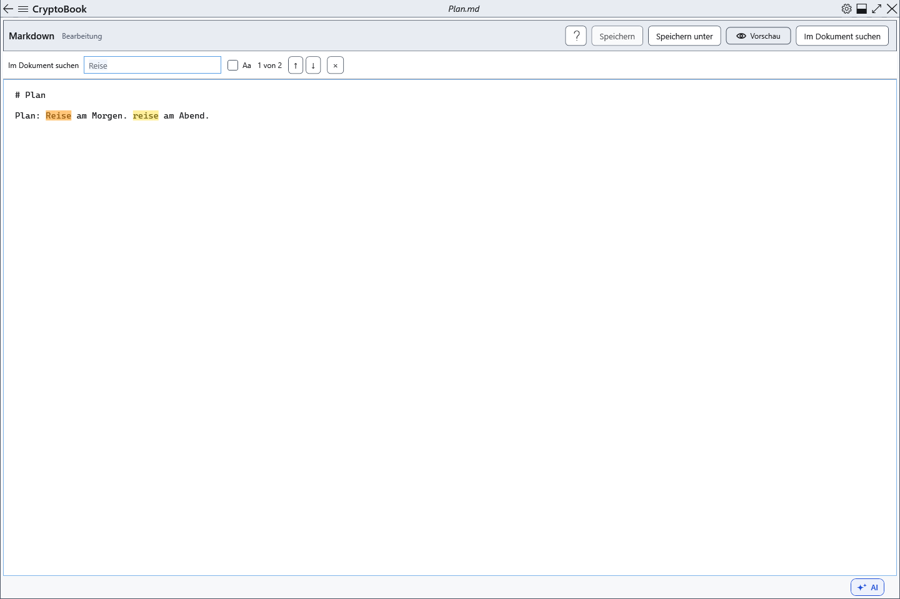
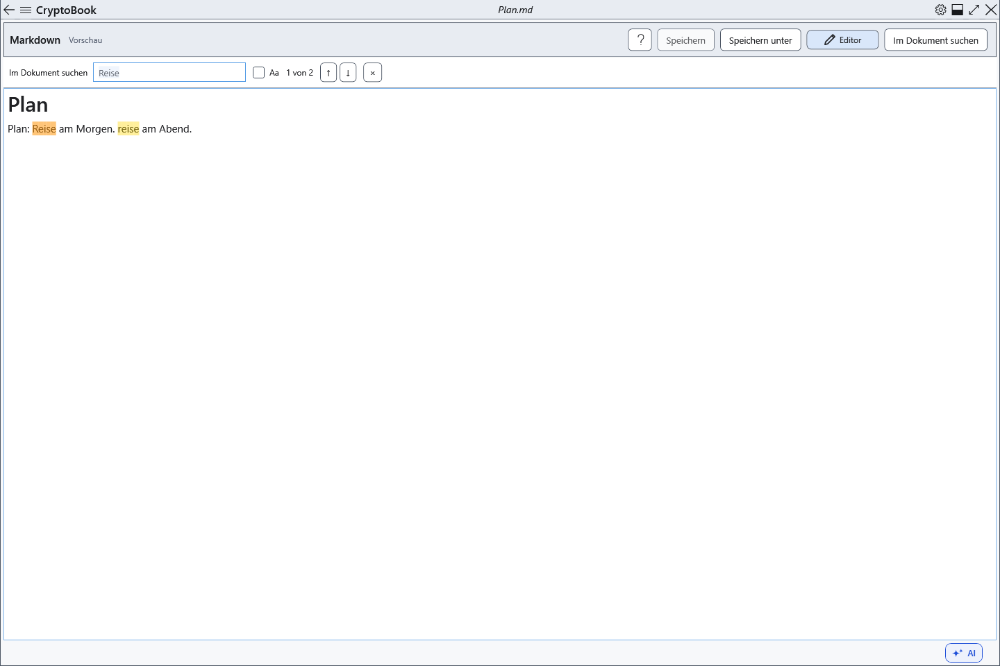

# Im aktuellen Dokument suchen

Die Suche markiert Treffer im aktuellen Dokument und zeigt ihre Nummer.

## Vorbereitung

Öffnen Sie das gewünschte Dokument und aktivieren Sie seine Seite. Markdown-Quelltext enthält Auszeichnung, die Vorschau dargestellten Text; die Treffer können daher abweichen.

Im normalen Dokument schließt die Seitenvorschau die Suche. Suchen oder Ctrl+F aus dieser Vorschau führt zum Bearbeiten zurück und sucht dort. Beide Markdown-Modi unterstützen die Suche.

## Vorgehen

1. Wählen Sie **Im Dokument suchen** oder drücken Sie Ctrl+F mit Fokus im Dokumentbereich. Geben Sie Text ein; Markierungen und Zähler erscheinen nach einer kurzen Pause.
2. **Aa** (**Groß-/Kleinschreibung beachten**) aktiviert die Beachtung der Groß- und Kleinschreibung.
3. ↑/↓ wählen den vorherigen/nächsten Treffer. Im Suchfeld funktionieren Enter und Shift+Enter; bei geöffnetem Suchbereich im Dokument F3 und Shift+F3. Die Navigation beginnt nach dem letzten Treffer wieder vorn.
4. Schließen Sie den Bereich mit × (**Suche schließen (Esc)**) oder Esc im Dokumentbereich.

## Ergebnis prüfen

Der aktuelle Treffer wird ausgewählt und in den sichtbaren Bereich gescrollt. Die Suche arbeitet wörtlich, ohne Ersetzen, Platzhalter oder Texterkennung in Bildern. Änderungen aktualisieren die Treffer.

## Abbrechen und zurückkehren

Das Schließen entfernt Suchmarkierungen und gibt den Fokus an den Editor zurück. Text und Bearbeitungen bleiben erhalten.

## Bei Problemen

Keine Treffer: Prüfen Sie Aa und den Markdown-Modus. Enter außerhalb des Suchfelds ist kein Suchbefehl. Ctrl+F in der Hilfe durchsucht die Hilfe; in anderen Fenstern hängt die Wirkung vom Fokus ab.

## Verwandte Themen

- [Vorschau, Seiten und Zoom](help:edit.view)
- [Markdown-Quelltext bearbeiten](help:md.edit)
