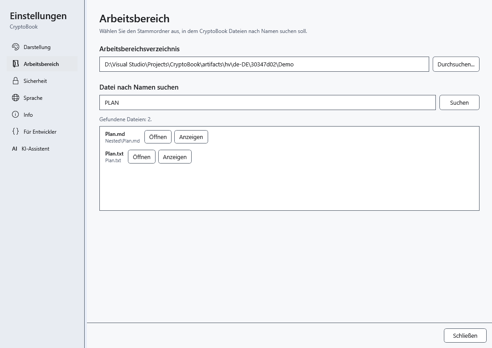

# Dateien nach Namen suchen

Die Namenssuche findet Dateien im ausgewählten Arbeitsordner und seinen Unterordnern. Ihr Suchbereich unterscheidet sich vom Filter des aktuellen Ordners im Dateimanager und von der Inhaltssuche.

## Vorbereitung

Wählen Sie zunächst einen lokalen Arbeitsordner. Ein verbundenes Android-Gerät gehört nicht zum Suchbereich.

## Vorgehen

1. Öffnen Sie die Einstellungen und **Arbeitsbereich**. Prüfen Sie den Ordnerpfad.
2. Geben Sie unter **Datei nach Namen suchen** einen Teil des Namens ein, bei Bedarf mit Erweiterung. Groß- und Kleinschreibung spielt keine Rolle; Platzhalter und reguläre Ausdrücke werden als wörtlicher Text behandelt.
3. Wählen Sie **Suchen** oder drücken Sie im Suchfeld Enter. Prüfen Sie den relativen Ordner jedes Ergebnisses.
4. Wählen Sie beim gewünschten Treffer **Öffnen**. Die Schaltfläche mit dem Hinweis **Datei im Datei-Explorer anzeigen** zeigt seinen Speicherort.

## Ergebnis prüfen

Die ausgewählte Datei wird geöffnet. Beim internen Öffnen eines Dokuments schließen sich die Einstellungen; externe Formate benötigen eine Windows-Anwendung. Die Liste enthält höchstens 200 Dateien.

## Abbrechen und zurückkehren

Ändern Sie die Anfrage und suchen Sie erneut oder schließen Sie die Einstellungen. Eine eigene Abbrechen-Schaltfläche gibt es hier nicht. Die Suche verändert keine Dateien.

## Bei Problemen

Keine Treffer: Prüfen Sie den Arbeitsordner und kürzen Sie den Namensteil. Bei gekürzten Ergebnissen oder übersprungenen Ordnern grenzen Sie die Suche ein und prüfen die Zugriffsrechte. Dateiinhalte werden hier nicht durchsucht.

## Verwandte Themen

- [Arbeitsverzeichnis auswählen](help:start.workspace)
- [Dokumentinhalte durchsuchen](help:search.workspace)
