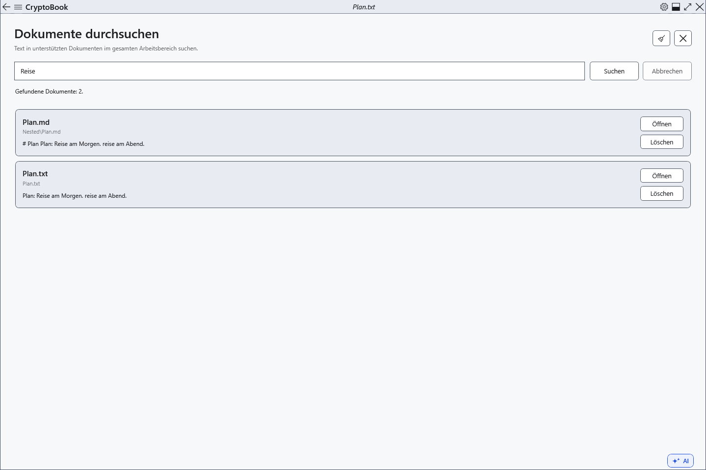
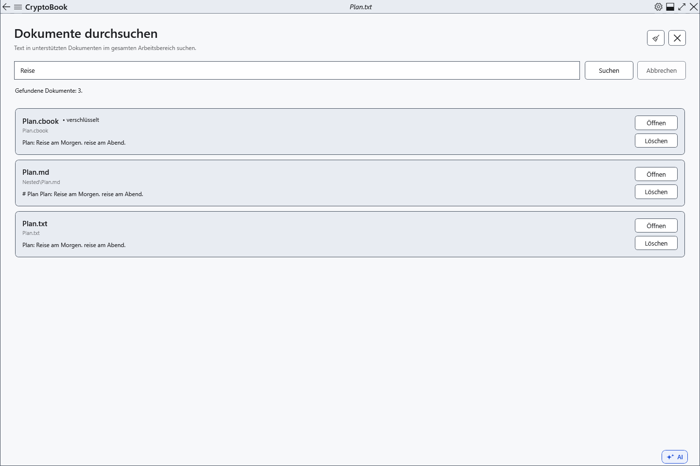

# Dokumentinhalte durchsuchen

Die Inhaltssuche zeigt passende Dateien und einen Ausschnitt um den ersten Treffer. Sie durchsucht den lokalen Arbeitsordner und erreichbare Unterordner. Ungespeicherte Änderungen im Editor gehören nicht zur Dateisuche.

## Vorbereitung

> **Löschen** bei einem Treffer löscht nach Bestätigung die Datei selbst. Dieser Weg löscht derzeit direkt über den Anbieter; eine Wiederherstellung aus dem Windows-Papierkorb ist nicht vorgesehen. Nutzen Sie den Dateimanager, wenn Sie den Papierkorb benötigen.

Unterstützt werden TXT, LOG, MD, CS, XAML, JSON, XML, RTF und XamlPackage. PDF und Texterkennung in Bildern werden nicht unterstützt. Die übliche Dateigrenze beträgt 16 MiB, die Ergebnisgrenze 200 Dateien.

## Vorgehen

1. Öffnen Sie im Seitenmenü **Arbeitsbereich → Dokumente durchsuchen**.
2. Geben Sie wörtlichen Text oder eine Wortfolge ein und wählen Sie **Suchen**. Die Suche ignoriert Großschreibung und sucht die Wortfolge zusammenhängend. **Abbrechen** stoppt sie.
3. Prüfen Sie Name, relativen Ordner und Ausschnitt. **Öffnen** öffnet die Datei ohne Sprung zur Fundstelle; verwenden Sie anschließend die Dokumentsuche.
4. **Leeren** entfernt Anfrage und Ergebnisse; **Schließen** führt zum aktiven Editor zurück.

## Ergebnis prüfen

Jede passende Datei erscheint einmal. Geschützte Dateien sind gekennzeichnet. Bei vorhandenen geschützten Dateien wird ein Schlüssel angefordert; Abbrechen überspringt sie. Geschützte Inhalte werden im Arbeitsspeicher durchsucht und nicht im Suchindex gespeichert.

Markdown wird als gespeicherter Quelltext einschließlich Auszeichnung durchsucht.

## Abbrechen und zurückkehren

Abbrechen stoppt die laufende Suche. Das Leeren der Ergebnisliste löscht keine Dateien. Auch das Schließen der Seite beendet die Suche.

## Bei Problemen

Speichern Sie Änderungen zuerst. Beachten Sie Meldungen über übersprungene, große, nicht unterstützte oder unzugängliche Dateien. Geschützte Dokumente benötigen den passenden Schlüssel.

## Verwandte Themen

- [Im aktuellen Dokument suchen](help:search.document)
- [Schlüssel und Passwort](help:security.password)
- [Zwei Editoren, Umbenennen und Schließen](help:doc.switch)
