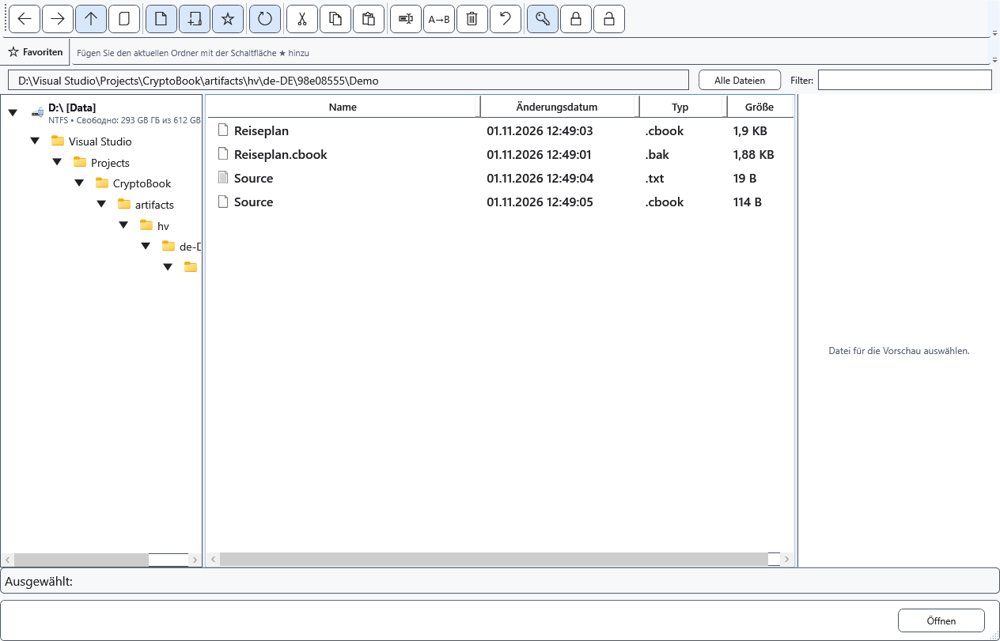

# Kompatibilität geschützter Dateien

Name und Erweiterung beweisen keine Verschlüsselung. CryptoBook erkennt den Container am Inhalt. Verschlüsselung am ursprünglichen Ort kann die alte Erweiterung beibehalten; geprüfte separate Kopien verwenden .cbook. Auch .cbox wird als geschützter Container erkannt.

## Öffnen und übertragen

1. Öffnen Sie die Datei mit ihrem ursprünglichen Schlüssel in CryptoBook. Neue Dateien verwenden das aktuelle Format; das frühere Format bleibt lesbar. Eine umbenannte Erweiterung wandelt den Inhalt nicht um und entfernt kein Kennwort.
2. Vergleichen Sie Text und Formatierung. Ein geschütztes Editordokument kann XamlPackage statt Klartext enthalten. Geschützte Bilder, Videos und andere Binärdateien werden dadurch nicht zu bearbeitbarem Text.
3. Entschlüsseln Sie für andere Programme ausdrücklich in das passende Originalformat oder RTF. Wählen Sie TXT nur, wenn Formatierung und Nichttextelemente entfallen dürfen.

## Schlüssel und Fehler

Ein altes kurzes Kennwort kann zum Lesen zulässig sein. Neue Verschlüsselung verlangt ein Kennwort nach den aktuellen Regeln. Prüfen Sie bei einem Schlüsselwechsel beim Speichern auch .bak: Eine mit dem neuen Schlüssel inkompatible Sicherung wird durch die aktuelle geschützte Datei ersetzt und enthält möglicherweise keine ältere Version mehr.

Bei falschem Schlüssel, beschädigter Datei oder nicht unterstütztem Inhalt überschreiben Sie nicht das einzige Original. Versuchen Sie eine separate gespeicherte Kopie. Das Windows-Kennwort ersetzt den CryptoBook-Schlüssel nicht; vergessene Kennwörter lassen sich nicht allgemein wiederherstellen. Ein Öffnungsabbruch lässt die Datei unverändert.

- [Dokumentformate](help:doc.formats)
- [Entschlüsselung](help:security.decrypt)
- [Vorherige Version .bak](help:recovery.backup)
